# Coherence Adaptive Repair Round 6 supplement: Scale alignment and rotating field feedback

**Decision:** retain SOURCE/C8. Close the tested rotating-complement continuation at the user-requested bounded endpoint. Late Scale and Shape recovery is real on this development panel, but four of five native signed-field allowances still fail, complete prefit Scale remains worse than SOURCE, State is worse than the common start, and the regional task worsens. The joint tradeoff does not justify model replacement or further training in this round.

**Scientific progress:** The requested definition audit separates estimator/definition effects from transfer: all three complete Scale definitions improve on TRAIN800 and worsen on VALIDATION100 at the original epoch-500 checkpoint, while all 13 actual-Adam shadow batches lower both sampled and complete Scale. The matched additional-100-epoch repair improves CH4/T signed risks and CH4/CO/T member MSE over unchanged continuation, without a distinguishable Scale gain. From candidate phase100 to phase225, published Scale improves by 0.206086 frozen units (paired 95% interval [-0.327195, -0.084647]) and Shape by 0.039843 [-0.063336, -0.017151]. At phase225, CH4/CO/T signed risks and member MSE are lower than the common start with paired intervals below zero; CH4 now passes its mean-risk allowance. The candidate is also better than the younger control100 on all three Scale definitions and Shape, but the unequal training age prevents attributing that whole difference to the repair. Preserve these component gains without promoting the model.

Both arms resume the identical original epoch-500 checkpoint with its actual AdamW, PI and random-stream state. The selected candidate is assessed after 225 additional phase epochs, at cumulative reporting age 725; the unchanged control receives 100 additional epochs, at cumulative age 600. The control is younger; this is an unequal-exposure comparison.

These are 100 reused development VALIDATION conditions with four paired members. VALIDATION informed selection and is not independent confirmation. TEST remains locked.

The selected phase-225 checkpoint is the last complete recovery boundary before the user-requested graceful stop. The subsequent stopped training tail is preserved and charged in the recorded cost; the endpoint metrics use the phase-225 checkpoint.

The intervention retains fixed Q4096 SSS and adds a separate paired-RFF 512-point complement only for Lagrangian field risk, with stratified inclusion weights against native physical mass. Original R0, allowances, scales, C0, Adam and PI are retained. Each update uses fresh three-family ConFIG and Lagrangian feedback; no native RF training objective is introduced.

For each condition and action, the additional 512 points are sampled uniformly without replacement from the 36,204 native points outside the fixed support S. With C denoting that complement, C_t its sampled subset and M the complete native physical mass, the estimator is `Rhat_f = [sum_S w_i l_if + (|C|/512) sum_Ct w_i l_if]/M`. For independent J2 members, `l_if = (Y1_if - y_if)(Y2_if - y_if)`. The original observation tensors and per-member RFF coefficients are shared by the two separate rollouts. This inclusion-weighted integral is sampling-unbiased for frozen pointwise endpoints; it does not imply an unbiased AdamW action or an equivalent learning trajectory.

## Diagnostic evidence

The diagnostic comparison used the same complete expanded prefit definition and frozen TRAIN unit 0.25978531: epoch-500 change versus SOURCE was -0.07198 on TRAIN800 and +0.27398 on reused VALIDATION100. The fixed-parent J2 Adam shadow lowered both sampled and complete Scale in all 13 paired batches; these are local actions, not independent learning trajectories.

The fair score is A − R, where A is the mean declared distance from each of J members to the reference and R is the sum of unordered member-pair distances divided by J(J−1). R is positive separation and is subtracted. Scale definitions on the same frozen Q4096 support are: published core = signed + 0.25 joint + log-power + correlation; complete prefit core = 2 signed + 0.3208755755 joint + 0.5 log-power + 0.8190801090 correlation; complete expanded prefit adds 0.5 times the mean of eight frozen triple queries. Prefit coefficients are shown rounded. Complete means the declared query population on Q4096, not all 40,300 native points.

Paired changes versus SOURCE and 95% condition-bootstrap intervals are in the original frozen TRAIN Scale unit 0.25978531; negative is better.

| Split | Epoch | Scale definition | Change [95% interval] |
| --- | ---: | --- | ---: |
| TRAIN800 | 100 | Published_Core_Default | -0.1117 [-0.1274, -0.0963] |
| TRAIN800 | 100 | Complete_Core_Prefit | -0.0297 [-0.0418, -0.0181] |
| TRAIN800 | 100 | Complete_Expanded_Prefit | -0.0283 [-0.0406, -0.0162] |
| TRAIN800 | 500 | Published_Core_Default | -0.1586 [-0.1760, -0.1428] |
| TRAIN800 | 500 | Complete_Core_Prefit | -0.0714 [-0.0858, -0.0584] |
| TRAIN800 | 500 | Complete_Expanded_Prefit | -0.0720 [-0.0864, -0.0589] |
| VALIDATION100 | 100 | Published_Core_Default | +0.0610 [-0.0296, +0.1496] |
| VALIDATION100 | 100 | Complete_Core_Prefit | +0.1186 [+0.0449, +0.1891] |
| VALIDATION100 | 100 | Complete_Expanded_Prefit | +0.1177 [+0.0427, +0.1891] |
| VALIDATION100 | 500 | Published_Core_Default | +0.2235 [+0.1042, +0.3314] |
| VALIDATION100 | 500 | Complete_Core_Prefit | +0.2754 [+0.1764, +0.3714] |
| VALIDATION100 | 500 | Complete_Expanded_Prefit | +0.2740 [+0.1720, +0.3710] |

Original epoch-500 VALIDATION100 expanded prefit block changes in frozen units: joint +0.1689 [+0.1345, +0.2054], signed +0.0732 [+0.0372, +0.1067], log-power +0.0188 [-0.0235, +0.0605], correlation +0.0145 [+0.0007, +0.0277], triples -0.0014 [-0.0083, +0.0053]. Total attraction changed -0.0711 [-0.1547, +0.0094] and separation changed -0.3451 [-0.4000, -0.2915]; the score subtracts separation. Log-power attraction and separation changed -0.1509 [-0.1921, -0.1093] and -0.1697 [-0.1888, -0.1503], respectively.

The weighted CO field attribution is +0.3030 [+0.2498, +0.3562], including band 3 +0.1129 and piece means +0.0988; CO–U1 pair attribution is +0.0176 [+0.0121, +0.0233]. Norm-based field and band allocations are additive attributions, not independent proper scores or causal effects.

Actual parent AdamW finite Scale changes (sample-weighted raw units, 13 independently reset TRAIN J2 batches): same_query_train_scale -0.0086869 (13/13 negative), independent_query_train_scale -0.0081898 (13/13 negative), Published_Core_Default -0.0079876 (13/13 negative), Complete_Core_Prefit -0.0079431 (13/13 negative), Complete_Expanded_Prefit -0.0081475 (13/13 negative). Simultaneous signed field-risk changes in model units squared: CH4 -0.00043074 (13/13 decreases), CO -0.0024132 (13/13 decreases), T -0.00038481 (13/13 decreases), U_1 -0.0010439 (13/13 decreases), p +0.00012118 (1/13 decreases). These are local shadow updates, not independent learning trajectories.

The epoch500-minus-SOURCE complement-minus-selected native cached field-risk change, divided by the original field allowances, is CH4 +0.716 [+0.636, +0.790], CO +0.493 [+0.433, +0.550], T +0.605 [+0.538, +0.669], U_1 +0.247 [+0.220, +0.274], p +0.020 [-0.007, +0.046] on TRAIN800 and CH4 +0.430 [-0.267, +1.098], CO +0.444 [-0.005, +0.900], T +0.363 [-0.285, +0.968], U_1 +0.085 [-0.350, +0.552], p +0.039 [-0.633, +0.644] on VALIDATION100 (paired 95% condition-bootstrap intervals). The held-out gaps are uncertain and do not establish a spatial generalization mechanism; the measured TRAIN gap motivated testing complement feedback. These cached native-region comparisons are not identical to the selected-support training rollout.

Four paired grouped-query seed replays of epoch500 minus SOURCE, in frozen TRAIN Scale units: TRAIN800: Published_Core_Default: all negative, Complete_Core_Prefit: all negative, Complete_Expanded_Prefit: all negative; expanded range [-0.0733, -0.0712]; VALIDATION100: Published_Core_Default: all positive, Complete_Core_Prefit: all positive, Complete_Expanded_Prefit: all positive; expanded range [+0.2234, +0.3051]. These use fixed cached J4/T256 endpoints; the actual-Adam shadow uses J2 and the variable-observation TRAIN law. Query seeds measure estimator variation on the same conditions, not independent datasets or a causal generalization test.

The learning experiment retains the original internal Scale coefficients and tests field-feedback coverage. A uniform positive Scale-family multiplier leaves its normalized ConFIG gradient row unchanged, while the assigned direction length and its ratio to field feedback can change; an outer weight increase alone does not isolate the observed transfer problem.

Aligned Scale candidate minus control, frozen TRAIN units, paired 95% intervals: Published_Core_Default: -0.2059 [-0.3209, -0.092804]; Complete_Core_Prefit: -0.14475 [-0.26454, -0.030266]; Complete_Expanded_Prefit: -0.14586 [-0.27179, -0.026867].

Aligned Scale candidate minus start, frozen TRAIN units, paired 95% intervals: Published_Core_Default: -0.1021 [-0.22556, +0.026739]; Complete_Core_Prefit: -0.075058 [-0.19306, +0.045434]; Complete_Expanded_Prefit: -0.074517 [-0.19613, +0.051363].

The unchanged R0 was fitted using selected-support TRAIN800 J2 with training-observation draws; it is not an exact native-support SOURCE risk. Cached native J4/T256 SOURCE and the original R0 use different draw and observation laws, so their difference is descriptive and unpaired. Matched native field assessment uses its own paired J4 SOURCE bank.

## Matched phase-100 continuation review

Both forks had 100 additional epochs and the same original epoch-500 parent. Changes are candidate minus the stated baseline in frozen TRAIN units; intervals are paired condition bootstraps on the reused development panel, with negative favoring the candidate.

| Baseline | State | Scale | Shape |
| --- | ---: | ---: | ---: |
| SOURCE | +0.1745 [-0.0616, +0.4146] | +0.3275 [+0.2279, +0.4215] | -0.2846 [-0.3214, -0.2489] |
| Common start | +0.2360 [-0.0550, +0.5126] | +0.1040 [+0.0021, +0.2024] | +0.0260 [+0.0058, +0.0458] |
| Same-age control | -0.0556 [-0.3513, +0.2219] | +0.0002 [-0.0693, +0.0709] | +0.0127 [-0.0023, +0.0273] |

| Candidate contrast | Published core | Complete prefit core | Complete prefit expanded |
| --- | ---: | ---: | ---: |
| SOURCE | +0.3275 [+0.2279, +0.4215] | +0.3504 [+0.2607, +0.4422] | +0.3547 [+0.2647, +0.4475] |
| Common start | +0.1040 [+0.0021, +0.2024] | +0.0750 [-0.0190, +0.1664] | +0.0807 [-0.0156, +0.1738] |
| Same-age control | +0.0002 [-0.0693, +0.0709] | +0.0053 [-0.0629, +0.0789] | +0.0094 [-0.0604, +0.0826] |

| Field | Candidate signed-risk change / allowance | Same-age control signed-risk change / allowance |
| --- | ---: | ---: |
| CH4 | +1.992 | +4.152 |
| CO | +2.911 | +3.596 |
| T | +5.669 | +7.806 |
| U_1 | +7.745 | +8.692 |
| p | +3.134 | +14.797 |

The following rationale and limitations record the historical phase-100 decision; the later selected phase-225 closeout and completed scoring supersede its prospective endpoint and pending-scoring statements.

At matched additional age100, rotating feedback reduces signed CH4 and T risks versus unchanged control with paired intervals below zero; CH4, CO and T member MSE also improve. All five signed-risk point estimates improve relative to control; the CO, U_1 and pressure signed-risk intervals include zero. The candidate satisfies the legacy member guard, unlike control. Native signed-field allowances still fail in all five fields.

Published, complete-prefit-core and complete-expanded Scale show no distinguishable candidate advantage over the age-matched control. Published Scale worsens versus common start by0.1039907589 frozen units, and Shape worsens by0.0260326087; Shape still improves over SOURCE by0.2845789859. These are condition-bootstrap development-panel comparisons, not independent trajectories.

Can the measured CH4/T field recovery continue as the native-quadrature PI multipliers adapt, reduce the remaining native-field deficits, and preserve the existing Shape advantage without persistent Scale deterioration? The last25 online TRAIN allowance-excess norm decreases modestly while CH4/CO multipliers continue rising, leaving a useful bounded adaptation question through500.

One reused development panel/trajectory and one stochastic continuation per method; unchanged control ends at100, so the final candidate500/control100 contrast has unequal training exposure. Online TRAIN windows use different field quadratures and are not matched native-field evaluations. Source retention remains the default pending final joint scoring; no model promotion is made at100.

## Selected phase-225 outcome and unequal-exposure control

Selected endpoint minus SOURCE on the reused VALIDATION100 panel; negative values favor the endpoint. Intervals are the already recorded paired 95% condition-bootstrap intervals in frozen TRAIN units.

| Core family | Change [95% interval] |
| --- | ---: |
| State | +0.29046679 [-0.04936431, +0.67767068] |
| Scale | +0.12144905 [-0.00211279, +0.24352332] |
| Shape | -0.32442196 [-0.36776875, -0.28289052] |

| Complete Scale definition on Q4096 | Change [95% interval] |
| --- | ---: |
| Published_Core_Default | +0.12144905 [-0.00211279, +0.24352332] |
| Complete_Core_Prefit | +0.20036601 [+0.07554024, +0.31891885] |
| Complete_Expanded_Prefit | +0.19946673 [+0.07184266, +0.32063100] |

Candidate minus control core changes in frozen TRAIN units: state +0.060343 (paired 95% interval [-0.26996, +0.41721]), scale -0.2059 (paired 95% interval [-0.3209, -0.092804]), shape -0.027164 (paired 95% interval [-0.049444, -0.005608]).

Candidate regional normalized improvement -0.61631; event normalized score change +0.093155. Positive regional improvement and negative event change favor the candidate.

Candidate minus common-start core changes in frozen TRAIN units: state +0.35188 (paired 95% interval [+0.025282, +0.71101]), scale -0.1021 (paired 95% interval [-0.22556, +0.026739]), shape -0.01381 (paired 95% interval [-0.035713, +0.0070242]).

| Field | Candidate signed-risk change / allowance | Control signed-risk change / allowance |
| --- | ---: | ---: |
| CH4 | +0.37572 | +4.1522 |
| CO | +1.0826 | +3.5963 |
| T | +3.8086 | +7.8056 |
| U_1 | +8.6289 | +8.6922 |
| p | +24.871 | +14.797 |

Field metrics use the native physical mask, and MSE is in each field's squared physical units. Signed-risk intervals are paired candidate minus SOURCE and divided by the fixed field allowance.

| Field | SOURCE member MSE | Candidate member MSE | SOURCE ensemble-mean MSE | Candidate ensemble-mean MSE | Signed-risk delta / allowance (95% interval) |
| --- | ---: | ---: | ---: | ---: | ---: |
| CH4 | 8.5883e-05 | 8.9278e-05 | 8.2485e-05 | 8.3538e-05 | +0.37572 [-1.9497, +2.6027] |
| CO | 4.2179e-05 | 4.5396e-05 | 3.9719e-05 | 4.1016e-05 | +1.0826 [-0.19117, +2.2422] |
| T | 74409 | 79894 | 71911 | 75128 | +3.8086 [+1.5654, +6.0562] |
| U_1 | 1183.3 | 1248.4 | 1158.6 | 1214.4 | +8.6289 [+4.2844, +12.907] |
| p | 3.1801e+07 | 3.393e+07 | 3.1637e+07 | 3.3551e+07 | +24.871 [-7.6369, +64.099] |

## Engineering and cost

Retain the qualified rotating native-complement field estimator and its fresh-process resume/ordered recording implementation as an opt-in research tool; do not enable this repair as the default model or claim acceleration. The matched complete-epoch qualification cost was 191.284 seconds versus 167.315 seconds for unchanged feedback (about 14.3% higher), with similar peak allocation. Preserve the original Round 6 isolated batched-VJP and grouped-query decisions in their existing report; the combined package had no net speedup. Keep wide TorchJD, context reuse disabled, SSS-only objectives, fresh parameter-space ConFIG and signed Lagrangian field feedback. Native RF/MSE training loss remains disabled.

This Round 6 continuation occupied 13.940997 GPU-hours across 15 closed leases, including diagnostics, failed attempts with GPU occupation, both substantive learning arms, the preserved post-selection training tail and cached assessment. No lease remains active; this is below its separately authorized 30-hour ceiling. Earlier Round 6 charges remain 25.2268974161 GPU-hours, including its retained conservative bounds. The candidate was stopped at phase 227.25 and assessed at phase 225; all 2.25 later epochs are retained and charged. The final cached endpoint worker took 146.41 seconds, with 32.29 GPU-seconds for prediction generation; scoring and report production are CPU work. CPU time inside a GPU lease is not charged twice. Some preparatory CPU helpers and the pre-subprocess serialization failure lack complete timers; no exact all-CPU total or overall speedup is claimed.

**Material limitations:** VALIDATION100/J4 is reused development evidence that informed selection; paired condition intervals do not provide independent-trajectory confirmation. The unchanged control stops at phase100, so its comparison with candidate225 has unequal exposure. The actual graceful-stop state is phase227.25, while the selected routine recovery endpoint is225; its later tail is retained and charged. No TEST evaluation, output blend or checkpoint search was performed.

| Recorded measurement | Value |
| --- | ---: |
| continuation_total_occupied_gpu_hours | 13.941 |
| continuation_total_occupied_gpu_seconds | 50187.6 |
| closed_gpu_lease_count | 15 |
| active_gpu_lease_count | 0 |
| original_round6_charged_gpu_hours | 25.2269 |
| control100_formal_gpu_seconds | 15343.7 |
| candidate100_formal_gpu_seconds | 14490.3 |
| candidate_resumed_tail_formal_gpu_seconds | 17504 |
| candidate_actual_trained_phase_epochs | 227.25 |
| candidate_selected_assessed_phase_epochs | 225 |
| preserved_charged_post_selected_phase_epochs | 2.25 |
| candidate_complete_epoch_mean_wall_seconds | 140.7 |
| candidate_recent10_complete_epoch_mean_wall_seconds | 137.997 |
| final225_prediction_gpu_seconds | 32.294 |
| final225_assessment_worker_wall_seconds | 146.408 |
| final225_taskfree_cpu_wall_seconds | 70.6136 |
| final225_taskfree_cpu_process_seconds | 96.8972 |
| final225_scale_cpu_wall_seconds | 14.567 |
| final225_scale_cpu_process_seconds | 25.622 |
| final225_task_cpu_wall_seconds | 3.17457 |
| final225_task_cpu_process_seconds | 5.85551 |
| matched_qualification_control_epoch_seconds | 167.315 |
| matched_qualification_rotating_epoch_seconds | 191.284 |
| matched_qualification_rotating_cost_increase_percent | 14.3257 |

This Round 6 continuation has a separately authorized 30 occupied GPU-hour budget; earlier Round 6 costs remain separately recorded. The experiment changes only the candidate field-feedback quadrature, so the same-parent comparison evaluates this package under the declared compute and sampling conditions.

## Figure index

- [Figure matched train validation scale](#figure-matched-train-validation-scale)
- [Figure native field support gap](#figure-native-field-support-gap)
- [Figure actual adam complete scale changes](#figure-actual-adam-complete-scale-changes)
- [Figure scale components and definitions](#figure-scale-components-and-definitions)
- [Figure scale field pair band localization](#figure-scale-field-pair-band-localization)
- [Figure control learning and action](#figure-control-learning-and-action)
- [Figure control family history](#figure-control-family-history)
- [Figure control fixed coefficients](#figure-control-fixed-coefficients)
- [Figure control leaf history 1](#figure-control-leaf-history-1)
- [Figure control leaf history 2](#figure-control-leaf-history-2)
- [Figure candidate learning and action](#figure-candidate-learning-and-action)
- [Figure candidate family history](#figure-candidate-family-history)
- [Figure candidate fixed coefficients](#figure-candidate-fixed-coefficients)
- [Figure candidate leaf history 1](#figure-candidate-leaf-history-1)
- [Figure candidate leaf history 2](#figure-candidate-leaf-history-2)
- [Figure field core task](#figure-field-core-task)
- [Figure regional and event](#figure-regional-and-event)
- [Figure fields case 1 part 1](#figure-fields-case-1-part-1)
- [Figure fields case 1 part 2](#figure-fields-case-1-part-2)
- [Figure fields case 1 part 3](#figure-fields-case-1-part-3)
- [Figure event case 1](#figure-event-case-1)
- [Figure fields case 2 part 1](#figure-fields-case-2-part-1)
- [Figure fields case 2 part 2](#figure-fields-case-2-part-2)
- [Figure fields case 2 part 3](#figure-fields-case-2-part-3)
- [Figure event case 2](#figure-event-case-2)
- [Figure fields case 3 part 1](#figure-fields-case-3-part-1)
- [Figure fields case 3 part 2](#figure-fields-case-3-part-2)
- [Figure fields case 3 part 3](#figure-fields-case-3-part-3)
- [Figure event case 3](#figure-event-case-3)
- [Figure matched phase comparison](#figure-matched-phase-comparison)
- [Figure phase learning and pi](#figure-phase-learning-and-pi)

## Figure matched train validation scale

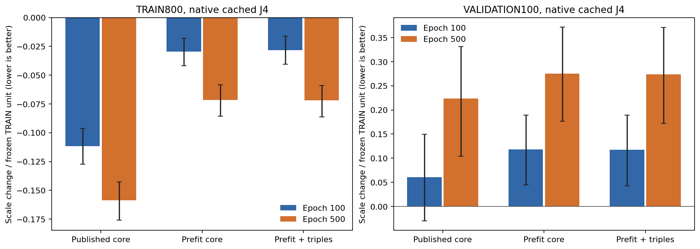

Same complete Scale definitions on cached TRAIN800 and development VALIDATION100 endpoints; paired intervals resample conditions within each split. [PDF master](figures/matched_train_validation_scale.pdf)

## Figure native field support gap

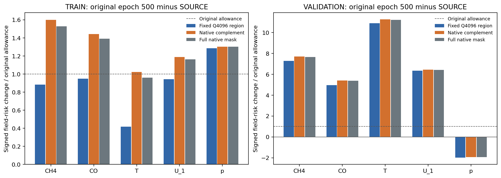

Cached native J4 signed field-risk changes on selected and complement regions, with their own physical-mass normalization; these are not selected-support model rollouts. [PDF master](figures/native_field_support_gap.pdf)

## Figure actual adam complete scale changes

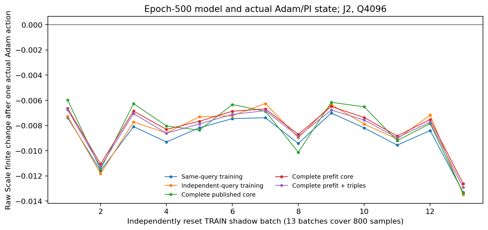

Thirteen independently reset TRAIN J2 shadows of the actual parent AdamW action; negative means an immediate decrease and the batches are not independent trajectories. [PDF master](figures/actual_adam_complete_scale_changes.pdf)

## Figure scale components and definitions

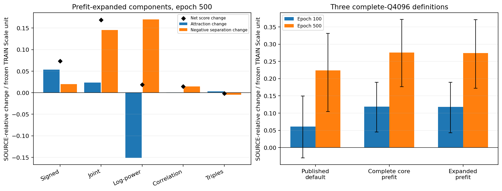

VALIDATION100 attraction and separation changes and the three complete-Q4096 Scale definitions in frozen TRAIN units; negative score changes favor repair. [PDF master](figures/scale_components_and_definitions.pdf)

## Figure scale field pair band localization

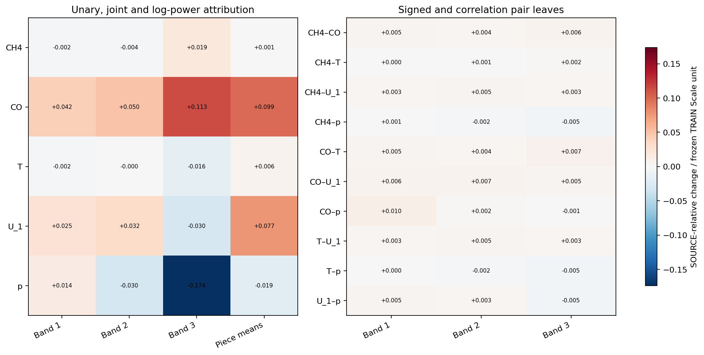

Prefit-expanded field, pair and spectral-band changes; joint and log-power norm components are additive attributions, not independently proper field scores. [PDF master](figures/scale_field_pair_band_localization.pdf)

## Figure control learning and action

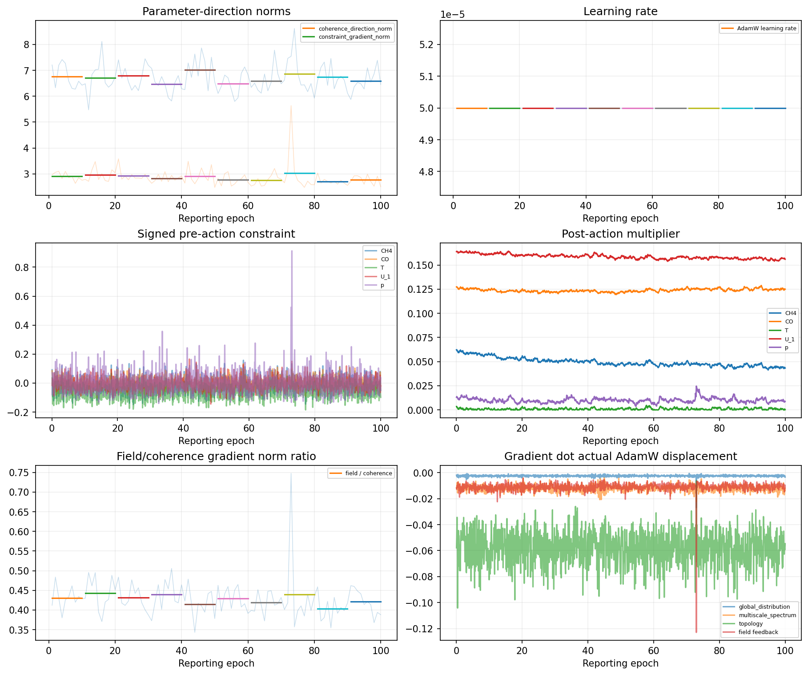

Control full phase learning and action; sampled losses and actual-displacement diagnostics retain their own units and do not define a scalar ConFIG loss. [PDF master](figures/control_learning_and_action.pdf)

## Figure control family history

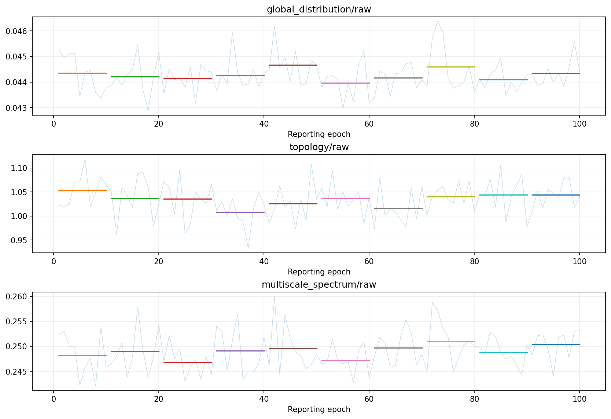

Control full phase family history; sampled losses and actual-displacement diagnostics retain their own units and do not define a scalar ConFIG loss. [PDF master](figures/control_family_history.pdf)

## Figure control fixed coefficients

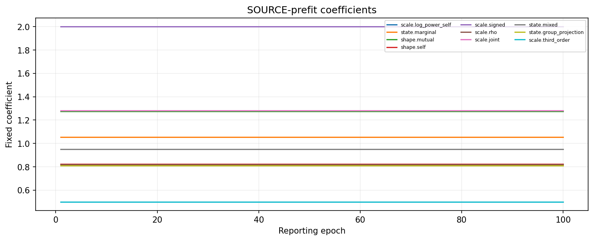

Control full phase fixed coefficients; sampled losses and actual-displacement diagnostics retain their own units and do not define a scalar ConFIG loss. [PDF master](figures/control_fixed_coefficients.pdf)

## Figure control leaf history 1

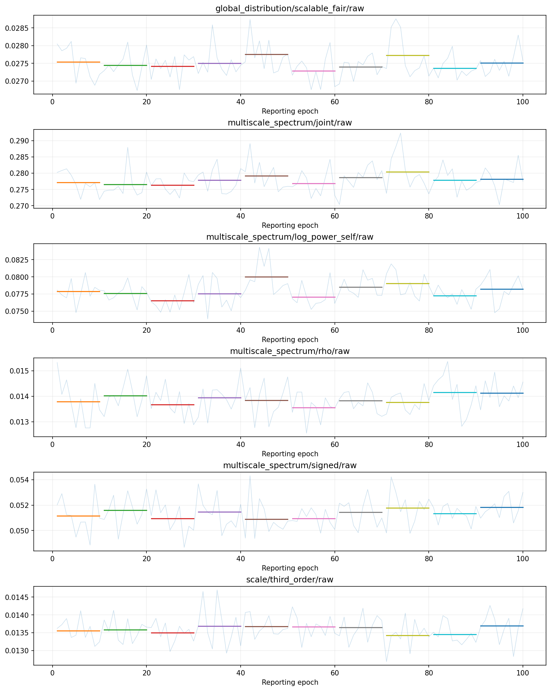

Control full phase leaf history 1; sampled losses and actual-displacement diagnostics retain their own units and do not define a scalar ConFIG loss. [PDF master](figures/control_leaf_history_1.pdf)

## Figure control leaf history 2

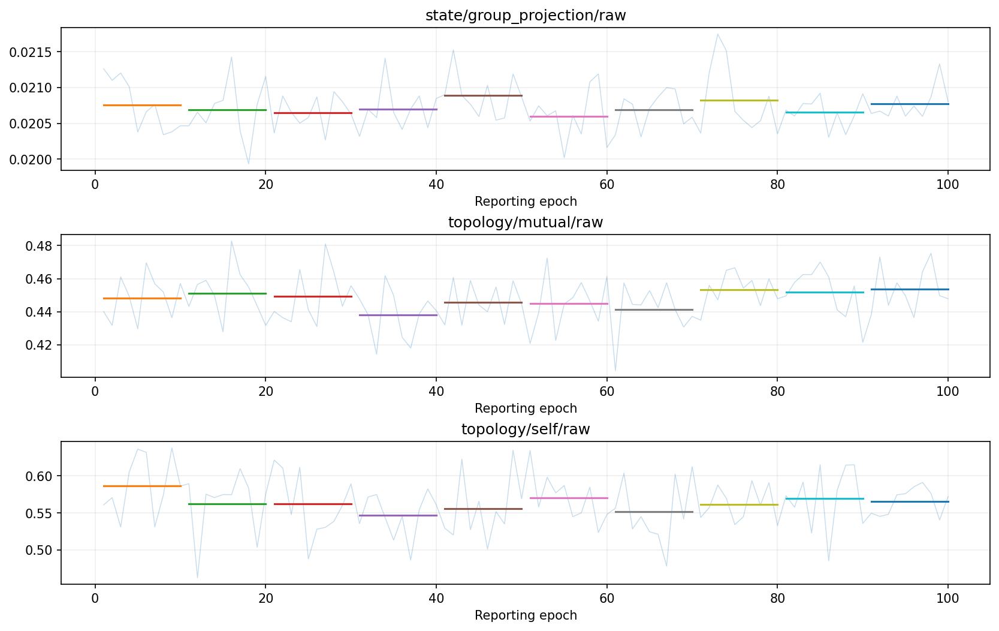

Control full phase leaf history 2; sampled losses and actual-displacement diagnostics retain their own units and do not define a scalar ConFIG loss. [PDF master](figures/control_leaf_history_2.pdf)

## Figure candidate learning and action

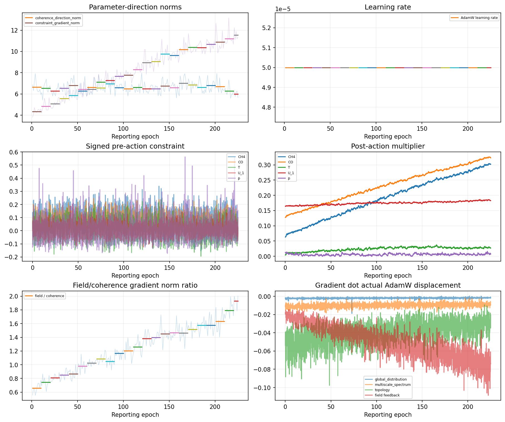

Candidate full phase learning and action; sampled losses and actual-displacement diagnostics retain their own units and do not define a scalar ConFIG loss. [PDF master](figures/candidate_learning_and_action.pdf)

## Figure candidate family history

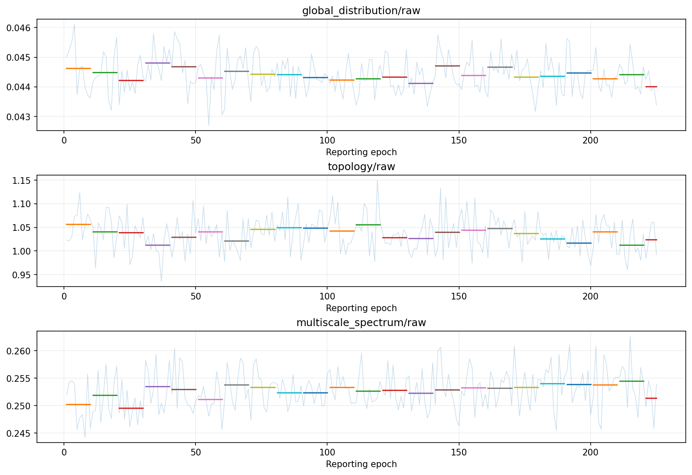

Candidate full phase family history; sampled losses and actual-displacement diagnostics retain their own units and do not define a scalar ConFIG loss. [PDF master](figures/candidate_family_history.pdf)

## Figure candidate fixed coefficients

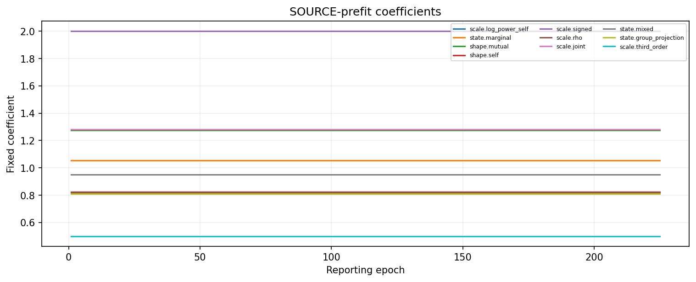

Candidate full phase fixed coefficients; sampled losses and actual-displacement diagnostics retain their own units and do not define a scalar ConFIG loss. [PDF master](figures/candidate_fixed_coefficients.pdf)

## Figure candidate leaf history 1

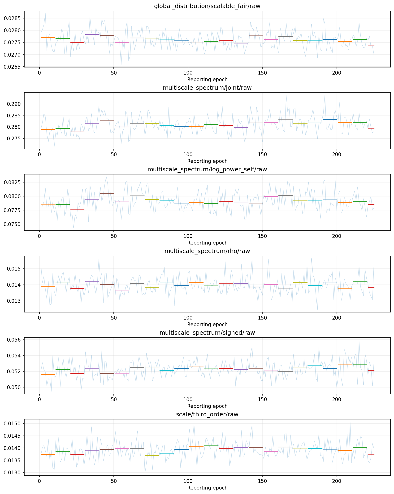

Candidate full phase leaf history 1; sampled losses and actual-displacement diagnostics retain their own units and do not define a scalar ConFIG loss. [PDF master](figures/candidate_leaf_history_1.pdf)

## Figure candidate leaf history 2

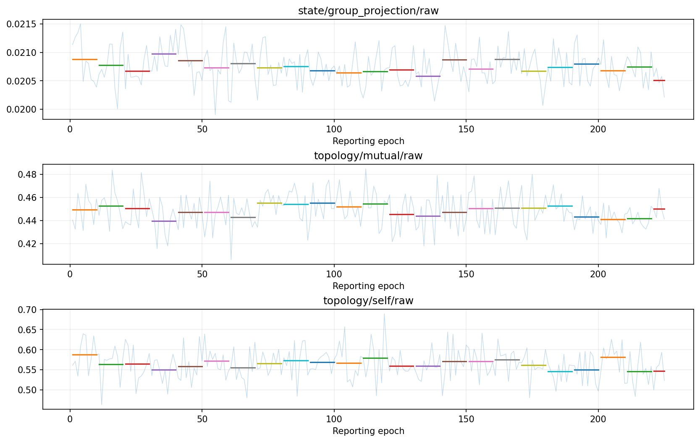

Candidate full phase leaf history 2; sampled losses and actual-displacement diagnostics retain their own units and do not define a scalar ConFIG loss. [PDF master](figures/candidate_leaf_history_2.pdf)

## Figure field core task

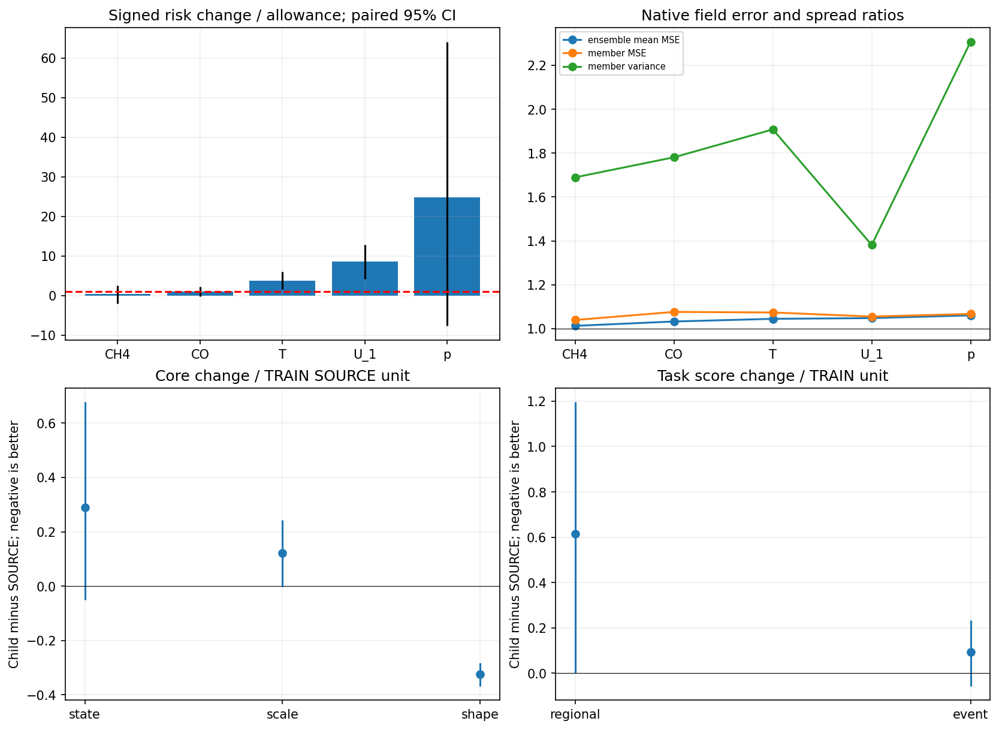

Native field accuracy and spread, and paired State, Scale, Shape and task uncertainty on reused VALIDATION100; negative score changes favor the candidate. [PDF master](figures/field_core_task.pdf)

## Figure regional and event

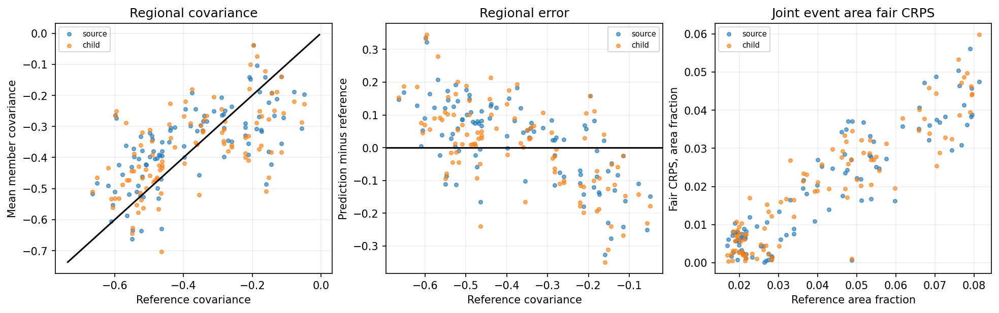

Matched regional covariance and event fair-CRPS scatter on reused development VALIDATION100. [PDF master](figures/regional_and_event.pdf)

## Figure fields case 1 part 1

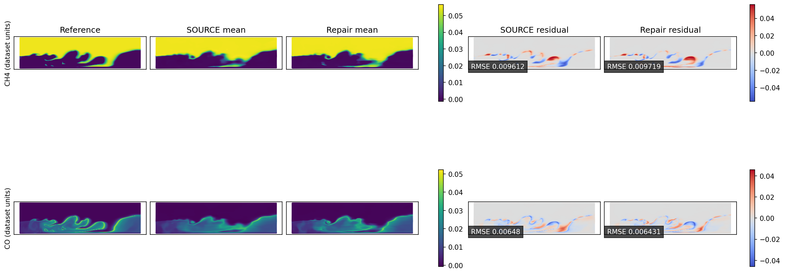

trajectory_000000:8034, fields CH4, CO: native positive-mass field reconstructions and residuals; residual badges are mass-weighted mean-field RMSE in dataset field units. [PDF master](figures/fields_case_1_part_1.pdf)

## Figure fields case 1 part 2

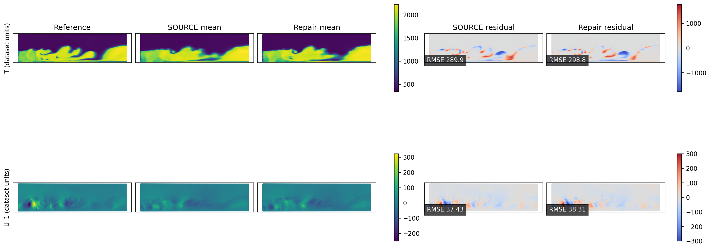

trajectory_000000:8034, fields T, U_1: native positive-mass field reconstructions and residuals; residual badges are mass-weighted mean-field RMSE in dataset field units. [PDF master](figures/fields_case_1_part_2.pdf)

## Figure fields case 1 part 3

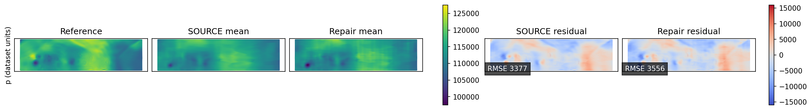

trajectory_000000:8034, fields p: native positive-mass field reconstructions and residuals; residual badges are mass-weighted mean-field RMSE in dataset field units. [PDF master](figures/fields_case_1_part_3.pdf)

## Figure event case 1

trajectory_000000:8034: frozen unary event supports, signed joint missing/excess and independent-member joint-event probability on native positive-mass support. Predicted unary and joint-error panels display mass-weighted probability RMSE against the reference masks, in dimensionless units. [PDF master](figures/event_case_1.pdf)

## Figure fields case 2 part 1

trajectory_000000:8049, fields CH4, CO: native positive-mass field reconstructions and residuals; residual badges are mass-weighted mean-field RMSE in dataset field units. [PDF master](figures/fields_case_2_part_1.pdf)

## Figure fields case 2 part 2

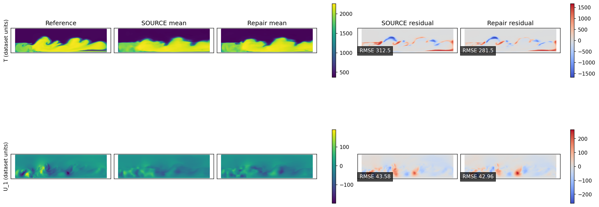

trajectory_000000:8049, fields T, U_1: native positive-mass field reconstructions and residuals; residual badges are mass-weighted mean-field RMSE in dataset field units. [PDF master](figures/fields_case_2_part_2.pdf)

## Figure fields case 2 part 3

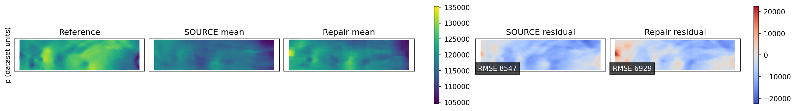

trajectory_000000:8049, fields p: native positive-mass field reconstructions and residuals; residual badges are mass-weighted mean-field RMSE in dataset field units. [PDF master](figures/fields_case_2_part_3.pdf)

## Figure event case 2

trajectory_000000:8049: frozen unary event supports, signed joint missing/excess and independent-member joint-event probability on native positive-mass support. Predicted unary and joint-error panels display mass-weighted probability RMSE against the reference masks, in dimensionless units. [PDF master](figures/event_case_2.pdf)

## Figure fields case 3 part 1

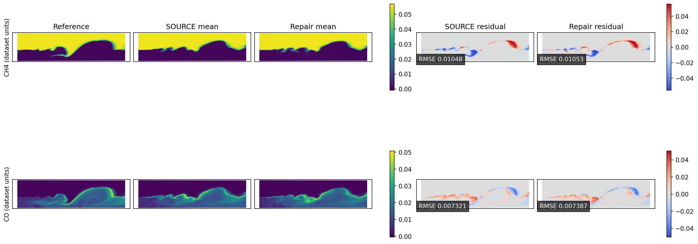

trajectory_000000:8081, fields CH4, CO: native positive-mass field reconstructions and residuals; residual badges are mass-weighted mean-field RMSE in dataset field units. [PDF master](figures/fields_case_3_part_1.pdf)

## Figure fields case 3 part 2

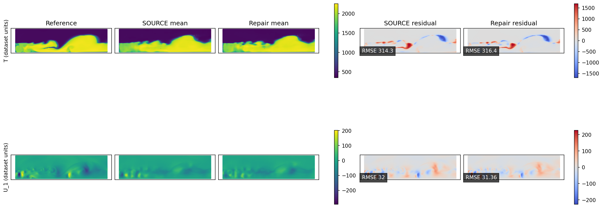

trajectory_000000:8081, fields T, U_1: native positive-mass field reconstructions and residuals; residual badges are mass-weighted mean-field RMSE in dataset field units. [PDF master](figures/fields_case_3_part_2.pdf)

## Figure fields case 3 part 3

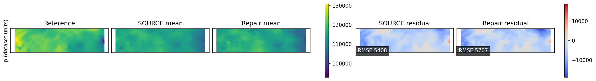

trajectory_000000:8081, fields p: native positive-mass field reconstructions and residuals; residual badges are mass-weighted mean-field RMSE in dataset field units. [PDF master](figures/fields_case_3_part_3.pdf)

## Figure event case 3

trajectory_000000:8081: frozen unary event supports, signed joint missing/excess and independent-member joint-event probability on native positive-mass support. Predicted unary and joint-error panels display mass-weighted probability RMSE against the reference masks, in dimensionless units. [PDF master](figures/event_case_3.pdf)

## Figure matched phase comparison

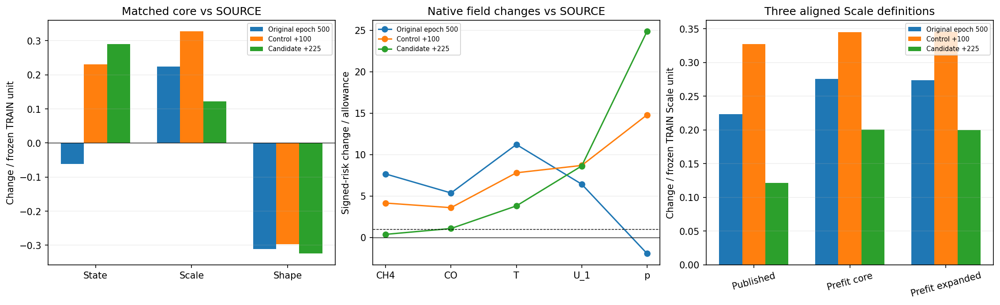

Matched development VALIDATION100 comparisons against SOURCE: original core changes, native signed field changes relative to fixed allowances and three identical Scale definitions. Dashed line denotes the field allowance. [PDF master](figures/matched_phase_comparison.pdf)

## Figure phase learning and pi

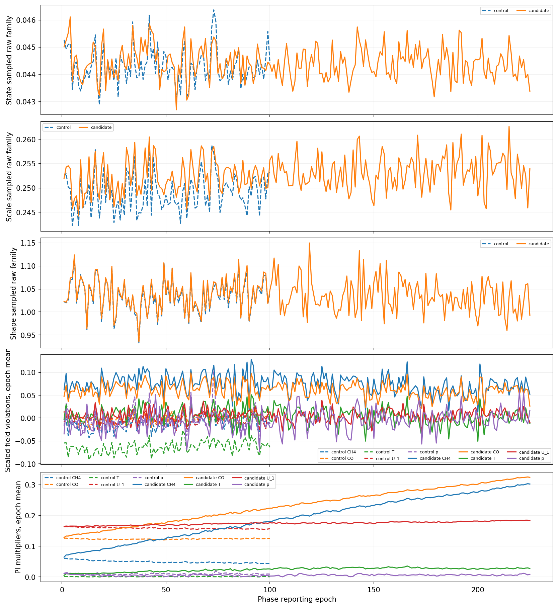

Phase-indexed sampled family histories and per-action PI journal values averaged within each 12-action epoch; raw family units differ and no scalar objective is implied. [PDF master](figures/phase_learning_and_pi.pdf)
