# Coherence Adaptive Repair: Round 6

**Decision:** retain SOURCE/C8. Retain SOURCE/C8 and close operational promotion of this tested epoch-500 package. Four native signed-field changes exceed their fixed allowances by factors 7.662, 5.371, 11.218, 6.432; CO and T member MSE rise 13.19% and 12.94%. Native Scale worsens by 0.22354 SOURCE-normalized TRAIN units, and the regional relationship score worsens by 0.60547 units with a paired condition interval excluding zero. Shape improves, but this measured retention and task tradeoff does not justify replacement. Complete 500 learning and the cached tasks have been evaluated; no additional training or output-policy search is needed for this bounded disposition.

**Scientific progress:** The original zero fitted gain was a symmetric drift-target diagnostic, not evidence that Lagrangian repair could not learn. The measured PI package completed 500 epochs / 6000 accepted actions with fresh full-parameter ConFIG, fixed coefficients and zero native-data update weight. Late pooled TRAIN field excess J is 0.02904, while native VALIDATION field excess J is 14.0504. Shape improves by 0.31061 frozen TRAIN units with interval [-0.35084,-0.27111]; State point improvement 0.06141 is uncertain. Joint-event fair CRPS falls 3.04% at the point estimate, with normalized difference -0.06431 and interval [-0.20425,+0.07523], so a reliable event gain is not established. Sampled training progress and qualified estimator/computation benefits are retained as scoped results, but this package has not repaired native held-out retention and does not robustly dominate the matched historical package. This closes the tested recipe rather than the general SSS-only Lagrangian-ConFIG framework.

The user-authorized resumption treats the original SOURCE-normalized core/task margins as reported references. Their combined replacement flag is False; the operational recommendation above is an explicit measured judgment, with field, sensor and member safeguards retained.

The raw FFM_SSS_EpochCalibrated_PI_Repair model is compared with matched SOURCE on 100 development VALIDATION conditions, each with four independent members, at reporting epoch 500. TEST remains locked. No native reconstruction loss was added to the SSS update.

## Scientific intervention

Each action computes fresh full-parameter State, Scale and Shape gradients. The pinned TorchJD operation normalizes the family rows, forms the ConFIG direction and assigns its length. Field feedback then forms `d = d_C/C0 + sum_f lambda_f grad(e_f)`, with fixed SOURCE scale C0 = 1.8591271, followed by clipping and AdamW. This vector construction is not generally the gradient of one scalar loss; family scores and actual-displacement products are reported separately.

For field f, `e_f = (R_f - R0_f - a_f)/s_f`, with allowance `a_f = 0.10 M0_f` and positive scale `s_f = max(M0_f, 1e-8)` from the frozen TRAIN SOURCE reference. The signed J2 training risk is the physical integral of the product of the two independent members' errors. Native J4 assessment uses ensemble-mean squared error minus sample variance divided by four, compares the child with matched VALIDATION SOURCE risk and converts the fixed TRAIN allowance by the squared saved field normalization. Signed finite-member risks are retained; member MSE, ensemble-mean MSE, spread and sensor errors are reported separately.

A reporting epoch contains 12 successful actions of batch size 64, or 768 objective-bearing condition visits under the saved full-pass stream. The saved maximum horizon is 500 epochs. Learning-rate warmup is 50 epochs. Query groups: 8; family VJP execution: batched. These execution choices are included in the package decision and its measured cost.

The projected PI controller uses delta = 1/12 epoch, tau = 1 epoch, H = 10 epochs and gamma = 11.621005. Its integral rate is 0.013945206 per epoch and proportional rate is H times that value. It smooths detached signed pre-action errors, uses the current multiplier in the action, and commits `lambda_next = positive_part(lambda + kI*delta*e + kP*(z_next-z))` only after success. The whole increment is projected once; training errors are not clipped to positive parts.

## Field retention and coherence

Signed field and sensor guard: False; member-MSE guard: False. State, Scale and Shape normalized changes: state -0.061409, scale +0.22354, shape -0.31061.

Regional task improvement in frozen TRAIN units: -0.60547; joint-event score change: -0.064308. Positive regional improvement and negative event change favor the repair. These are reused development outcomes, not independent confirmation.

The sensor guard covers observed T only (256 observations per condition); the final trusted-sensor clamp gives zero T sensor MSE. Other fields have no sensor observations, so their sensor MSE values are unavailable.

| Field | Signed risk change | TRAIN allowance | Change / allowance | SOURCE sensor MSE | Repair sensor MSE | Sensor allowance |
| --- | ---: | ---: | ---: | ---: | ---: | ---: |
| CH4 | 5.54429e-06 | 7.23573e-07 | 7.66238 | unavailable | unavailable | 1.01252e-17 |
| CO | 3.25877e-06 | 6.0674e-07 | 5.37095 | unavailable | unavailable | 1.47808e-18 |
| T | 7251.57 | 646.404 | 11.2183 | 0 | 0 | 9.25824e-09 |
| U_1 | 39.2357 | 6.09996 | 6.43212 | unavailable | unavailable | 1.67099e-11 |
| p | -144035 | 74097.5 | -1.94386 | unavailable | unavailable | 6.96626e-07 |

| Field | SOURCE mean MSE | Repair mean MSE | SOURCE member MSE | Repair member MSE | SOURCE spread | Repair spread |
| --- | ---: | ---: | ---: | ---: | ---: | ---: |
| CH4 | 8.2485e-05 | 8.8619e-05 | 8.58825e-05 | 9.37854e-05 | 4.53002e-06 | 6.88858e-06 |
| CO | 3.97192e-05 | 4.35541e-05 | 4.21787e-05 | 4.77421e-05 | 3.2793e-06 | 5.58401e-06 |
| T | 71910.7 | 79757.3 | 74408.6 | 84040.5 | 3330.61 | 5710.9 |
| U_1 | 1158.64 | 1199.98 | 1183.27 | 1230.92 | 32.8304 | 41.2432 |
| p | 3.16369e+07 | 3.15773e+07 | 3.18011e+07 | 3.19947e+07 | 218885 | 556512 |

## Controller nomination and learning evidence

The user-authorized resumption nominated the measured norm-balanced probe gamma = 11.621005 for a fresh SOURCE trajectory. The prior exact ten-epoch drift fit selected zero because the saved mature AdamW action already corrected faster than that target. The measured probe lowered the remaining pooled field-violation norm from 2.57031 to 1.79759, with a weaker but positive independent-query Shape decrease. This supports the bounded learning test; it does not establish an optimal gain or model replacement.

## Pilot PI reconstruction

The 20-epoch pilot completed 240 actions, and its exact PI recursion matched the recorded state. The coarse reconstruction repeats each epoch’s last-batch errors for all 12 actions; it is neither a trained counterfactual trajectory nor validation of the hypothetical mature profile.

| Field | Actual multiplier | Coarse last-batch multiplier | Coarse minus actual |
| --- | ---: | ---: | ---: |
| CH4 | 0.0026048508 | 0.0074091114 | +0.0048042606 |
| CO | 0.0098028924 | 0.0093604189 | -0.00044247359 |
| T | 0 | 0.0022711193 | +0.0022711193 |
| U_1 | 0.00086667376 | 0.0063953803 | +0.0055287066 |
| p | 0.0010960914 | 0.0098377407 | +0.0087416493 |

Maximum absolute multiplier discrepancy: 0.0087416493.

## Completed training and paired learning changes

The trained Scale scalar uses fixed, nonuniform SOURCE-prefit weights and eight fixed triple queries; published complete-core validation uses unit base coefficients and no triple queries. Sampled training and published validation Scale changes therefore describe different observables.

TRAIN signed field errors are pooled over every action before applying the positive part for J; these are sampled training quantities, not native held-out field scores.

| TRAIN window | Pooled positive-excess J | CH4 | CO | T | U_1 | p |
| --- | ---: | ---: | ---: | ---: | ---: | ---: |
| epochs 76–100 | 1.11284 | +0.0616433 | +0.0583258 | -0.00311815 | +0.0715928 | +0.00754075 |
| epochs 451–475 | 0 | -0.0206887 | -0.00606396 | -0.0711701 | -0.00423755 | -0.00382327 |
| epochs 476–500 | 0.0290397 | -0.0150357 | -0.00273249 | -0.0662143 | -0.00246184 | +0.00290397 |

For the 600 late TRAIN actions, 600 combined constraint-gradient products with actual optimizer displacement were negative; these are first-order action diagnostics.

| Family | Sampled TRAIN change, epochs 76–100 to 476–500 | Held-out epoch 500 minus 100 | Held-out 95% interval |
| --- | ---: | ---: | ---: |
| State | -7.882% | +0.05556 | [-0.15668, +0.26758] |
| Scale | -6.538% | +0.16256 | [+0.06396, +0.26323] |
| Shape | -4.730% | -0.02036 | [-0.04057, +0.00033] |

| Family | Epoch500 minus historical epoch500 | Paired 95% interval |
| --- | ---: | ---: |
| State | +0.09521 | [-0.06669, +0.25614] |
| Scale | +0.05429 | [-0.00158, +0.10931] |
| Shape | -0.00535 | [-0.01791, +0.00818] |

TRAIN family changes are relative changes in sampled losses; held-out differences are in frozen SOURCE normalization units, with negative values favoring the current endpoint. Intervals are paired condition bootstraps on the same reused development trajectory, not independent trajectory confirmation. The historical comparison is between complete packages and does not isolate a PI effect.

## Epoch100 learning review

The substantive 100-epoch test shows useful State and Shape point improvements and a much smaller Scale regression than the matched-age historical constrained repair. Shape improves by 0.290255 SOURCE units with paired condition-bootstrap 95% interval [-0.325953, -0.256641]; the State improvement and Scale regression intervals span zero. Native field/member safeguards still fail, with mixed fieldwise effects, so SOURCE/C8 remains operational. Active late corrective feedback and decreasing pooled TRAIN excess support completing the bounded 500-epoch question. This is a development VALIDATION package comparison, not an isolated PI effect or independent confirmation.

Continuation question and decision: Continue the unchanged package to the authorized 500-epoch endpoint to test whether active PI feedback can recover native field retention and Scale while preserving State/Shape gains. At 100, normalized VALIDATION changes are State -0.116967, Scale +0.060983 and Shape -0.290255; matched historical R3 values are +0.038649, +0.260590 and -0.292063. Four signed field guards fail: CH4 and T are worse than historical 100, while CO, U_1 and pressure improve. Pooled positive native allowance excess is 10.0298 versus 17.7823 historically. CO member-MSE ratio 1.10506 exceeds the 1.10 safeguard, so current raw replacement is ineligible. Across the two full 300-action TRAIN windows at epochs 51–75 and 76–100, pooled positive excess falls 17.24%; all field means decrease, feedback is active and all 600 constraint-displacement products are negative. Sampled State/Scale means fall 1.02%/1.04%; Shape is 0.43% higher but has a useful held-out gain. This is a concrete recovery question; TRAIN temperature feasibility has not transferred to native VALIDATION. Continue without gain, loss, query, LR or objective retuning. Endpoint tasks remain withheld. The conservative continuation cap, assessment and reserve fit within 22.6865 remaining occupied GPU-hours.

Both endpoint tasks remained withheld at this review. The continuation used development VALIDATION and the recorded training trajectory, with an explicit remaining-resource forecast.

## Original controller target-fit diagnostic

The preserved original TRAIN-only symmetric drift-target diagnostic fitted gamma = 0. This fitted value is a diagnostic, not the executed training gain; the scientific intervention above describes the actual saved configuration.

## Matched grouped-query action diagnostic

On one matched TRAIN800 panel, four paired query seeds repeat estimators at the same mature model and Adam state. Each result is a finite single-action diagnostic with the nominated off-policy feedback profile; these are not four datasets or learning efficacy evidence.

| Measurement | Shared query | Eight groups |
| --- | ---: | ---: |
| Shape parameter-gradient variance, per batch | 76.6656 | 59.1881 |
| Shape parameter-gradient variance, panel mean | 6.52335 | 4.53187 |
| Independent-query State decrease / SOURCE unit | 0.0451146 | 0.0446277 |
| Independent-query Scale decrease / SOURCE unit | 0.0498655 | 0.0500957 |
| Independent-query Shape decrease / SOURCE unit | 0.0113728 | 0.0116269 |
| Post-action pooled field positive-excess J | 1.79071 | 1.77586 |
| Ten-epoch target weighted response residual squared | 207.299 | 216.124 |

J is the norm of positive pooled signed field excess weighted by the saved scale-to-allowance ratio. The original response-to-target residual uses delta = 1/12 epoch, H = 10 epochs and the same saved field weights.

The grouped action lowers J by 0.0148527; its original target residual squared changes by +4.257% because the stronger field recovery overshoots that drift target. State decreases by 0.000486827 fewer SOURCE units with grouping, while U_1 post-action excess changes by +0.00368383 allowance units. No query-law or model adoption follows from this diagnostic alone.

## Engineering and cost

At fixed shared queries, batched fresh family VJPs reduced mean complete-epoch wall time from 127.557 to 122.949 seconds (3.612%); at fixed batched VJP, eight query groups increased it from 123.490 to 128.600 seconds (4.137%). Across the two matched study blocks, the selected batched/eight-group package averaged 128.600 seconds versus 127.557 seconds for original separate/shared execution (+0.818%), with peak allocation 37.25 GB versus 19.02 GB. The four repeated query seeds on one mature TRAIN800 panel showed lower Shape parameter-gradient variance for grouping, with near-equal mean independent-query SSS decrease and a small pooled field-feasibility improvement; individual State and U_1 tradeoffs remain. The common initial scientific state and recorded condition, observation, spatial-query and member-RNG coupling matched across all eight epochs. Two epochs per method in each of two blocks do not establish an overall speedup, mature-trajectory cost, or model efficacy; the shared batched control differed by 0.440% between blocks. Wide TorchJD ConFIG and disabled context reuse are retained; the global separate-VJP and shared-query defaults are unchanged.

Exact graph-scoped State/Scale reuse is inherited from Round 3, not a new Round 6 change. Its qualified comparison reduced peak training allocation by 502892032 bytes (0.468 GiB, 2.57%); historical and reused complete-epoch times were 115.14 and 114.12 seconds, while update-only timing changed in the opposite direction, so no speedup was established. The current State scoring and live Scale coefficient reuse match the frozen execution inventory.

Final engineering decisions: retain batched VJPs as an opt-in computation improvement and eight groups as an optional lower-variance research estimator; keep separate VJPs and shared queries as global defaults. Retain the faithful PI implementation and its demonstrated TRAIN correction, but do not promote this package as a native-field-retention repair. SOURCE/C8 remains operational after the completed 500-epoch assessment. No overall training speedup or isolated component efficacy is claimed.

All prescribed model assessments completed with 25.227 charged occupied GPU-hours, including 7,800 seconds of conservative upper-bound charges whose exact occupation is unknown. Formal training used 21.357 hours; the two candidate VALIDATION generation leases used 108.744 seconds. Historical SOURCE predictions were reused. The 499 complete epoch timings average 153.685 seconds; split epoch 439 records only 11 current-process actions and its full duration remains unavailable. Task-free CPU scoring used 71.135 and 170.679 wall seconds, and endpoint relationship scoring used 7.720 wall seconds; CPU work is separate from enclosing GPU occupation. Handoff intervals include offline waiting and assessment or administrative work, so they are not all idle and are not added to GPU time. The final report production wall/user/system CPU timing is recorded after rendering in its accompanying compact evidence index and receipt, separately from these model measurements.

| Measurement | Value |
| --- | ---: |
| campaign_charged_occupied_gpu_seconds | 90816.8 |
| campaign_charged_occupied_gpu_hours | 25.2269 |
| campaign_measured_lease_gpu_seconds_excluding_unknown_upper_charges | 83016.8 |
| preparation_charged_gpu_seconds | 13824.2 |
| preparation_unknown_exact_upper_charges_seconds | 7800 |
| formal_training_gpu_seconds | 76883.9 |
| formal100_gpu_seconds | 12472.6 |
| formal500_partial_lease_gpu_seconds | 55136.2 |
| formal500_recovery_gpu_seconds | 9275.09 |
| epoch100_validation_generation_gpu_seconds | 31.7966 |
| epoch500_validation_generation_gpu_seconds | 76.9478 |
| failed_groupcost_attempt_gpu_seconds | 38.0987 |
| complete_epoch_duration_count | 499 |
| complete_epoch_mean_wall_seconds_excluding_split_epoch | 153.685 |
| complete_epoch_mean_train_seconds_excluding_split_epoch | 153.333 |
| split_epoch_439_recorded_process_timed_actions | 11 |
| split_epoch_439_full_duration_seconds | unavailable |
| epoch100_taskfree_cpu_wall_seconds | 71.1346 |
| epoch100_taskfree_cpu_process_seconds | 98.2336 |
| epoch500_taskfree_cpu_wall_seconds | 170.679 |
| epoch500_taskfree_cpu_process_seconds | 222.612 |
| cached_source_bank_original_historical_wall_seconds | 29.938 |
| formal100_end_to_continuation_start_wall_seconds | 3499.54 |
| graceful_pause_to_recovery_start_wall_seconds | 309.471 |
| formal500_end_to_endpoint_generation_start_wall_seconds | 2795.37 |
| endpoint_task_cpu_wall_seconds | 7.72031 |
| endpoint_task_cpu_process_seconds | 13.1647 |
| all_model_scoring_cpu_wall_seconds | 249.534 |
| all_model_scoring_cpu_process_seconds | 334.011 |

## Interpretation boundary

The decision concerns this SOURCE and combustion cohort on 100 previously accessed development conditions. The controller and any adopted query/computation changes form the evaluated package; local action audits support mechanism statements but do not isolate every contribution to the learned outcome. Finite SSS observables and these reused tasks do not establish cross-model or cross-system performance. TEST remains locked.

## Figure index

- [Figure learning and action](#figure-learning-and-action)
- [Figure family history](#figure-family-history)
- [Figure fixed coefficients](#figure-fixed-coefficients)
- [Figure field core task](#figure-field-core-task)
- [Figure regional and event](#figure-regional-and-event)
- [Figure leaf history 1](#figure-leaf-history-1)
- [Figure leaf history 2](#figure-leaf-history-2)
- [Figure complete epoch engineering](#figure-complete-epoch-engineering)
- [Figure measured controller response](#figure-measured-controller-response)
- [Figure grouped query diagnostic](#figure-grouped-query-diagnostic)
- [Figure learning review and endpoint](#figure-learning-review-and-endpoint)
- [Figure fields case 1 part 1](#figure-fields-case-1-part-1)
- [Figure fields case 1 part 2](#figure-fields-case-1-part-2)
- [Figure fields case 1 part 3](#figure-fields-case-1-part-3)
- [Figure event case 1](#figure-event-case-1)
- [Figure fields case 2 part 1](#figure-fields-case-2-part-1)
- [Figure fields case 2 part 2](#figure-fields-case-2-part-2)
- [Figure fields case 2 part 3](#figure-fields-case-2-part-3)
- [Figure event case 2](#figure-event-case-2)
- [Figure fields case 3 part 1](#figure-fields-case-3-part-1)
- [Figure fields case 3 part 2](#figure-fields-case-3-part-2)
- [Figure fields case 3 part 3](#figure-fields-case-3-part-3)
- [Figure event case 3](#figure-event-case-3)

## Figure learning and action

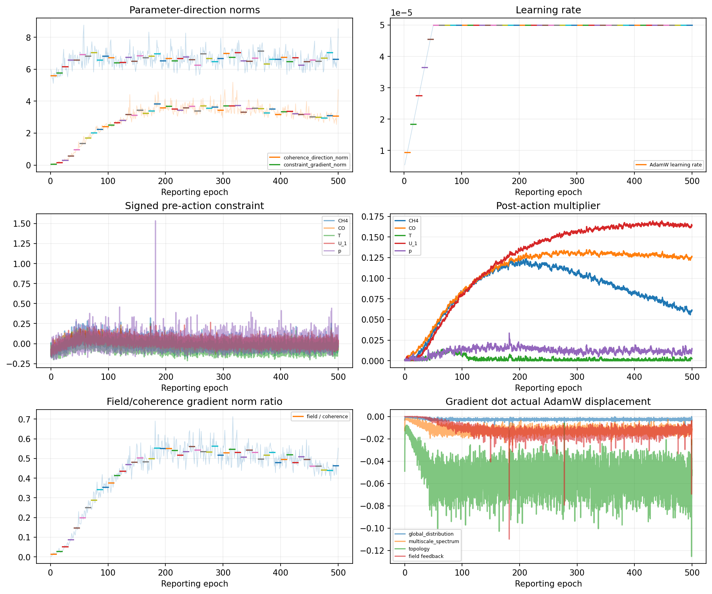

Parameter-direction norms, learning rate, pre-action signed violations, post-action multipliers, gradient norm ratio and actual optimizer-displacement products; translucent curves show recorded values and solid bars show ten-epoch means where applicable. [PDF master](figures/learning_and_action.pdf)

## Figure family history

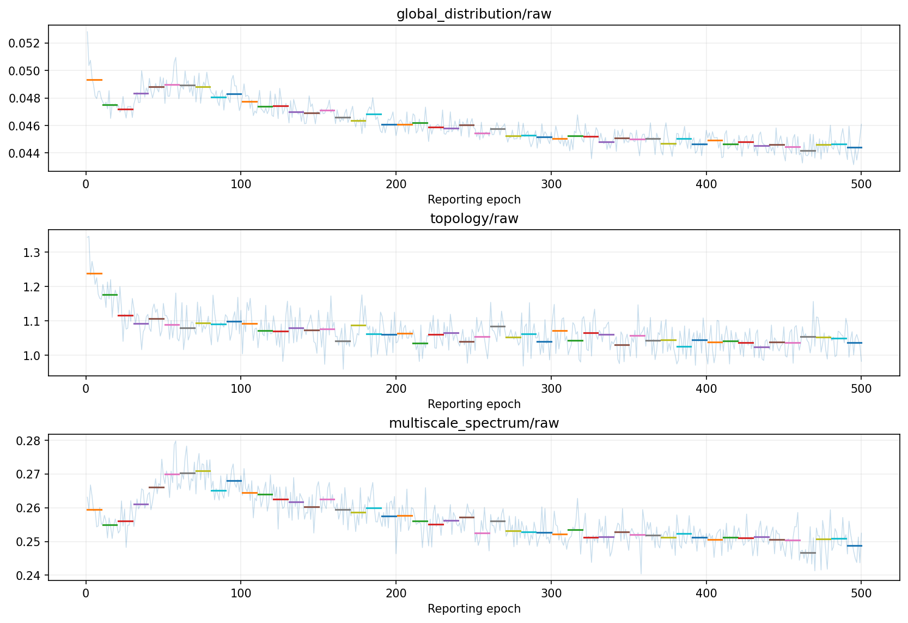

Complete raw sampled family histories in their respective declared representation units, with translucent epoch records and descriptive ten-epoch means. [PDF master](figures/family_history.pdf)

## Figure fixed coefficients

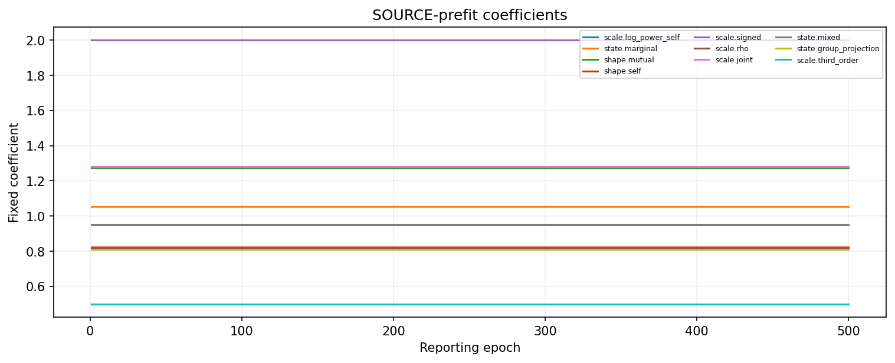

SOURCE-prefit coefficients remain fixed throughout the recorded optimization. [PDF master](figures/fixed_coefficients.pdf)

## Figure field core task

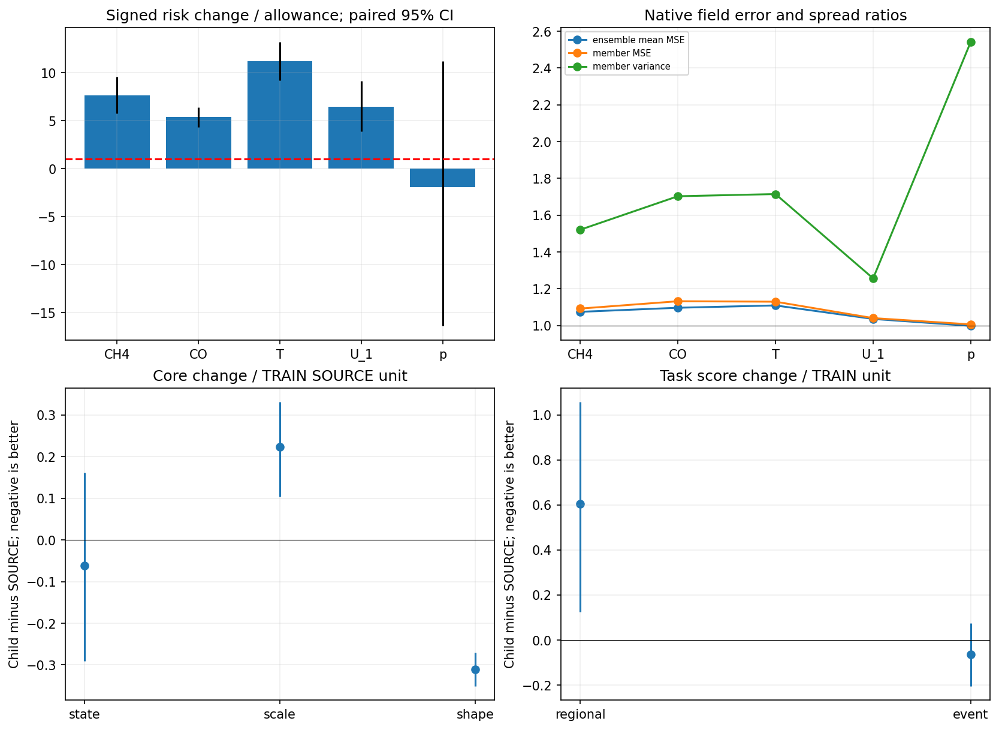

Native positive-mass field retention, member and ensemble errors and spread, with paired 95% condition-bootstrap intervals for complete State, Scale, Shape and endpoint regional and event score changes; lower score changes are better. [PDF master](figures/field_core_task.pdf)

## Figure regional and event

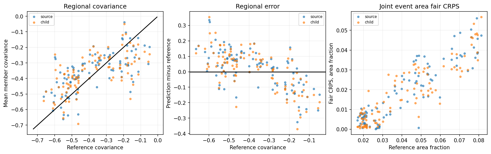

Matched VALIDATION conditions: right-half mass-weighted CO–U1 covariance prediction and error, and memberwise joint-event area fair CRPS. These are frozen reused development tasks. [PDF master](figures/regional_and_event.pdf)

## Figure leaf history 1

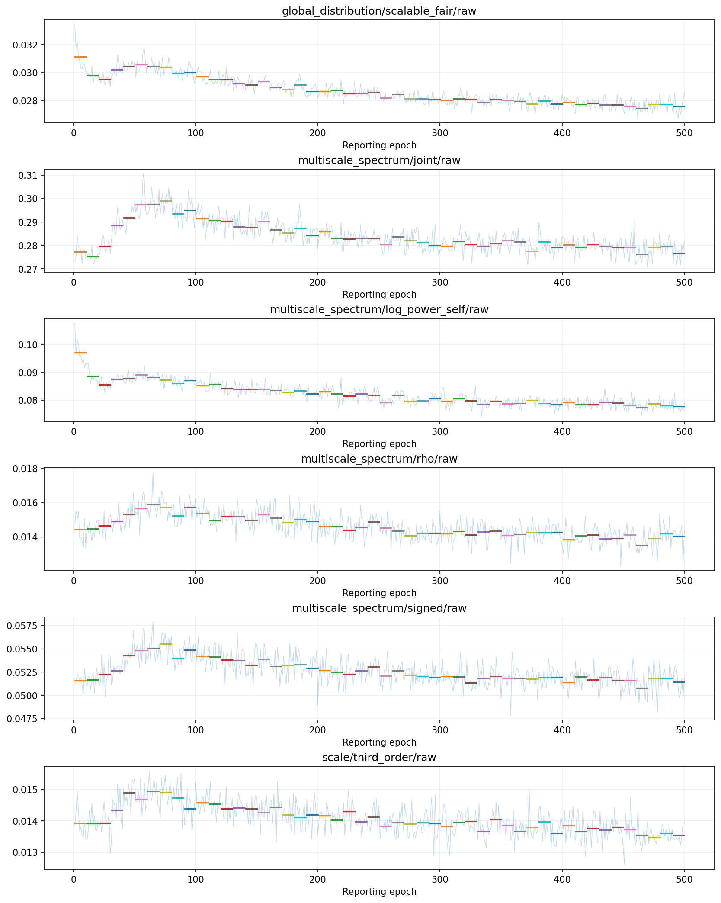

Complete raw sampled leaf histories in their declared representation units; translucent values are epoch records and solid bars are descriptive ten-epoch means. [PDF master](figures/leaf_history_1.pdf)

## Figure leaf history 2

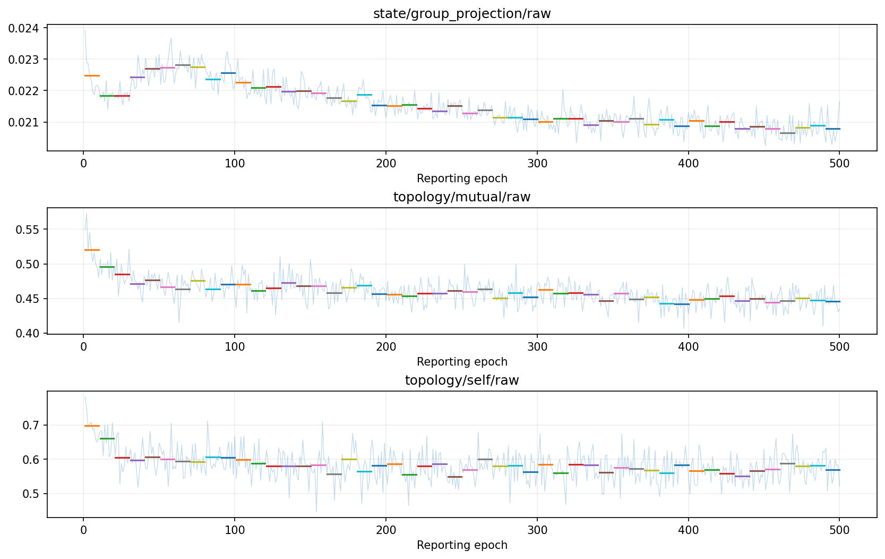

Complete raw sampled leaf histories in their declared representation units; translucent values are epoch records and solid bars are descriptive ten-epoch means. [PDF master](figures/leaf_history_2.pdf)

## Figure complete epoch engineering

Four fresh-SOURCE complete-epoch engineering qualifications on the same GPU (NVIDIA RTX 6000 Ada Generation), two per method in separate, batched, batched, separate order. Points show individual epoch wall times and peak allocated memory; bars show within-method means. These qualifications do not establish mature-trajectory performance or model efficacy. [PDF master](figures/complete_epoch_engineering.pdf)

## Figure measured controller response

Matched TRAIN800 mature-state actions nominate the already measured positive PI probe: pool signed field errors before taking their positive part. Both Shape decreases remain positive; the independent-query decrease is weaker under the probe. Actual saved Adam moments contain historical feedback. This is local nomination evidence, not a fresh-state trajectory or held-out efficacy result. [PDF master](figures/measured_controller_response.pdf)

## Figure grouped query diagnostic

One fixed mature model and Adam state on matched TRAIN800: four paired query-seed repetitions compare Shape parameter-gradient variance, finite independent-query State/Scale/Shape decreases, and pooled post-action field excess. The repetitions are not independent datasets; this one-action diagnostic is not learning efficacy. [PDF master](figures/grouped_query_diagnostic.pdf)

## Figure learning review and endpoint

The planned task-free epoch100 learning review and selected epoch500 endpoint reuse matched VALIDATION100/J4 conditions, member manifests and observers. Lines connect the assessed values; intermediate held-out values were not measured. Regional/event tasks were withheld at epoch100. These development observations support the recorded continuation decision and do not establish continuous feasibility. [PDF master](figures/learning_review_and_endpoint.pdf)

## Figure fields case 1 part 1

trajectory_000000:8034, fields CH4, CO: native positive-mass field reconstructions and residuals; residual badges are mass-weighted mean-field RMSE in dataset field units. [PDF master](figures/fields_case_1_part_1.pdf)

## Figure fields case 1 part 2

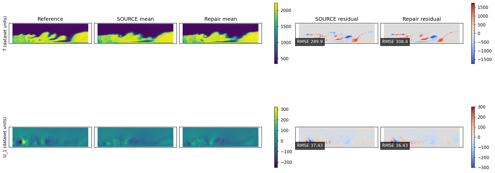

trajectory_000000:8034, fields T, U_1: native positive-mass field reconstructions and residuals; residual badges are mass-weighted mean-field RMSE in dataset field units. [PDF master](figures/fields_case_1_part_2.pdf)

## Figure fields case 1 part 3

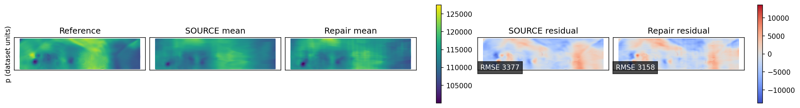

trajectory_000000:8034, fields p: native positive-mass field reconstructions and residuals; residual badges are mass-weighted mean-field RMSE in dataset field units. [PDF master](figures/fields_case_1_part_3.pdf)

## Figure event case 1

trajectory_000000:8034: frozen unary event supports, signed joint missing/excess and independent-member joint-event probability on native positive-mass support. Predicted unary and joint-error panels display mass-weighted probability RMSE against the reference masks, in dimensionless units. [PDF master](figures/event_case_1.pdf)

## Figure fields case 2 part 1

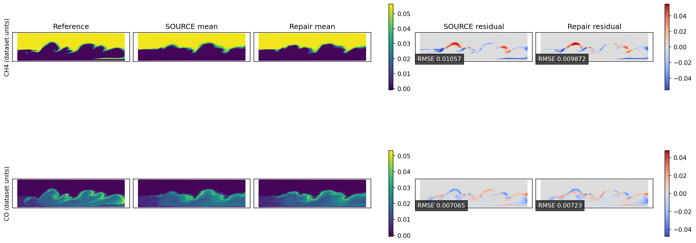

trajectory_000000:8049, fields CH4, CO: native positive-mass field reconstructions and residuals; residual badges are mass-weighted mean-field RMSE in dataset field units. [PDF master](figures/fields_case_2_part_1.pdf)

## Figure fields case 2 part 2

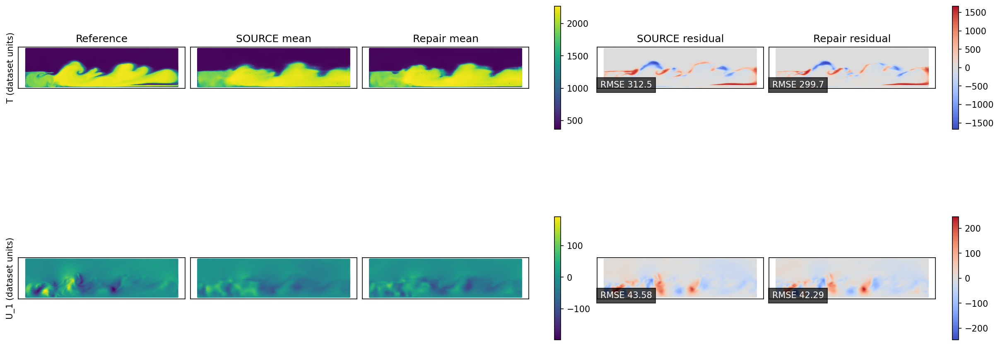

trajectory_000000:8049, fields T, U_1: native positive-mass field reconstructions and residuals; residual badges are mass-weighted mean-field RMSE in dataset field units. [PDF master](figures/fields_case_2_part_2.pdf)

## Figure fields case 2 part 3

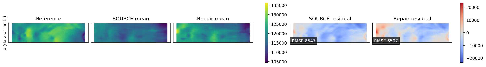

trajectory_000000:8049, fields p: native positive-mass field reconstructions and residuals; residual badges are mass-weighted mean-field RMSE in dataset field units. [PDF master](figures/fields_case_2_part_3.pdf)

## Figure event case 2

trajectory_000000:8049: frozen unary event supports, signed joint missing/excess and independent-member joint-event probability on native positive-mass support. Predicted unary and joint-error panels display mass-weighted probability RMSE against the reference masks, in dimensionless units. [PDF master](figures/event_case_2.pdf)

## Figure fields case 3 part 1

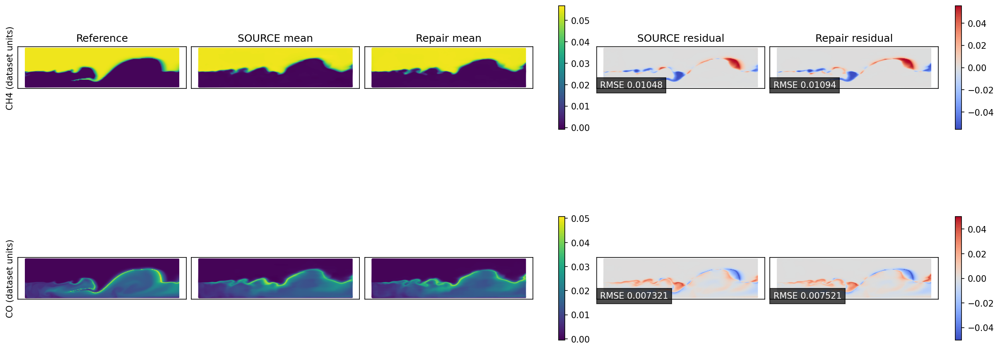

trajectory_000000:8081, fields CH4, CO: native positive-mass field reconstructions and residuals; residual badges are mass-weighted mean-field RMSE in dataset field units. [PDF master](figures/fields_case_3_part_1.pdf)

## Figure fields case 3 part 2

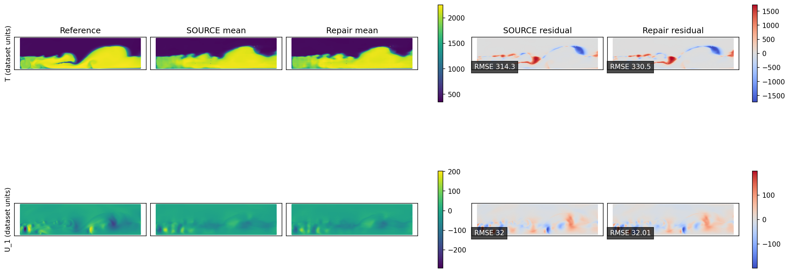

trajectory_000000:8081, fields T, U_1: native positive-mass field reconstructions and residuals; residual badges are mass-weighted mean-field RMSE in dataset field units. [PDF master](figures/fields_case_3_part_2.pdf)

## Figure fields case 3 part 3

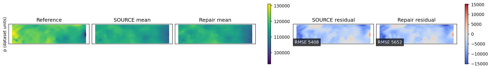

trajectory_000000:8081, fields p: native positive-mass field reconstructions and residuals; residual badges are mass-weighted mean-field RMSE in dataset field units. [PDF master](figures/fields_case_3_part_3.pdf)

## Figure event case 3

trajectory_000000:8081: frozen unary event supports, signed joint missing/excess and independent-member joint-event probability on native positive-mass support. Predicted unary and joint-error panels display mass-weighted probability RMSE against the reference masks, in dimensionless units. [PDF master](figures/event_case_3.pdf)
