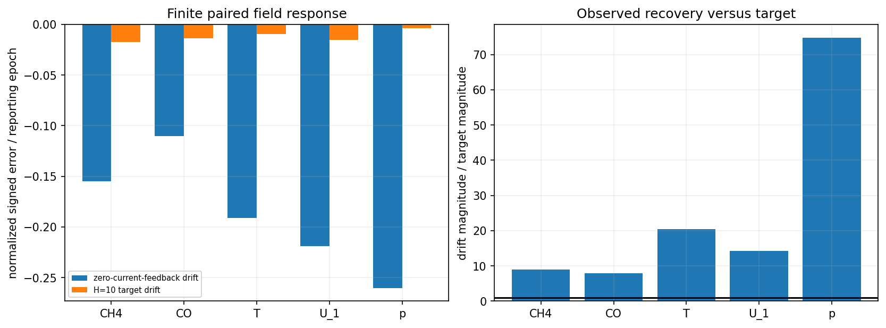
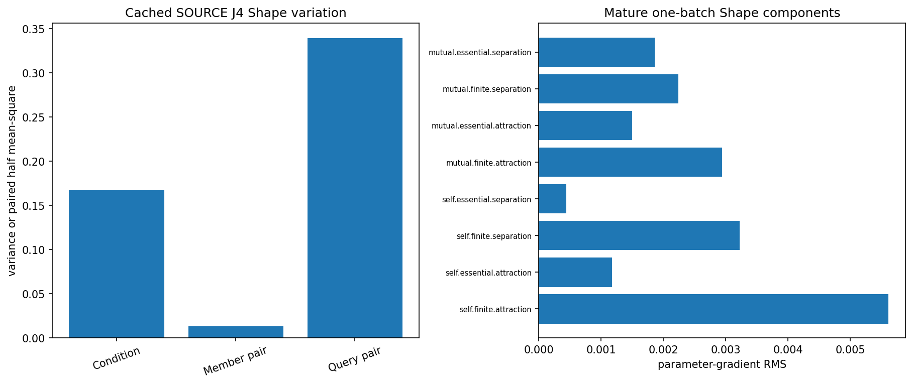
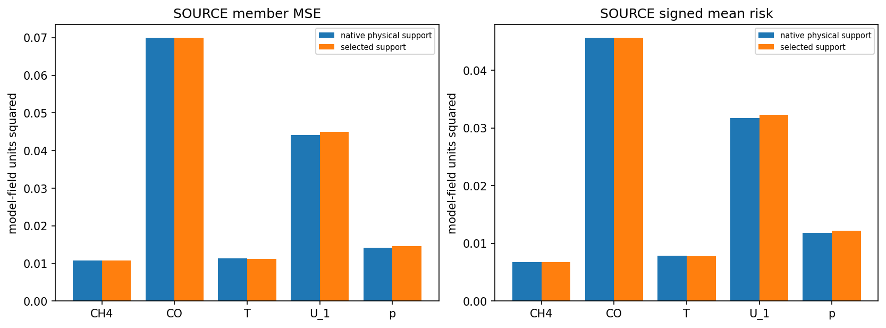
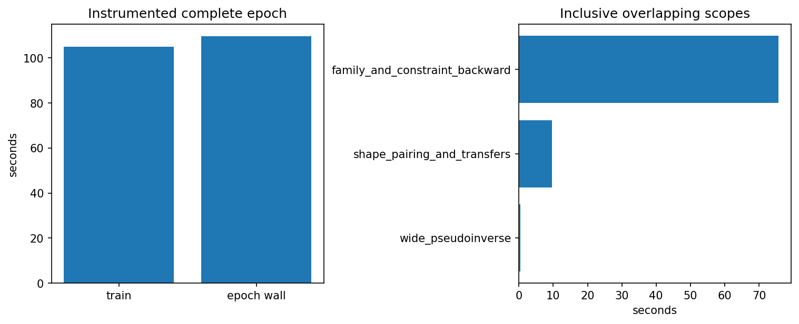
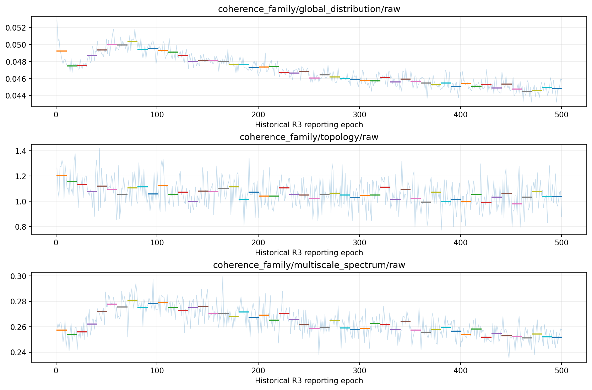
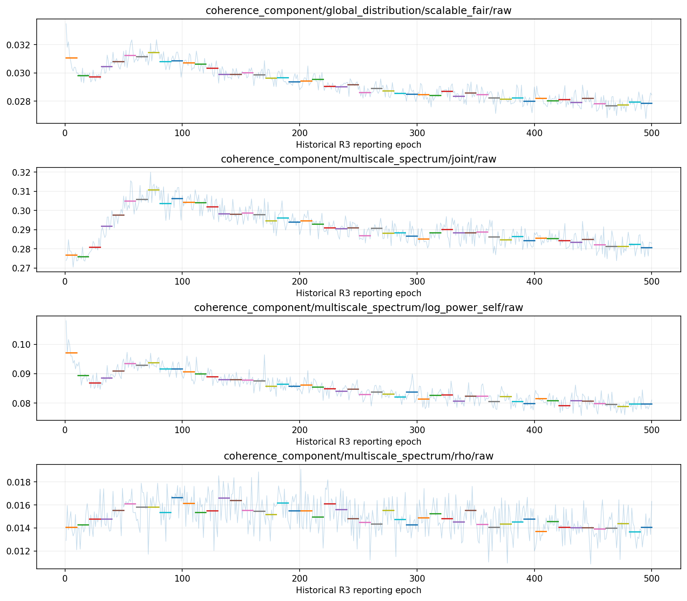
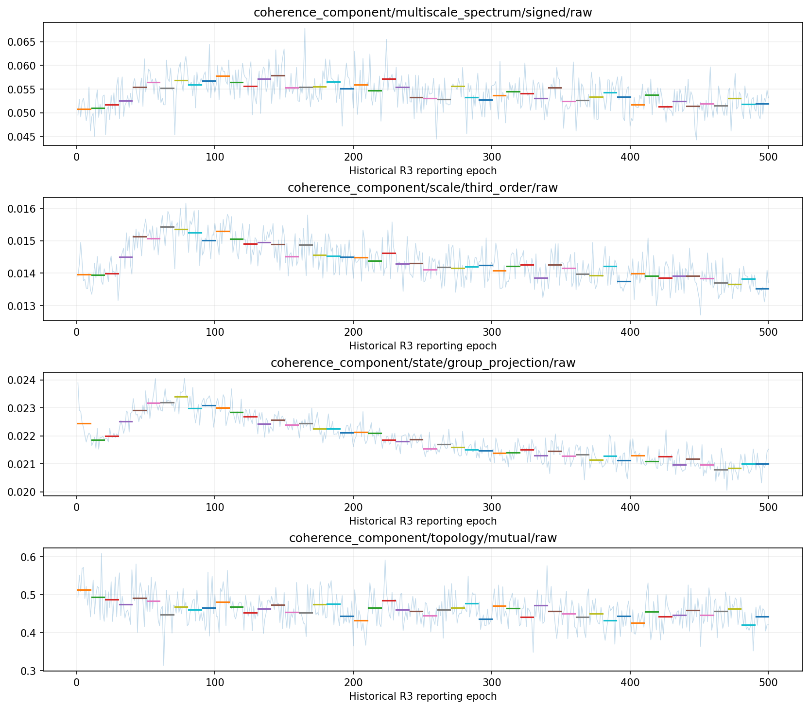
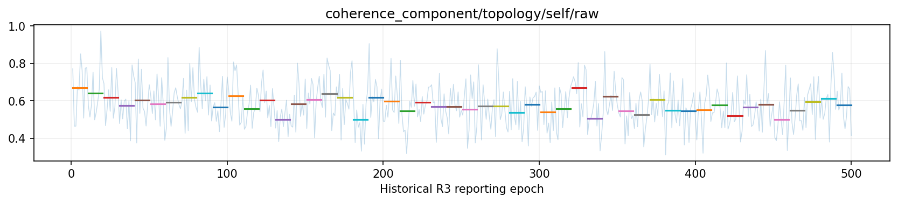
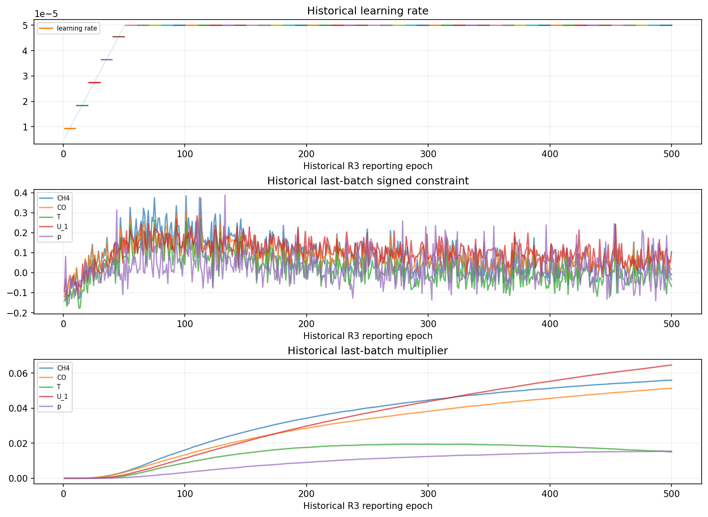

# Coherence Adaptive Repair: Round 6 preparation close

**Decision:** Retain SOURCE/C8. Do not freeze or launch the proposed PI candidate without a qualified gain.

The proposed PI repair did not qualify. SOURCE/C8 is retained. The 20-epoch pilot and conditional 100/500-epoch candidate training, held-out candidate assessment, and replacement decision were not performed. TEST remained locked. The one-epoch instrumented computation profile is an engineering qualification, not a Round 6 learning experiment.

## Mathematical and empirical diagnosis

The audited method uses SSS-only primary objectives. Three fresh full-parameter State, Scale and Shape gradients enter the pinned TorchJD ConFIG operation; the pre-clipping direction is d = d_C/C0 + sum_f lambda_f grad(e_f), followed by clipping and AdamW. The fixed SOURCE objective scale is C0 = 1.8591270517644938. The original native RF/MSE loss is not replayed. The mature audit uses J2 independent members, four Euler steps, batch64, Q4096 and 12 actions per reporting epoch.

Signed independent-member mean risk is mean-field squared error minus the finite-member spread correction. It estimates conditional-mean risk without equating that quantity to member MSE, which is the average error of individual predictions. A finite-sample signed estimate can be negative.

The signed normalized error is e_f = (R_f - R_0,f - a_f) / s_f. The candidate would update z_t = nu z_(t-1) + (1 - nu)e_t and lambda_(t+1) = projection_positive(lambda_t + k_I delta e_t + H k_I (z_t - z_(t-1))), with delta = 1/12 epoch, tau = 1 epoch, nu = exp(-delta/tau), H = 10 epochs and k_I = 0.0012 gamma per epoch. The current multiplier acts before this update.

For paired pre-action, zero-feedback and probe errors, b = (e_zero - e_pre)/delta, r = (e_probe - e_zero)/(gamma_probe delta), t_f = -max(e_pre,f, 0)/H, and W_ff = s_f/a_f. The predeclared fit is gamma_star = clip(dot(Wr, W(t-b)) / ||Wr||², 0, gamma_probe); the production combined-VJP replay independently remeasures r at the same probe. Workplan section 3 specifies closing preparation and retaining SOURCE when no justified correction remains.

The predeclared weighted response fit selected gamma = 0 (unconstrained fit -2.83336); the independent production combined-VJP probe at gamma = 11.621 gave unclipped fit -2.83336 and projected gain 0. Zero-current-feedback weighted residual norm was 4.10631; production probe residual norm was 14.3665; production-versus-separate response discrepancy was 9.67693e-06 and zero-action replay discrepancy was 0.

The mature zero-current-feedback action already reduced each field excess much faster than the prescribed target, so a positive probe moved the measured response farther from that particular target. The saved mature Adam moments include previous training feedback; zero current feedback is not an independently trained integral-control baseline. A zero fitted gain does not establish failure of Lagrangian methods or efficacy of an alternative.

The frozen SOURCE prefit matched the saved mature checkpoint and logged coefficients stayed constant: True. A proposed epoch-10 coefficient switch is therefore not supported by these records. The SOURCE support and pairing checks used 800 matched TRAIN conditions; sensor-pair and member-seed lists matched 800 and 0 conditions respectively. Seed lists differ in representation and may generate different priors; do not pair predictions by sample alone.

The Shape semantic fixture reconstructed the sampled family value to absolute difference 2.38419e-07 on one mature B64 graph. Its component gradients and cached SOURCE J4 member/query variation describe different quantities. State and Scale have first-order products only; finite paired reassessment was performed for Shape. No evidence here separates Adam moment carryover from preconditioning.

## Fieldwise controller response

R0, a and s are in model-field units squared. Errors are dimensionless and drifts are per reporting epoch; the pre-action mean is condition-weighted, and the zero-post value is reconstructed exactly from the saved baseline drift.

| Field | R0 | a | s | e pre | e zero post | e probe post | b | target t |
| --- | ---: | ---: | ---: | ---: | ---: | ---: | ---: | ---: |
| CH4 | 0.00630035 | 0.00101502 | 0.0101502 | 0.171643 | 0.158753 | 0.0968356 | -0.154674 | -0.0171643 |
| CO | 0.0431139 | 0.00675305 | 0.0675305 | 0.137857 | 0.128686 | 0.0825317 | -0.110052 | -0.0137857 |
| T | 0.00746529 | 0.00107503 | 0.0107503 | 0.0931929 | 0.0772786 | 0.0248451 | -0.190972 | -0.00931929 |
| U_1 | 0.0312105 | 0.00440286 | 0.0440286 | 0.153002 | 0.134753 | 0.12426 | -0.218981 | -0.0153002 |
| p | 0.01199 | 0.00145182 | 0.0145182 | 0.0348061 | 0.0131141 | 0.00818066 | -0.260304 | -0.00348061 |

## Engineering and cost

retain existing execution; no computation acceleration adopted. Measured wide pseudoinverse share was approximately 0.33% of epoch wall, while Gram squares conditioning and introduces action-parity risk. retain context_cache none. Historical failure remains unattributed because per-slice CUDA tensors and post-action outputs were not retained. A new CPU synthetic fixture supports, but does not prove for CUDA or J2, an epsilon-scale key-bias mechanism; no production change or speed claim. The measured controller gain did not qualify; the conditional candidate and its grouping qualification were not launched.

The mature batched-family-VJP fixture was qualified; its measured peak allocations were 18773440512 bytes separately and 37164916224 bytes batched. It was a one-batch compatibility check, not a complete-epoch speed qualification. No new computation route is adopted solely from that check.

Six completed GPU0 preparation leases occupied 1134.659 seconds (0.315183 GPU-hours), including initialization, data waits, update work and enclosed CPU work; no leased failure cost is omitted. This is below the four-hour preparation allowance and the 30-hour campaign ceiling. The one complete instrumented trainer epoch is engineering qualification; no 20-epoch PI pilot, 100/500-epoch learning run or candidate VALIDATION assessment was launched. Recorded CPU user/system work inside leases is already enclosed in GPU occupation and is not added to it. Cached CPU support/Shape helper wall times are a sum of helper durations, not serial elapsed time; report generation is measured in its final build receipt. Other CPU coding, checks and orchestration time was not completely timed and remains unavailable.

| Measurement | Value |
| --- | ---: |
| occupied_gpu_seconds | 1134.66 |
| occupied_gpu_hours | 0.315183 |
| failed_lease_gpu_seconds | 0 |
| preparation_gpu_hour_ceiling | 4 |
| campaign_gpu_hour_ceiling | 30 |
| complete_qualification_trainer_epochs | 1 |
| formal_candidate_training_epochs | 0 |
| cpu_user_seconds_inside_gpu_leases | 1302.15 |
| cpu_system_seconds_inside_gpu_leases | 50.6904 |
| cached_cpu_helper_wall_sum_seconds | 183.111 |
| other_cpu_preparation_seconds | unavailable |

## Figure index

- [Figure controller response](#figure-controller-response)
- [Figure action and shape](#figure-action-and-shape)
- [Figure shape variability](#figure-shape-variability)
- [Figure source support](#figure-source-support)
- [Figure engineering profile](#figure-engineering-profile)
- [Figure historical family 1](#figure-historical-family-1)
- [Figure historical leaf 1](#figure-historical-leaf-1)
- [Figure historical leaf 2](#figure-historical-leaf-2)
- [Figure historical leaf 3](#figure-historical-leaf-3)
- [Figure historical constraints](#figure-historical-constraints)

## Figure controller response

TRAIN800 mature one-step paired response with saved Adam moments: zero-current-feedback drift and the H=10 target, and the corresponding magnitudes. This is a local diagnostic rather than a trained PI trajectory. [PDF master](figures/controller_response.pdf)

## Figure action and shape

Sample-weighted mature TRAIN800 action evidence: family-gradient products with the actual zero-current-feedback AdamW displacement and finite Shape changes on matched versus independent queries. Products are first-order diagnostics; only Shape has finite score reassessment here. [PDF master](figures/action_and_shape.pdf)

## Figure shape variability

Cached SOURCE J4 variation across 800 TRAIN conditions and paired member/query draws; semantic-component gradient RMS comes from one separate real mature B64 fixture and is not a population variance estimate. [PDF master](figures/shape_variability.pdf)

## Figure source support

Cached TRAIN800 SOURCE J4 native and selected-support risks are in model-field units squared and use the same predictions and declared physical measures; these are support comparisons, not an experiment on support-induced training bias. [PDF master](figures/source_support.pdf)

## Figure engineering profile

One synchronized 12-action qualification epoch and selected inclusive profiling scopes. Scope durations overlap, include instrumentation effects, and do not establish an uninstrumented speedup. [PDF master](figures/engineering_profile.pdf)

## Figure historical family 1

Historical Round 3 SourceScaledRisk complete 500-epoch sampled history; translucent epoch values and descriptive ten-epoch means are shown in each raw family or leaf unit. This is not Round 6 training. [PDF master](figures/historical_family_1.pdf)

## Figure historical leaf 1

Historical Round 3 SourceScaledRisk complete 500-epoch sampled history; translucent epoch values and descriptive ten-epoch means are shown in each raw family or leaf unit. This is not Round 6 training. [PDF master](figures/historical_leaf_1.pdf)

## Figure historical leaf 2

Historical Round 3 SourceScaledRisk complete 500-epoch sampled history; translucent epoch values and descriptive ten-epoch means are shown in each raw family or leaf unit. This is not Round 6 training. [PDF master](figures/historical_leaf_2.pdf)

## Figure historical leaf 3

Historical Round 3 SourceScaledRisk complete 500-epoch sampled history; translucent epoch values and descriptive ten-epoch means are shown in each raw family or leaf unit. This is not Round 6 training. [PDF master](figures/historical_leaf_3.pdf)

## Figure historical constraints

Historical Round 3 SourceScaledRisk 500-epoch learning rate and last-batch field constraints and multipliers; the nested values are not epoch means and do not describe a Round 6 run. [PDF master](figures/historical_constraints.pdf)
