# Coherence Adaptive Repair: Round 7

TRAIN800 and VALIDATION100 use matched condition IDs, fixed T256 observations and four independent members. The Q4096 coherence support is reconstructed separately from native field support. VALIDATION is a reused development and selection panel; TEST remains locked.

## Decisions

**Exact executor: adopt factored static-feature execution for the qualified configuration.** Balanced mature composite-objective epochs on the same GPU reduced mean complete epoch-span time from 143.273 s to 86.011 s (39.97%); run-return time fell 39.34%. Peak allocated memory increased from 17.85 GiB to 37.02 GiB and reserved memory from 21.76 GiB to 41.97 GiB. Fresh same-state family/field parameter rows and clipped actions passed the measured float 32 qualification, and both real fresh-process resume paths passed. This accepts exact chain-rule scheduling with reordered floating arithmetic, not bitwise cross-executor trajectories or a general 500-epoch speedup. The tested 12-action trajectory difference is retained.

**Joint-Scale hypothesis: not supported as a useful Scale/field repair; close the tested joint-anchor recipe.** The initial matched 100 comparison gave uncertain held-out joint/expanded-Scale point advantages over composite, with intervals crossing zero and a State/field tradeoff. Continuing the unchanged joint lineage to 500 improved some package metrics but did not establish the intended held-out Scale/field tradeoff: VALIDATION complete-expanded Scale is +0.06386 [-0.02957, +0.15359] and raw joint Scale is +0.32345 [+0.21381, +0.44117] versus SOURCE in frozen TRAIN units. Joint attraction changes +0.07512 while transformed separation changes -0.24833, yielding the joint-score deterioration; physical member variance instead increases in all five fields, so this is not a raw ensemble-collapse claim. Shape improves -0.31447 and the frozen event improves -0.17092, but State is +0.12937 with an interval crossing zero and regional covariance +0.01507 is uncertain. The useful local gains do not rescue the tested overall recipe. This rejects operational adoption within this protocol; it does not establish a universal failure of joint energy scores or an isolated 500-versus 100 treatment effect.

**Raw model: retain SOURCE/C8.** At joint 500 the VALIDATION signed native risk differences divided by the fixed new allowances are CH4=0.912, CO=2.006, T=4.702, U_1=6.572, p=17.083. Four of five fields fail the required point-mean allowance despite all validation member-MSE ratios≤1.10 and exact sensor retention. TRAIN additionally fails CH4, CO, U_1 native risk and all member-MSE safeguards. Physical ensemble-mean MSE increases in all five fields. The last training window still has four positive mean signed violations with strong active field feedback, so inadequate fidelity is not explained solely by a native-support transfer gap. Retain the immutable SOURCE/C8 operational model; preserve all repair checkpoints as measured research outcomes.

## Training and assessment methods

Both arms restarted from the immutable ema_materialized SOURCE with fresh AdamW and PI state. Training used full pass TRAIN8000 sampling, batch 64, 12 actions per reporting epoch, 8 query groups, Q4096 selected support and 512 rotating complement points. Two independent members were reconstructed with 4 euler steps; the AdamW learning rate warmed up over 50 epochs. Each reporting epoch therefore visits 768 conditions. Training curves were refreshed every 10 epochs and at pauses and completion.

The composite control optimized the expanded prefit Scale score, including sampled signed, joint, log-power, correlation and frozen triple terms. The joint_anchor candidate optimized the full mean-augmented joint energy score alone, scaled by TRAIN-fitted kappa = 1.058432. Both kept State and Shape. Fresh parameter-space ConFIG combined the three coherence gradients; its direction was divided by C0 = 1.859127052, then the signed SOURCE-relative Lagrangian field gradient was added, followed by clipping and AdamW. The PI feedback used gamma = 11.62100506, smoothing time 1 epoch and horizon 10 epochs. No native data loss entered these updates.

The fixed field allowance was 0.1 times SOURCE member MSE, with the feedback scale floored at 1e-8; signed mean risk retained its sign. Evaluation used matched TRAIN800 and VALIDATION100 conditions, fixed T256 observations and four independent members. Native field predictions and the Q4096 coherence support were reconstructed separately. VALIDATION is reused for development and selection; TEST remains locked.

## Executor numerical and recording qualification

Each cell is maximum absolute error / relative L2 error against the first separate-backward run. The repeated separate run provides same-state numerical variability; the cached factored run is the candidate. These float32 comparisons do not establish trajectory equivalence.

### Family parameter rows

| State | Objective | Compared run | State row | Scale row | Shape row |
| --- | --- | --- | --- | --- | --- |
| SOURCE | Composite | Separate repeat | 0 / 0 | 0 / 0 | 0 / 0 |
| SOURCE | Composite | Factored static | 7.45e-08 / 5.26e-07 | 1.79e-07 / 4.85e-07 | 2.85e-07 / 7.22e-07 |
| SOURCE | Joint anchor | Separate repeat | 0 / 0 | 0 / 0 | 0 / 0 |
| SOURCE | Joint anchor | Factored static | 7.45e-08 / 5.26e-07 | 8.64e-07 / 6.66e-07 | 2.85e-07 / 7.22e-07 |
| Mature | Composite | Separate repeat | 0 / 0 | 0 / 0 | 0 / 0 |
| Mature | Composite | Factored static | 1.04e-07 / 4.15e-07 | 1.23e-07 / 4.79e-07 | 3.91e-07 / 1.07e-06 |
| Mature | Joint anchor | Separate repeat | 0 / 0 | 0 / 0 | 0 / 0 |
| Mature | Joint anchor | Factored static | 1.04e-07 / 4.15e-07 | 3.46e-07 / 5.93e-07 | 3.91e-07 / 1.07e-06 |

### Field, direction and displacement

| State | Objective | Compared run | Weighted field row | Direction | Actual displacement |
| --- | --- | --- | --- | --- | --- |
| SOURCE | Composite | Separate repeat | 0 / n/a | 0 / 0 | 0 / 0 |
| SOURCE | Composite | Factored static | 0 / n/a | 2.07e-07 / 4.88e-07 | 1.86e-07 / 8.97e-05 |
| SOURCE | Joint anchor | Separate repeat | 0 / n/a | 0 / 0 | 0 / 0 |
| SOURCE | Joint anchor | Factored static | 0 / n/a | 5.54e-07 / 5.81e-07 | 2.31e-07 / 9.79e-05 |
| Mature | Composite | Separate repeat | 0 / 0 | 0 / 0 | 0 / 0 |
| Mature | Composite | Factored static | 8.99e-08 / 7.38e-07 | 1.69e-07 / 6.18e-07 | 1.36e-07 / 4.71e-05 |
| Mature | Joint anchor | Separate repeat | 0 / 0 | 0 / 0 | 0 / 0 |
| Mature | Joint anchor | Factored static | 8.99e-08 / 7.38e-07 | 2.21e-07 / 6.72e-07 | 1.73e-07 / 4.92e-05 |

The fresh SOURCE field row is inactive; relative errors for zero-norm references are unavailable. Family and field norms, absolute L2 errors, and value/risk comparisons are retained in the bound preparation readout.

Both objective-specific fresh-process save/reload/resume checks passed. Independent zero-tolerance scientific checkpoint, definitions, history, PI, coupling and scalable-update comparisons found no differences after the explicitly recorded timing/accounting exclusions.

| Pilot epoch | Learning rate | κ | Raw joint | Weighted joint | Shape self | Shape mutual | Active field fraction |
| ---: | ---: | ---: | ---: | ---: | ---: | ---: | ---: |
| 1 | 5.41e-06 | 1.06 | 0.274 | 0.29 | 0.781 | 0.548 | 0.833 |
| 10 | 1.35e-05 | 1.06 | 0.281 | 0.297 | 0.663 | 0.476 | 1 |

Epoch 10 sampled raw / weighted family scalars are global_distribution: 0.0487 / 0.0487; multiscale_spectrum: 0.297 / 0.297; topology: 1.15 / 1.15. Prefit coefficients constant across actions = True; calibration-frozen flag constant = True (first True, last True). Query exposure and member/query identities for all eight groups are retained in the bound readout.

Scores are pre-action epoch averages and LR is averaged per accepted action; PI multipliers refer to before-action state and displacement to the actual post-action Adam update.

First-order products across the 120 accepted pilot actions:

| Actual displacement product | Negative | Zero | Positive | Minimum | Maximum | Mean |
| --- | ---: | ---: | ---: | ---: | ---: | ---: |
| global_distribution | 120 | 0 | 0 | -0.00283068 | -0.000232955 | -0.000623083 |
| multiscale_spectrum | 120 | 0 | 0 | -0.0139361 | -0.000789165 | -0.00324669 |
| topology | 120 | 0 | 0 | -0.0502426 | -0.00805556 | -0.0142675 |
| weighted_field | 116 | 2 | 2 | -0.000120513 | 1.27118e-05 | -2.88798e-05 |

These are first-order products of pre-action gradients with actual Adam displacement, not finite score changes. Different batch, member and query realizations during warmup mean the small sampled joint rise does not establish a defect or an efficacy gate; the products do not establish its cause.

The pilot recorded 10 complete reporting epochs and 120 contiguous accepted actions: 797.828 s total epoch span, including 792.519 s train and 5.310 s callback/reporting time. Its PI records and both decoded loss/coherence curve formats are bound in the preparation readout. These sampled training observations qualify execution and recording; they are not model efficacy evidence.

## Training-law calibration

The fixed joint-anchor magnitude is kappa = 1.058432, estimated on the declared TRAIN800 law. The field references below are model-unit quantities; physical assessment uses the saved field normalization.

| Field | New signed R0 [95% interval] | Prior signed R0 | New member M0 [95% interval] | Prior member M0 |
| --- | ---: | ---: | ---: | ---: |
| CH4 | 0.00662642 [0.0063147, 0.00693021] | 0.00630035 | 0.0104803 [0.0100945, 0.0108544] | 0.0101502 |
| CO | 0.0431803 [0.0415976, 0.0448316] | 0.0431139 | 0.0669081 [0.0649473, 0.0688714] | 0.0675305 |
| T | 0.00767025 [0.00738844, 0.00794907] | 0.00746529 | 0.0109413 [0.0105912, 0.011273] | 0.0107503 |
| U_1 | 0.0301093 [0.0292341, 0.0310504] | 0.0312105 | 0.0429354 [0.0418074, 0.044146] | 0.0440286 |
| p | 0.011231 [0.0107753, 0.0117506] | 0.01199 | 0.0135775 [0.0129822, 0.0142194] | 0.0145182 |

| Field | New risk scale | New allowance | Prior allowance |
| --- | ---: | ---: | ---: |
| CH4 | 0.0104803 | 0.00104803 | 0.00101502 |
| CO | 0.0669081 | 0.00669081 | 0.00675305 |
| T | 0.0109413 | 0.00109413 | 0.00107503 |
| U_1 | 0.0429354 | 0.00429354 | 0.00440286 |
| p | 0.0135775 | 0.00135775 | 0.00145182 |

Intervals are the saved 2,000-replicate condition bootstrap, retaining dependence between the two members within each condition. Kappa is the fitted gradient-norm ratio; no kappa uncertainty was recorded.

## Matched results

| Arm | Epoch | Split | Complete expanded Scale | Raw joint Scale | State | Shape |
| --- | ---: | --- | ---: | ---: | ---: | ---: |
| Composite control | 100 | train | -0.019995 | +0.062123 | -0.16561 | -0.2455 |
| Joint-anchor candidate | 100 | train | +0.043806 | +0.11544 | -0.13465 | -0.24503 |
| Composite control | 100 | validation | +0.19178 | +0.35286 | -0.10514 | -0.27943 |
| Joint-anchor candidate | 100 | validation | +0.15264 | +0.30491 | +0.075534 | -0.29235 |
| Joint-anchor candidate | 500 | train | -0.025662 | +0.04945 | -0.19738 | -0.26602 |
| Joint-anchor candidate | 500 | validation | +0.063864 | +0.32345 | +0.12937 | -0.31447 |

All values are paired child-minus-SOURCE changes divided by their frozen TRAIN SOURCE units; the figures show paired condition-bootstrap intervals. The earlier 0.02 regression and 0.05 improvement references are context, not an automatic combined veto.

## Direct matched-100 comparison

Values are joint-anchor minus composite-control effects in the corresponding frozen TRAIN units, with saved paired 95% condition-bootstrap intervals. Both arms use the matched initial recipe and reporting age; VALIDATION is reused for development and selection. Later revised phases are not isolated same-age treatment comparisons.

| Split | State | Complete expanded Scale | Raw joint Scale | Shape |
| --- | ---: | ---: | ---: | ---: |
| train | +0.030964 [+0.023542, +0.038305] | +0.063801 [+0.05629, +0.071122] | +0.053314 [+0.044787, +0.062606] | +0.0004678 [-0.0016085, +0.0024429] |
| validation | +0.18067 [-0.054318, +0.42035] | -0.039142 [-0.11017, +0.03493] | -0.047946 [-0.13837, +0.046653] | -0.012919 [-0.026938, +0.0012322] |

**train: direct complete Scale block changes.**

| Weighted Scale block | Attraction change | Positive separation change | Score change |
| --- | ---: | ---: | ---: |
| signed | +0.03204 [+0.029043, +0.03517] | +0.021306 [+0.020338, +0.022292] | +0.010734 [+0.0078909, +0.013661] |
| joint | +0.045362 [+0.042201, +0.048679] | +0.028255 [+0.026839, +0.029636] | +0.017107 [+0.014371, +0.020089] |
| log_power_self | +0.054601 [+0.05133, +0.057796] | +0.023528 [+0.022289, +0.024813] | +0.031073 [+0.027899, +0.034171] |
| rho | +0.0085678 [+0.0076387, +0.0094947] | +0.0048893 [+0.0044634, +0.0053174] | +0.0036785 [+0.0027761, +0.0045766] |
| third_order | +0.001635 [+0.0010579, +0.0022208] | +0.00042736 [+0.00023129, +0.00062729] | +0.0012077 [+0.00065623, +0.0017584] |

**validation: direct complete Scale block changes.**

| Weighted Scale block | Attraction change | Positive separation change | Score change |
| --- | ---: | ---: | ---: |
| signed | +0.011218 [-0.013792, +0.036832] | +0.022488 [+0.017324, +0.027866] | -0.011269 [-0.036025, +0.015235] |
| joint | +0.015807 [-0.012561, +0.044579] | +0.031191 [+0.024852, +0.03803] | -0.015385 [-0.044401, +0.01497] |
| log_power_self | +0.013837 [-0.006858, +0.035626] | +0.021166 [+0.014887, +0.027579] | -0.0073284 [-0.028524, +0.014805] |
| rho | -0.0033539 [-0.01618, +0.009487] | +0.0058488 [+0.0039094, +0.0079119] | -0.0092027 [-0.022171, +0.0033221] |
| third_order | +0.0039339 [-0.00084629, +0.009107] | -0.00010931 [-0.0011309, +0.000834] | +0.0040432 [-0.0011332, +0.0097054] |

Each score is attraction minus positive separation; all intervals are the saved paired condition-bootstrap intervals.

## Sealed epoch-100 continuation context

On reused development VALIDATION100, joint-anchor minus composite was -0.039142 [-0.11017, +0.03493] for complete-expanded Scale and -0.047946 [-0.13837, +0.046653] for raw joint Scale, in frozen TRAIN units. Lower is better. Both intervals include zero, so the point advantages are uncertain.

For the joint arm, the mean weighted field-gradient norm was 2.874 in epochs 51–75 and 4.571 in epochs 76–100; 5 of 5 mean training-law field violations remained positive in the latter window. The active PI feedback and remaining violations motivated the bounded recovery question, not a claim that retention had already recovered.

The two epoch-100 arms are matched in age and exposure. If the selected arm reaches epoch 500, its comparisons with SOURCE and its own epoch-100 checkpoint describe package progress; its comparison with composite at epoch 100 is not an isolated treatment effect. VALIDATION is development and selection evidence, not independent confirmation.

## Joint-anchor progression from epoch 100 to 500

Paired changes below are epoch 500 minus epoch 100 for the same joint-anchor lineage and conditions, in frozen TRAIN units; lower scores are better. VALIDATION was reused for development, and this is not a matched-age comparison with the composite control.

| Split | Measure | Paired change [95% interval] |
| --- | --- | ---: |
| train | Complete expanded Scale | -0.069467 [-0.082359, -0.057045] |
| train | Raw joint Scale | -0.065988 [-0.081961, -0.05007] |
| train | State | -0.06273 [-0.07509, -0.050534] |
| train | Shape | -0.020996 [-0.023996, -0.017729] |
| validation | Complete expanded Scale | -0.088772 [-0.2015, +0.014894] |
| validation | Raw joint Scale | +0.018542 [-0.13957, +0.18005] |
| validation | State | +0.053839 [-0.20643, +0.33908] |
| validation | Shape | -0.022127 [-0.041913, -0.0011795] |

## CO contribution to the joint Scale norm

The CO entries sum its spectral-band and connected-piece allocations. They partition the joint vector norm and are descriptive allocations, not independent proper field scores. A is attraction and R is positive separation.

| Arm | Epoch | Split | CO ΔA | CO ΔR | CO ΔS |
| --- | ---: | --- | ---: | ---: | ---: |
| Composite control | 100 | train | -0.5071 | -0.44359 | -0.063504 |
| Joint-anchor candidate | 100 | train | -0.47949 | -0.4185 | -0.060989 |
| Composite control | 100 | validation | -0.048607 | -0.48432 | +0.43572 |
| Joint-anchor candidate | 100 | validation | -0.093307 | -0.46095 | +0.36764 |
| Joint-anchor candidate | 500 | train | -0.47631 | -0.43932 | -0.036994 |
| Joint-anchor candidate | 500 | validation | -0.11948 | -0.44967 | +0.33019 |

## Late training-law field violations

The selected joint-anchor run has the following mean training-law field violations over epochs 476–500. These sampled training-law quantities are distinct from the native panel safeguards below.

| Field | Mean training-law violation |
| --- | ---: |
| CH4 | +0.026511 |
| CO | +0.052936 |
| T | -0.026235 |
| U_1 | +0.029968 |
| p | +0.0048606 |

## Native field comparisons

Each cell is the paired child-minus-SOURCE mean and 95% condition-bootstrap interval, except member MSE ratios, which are child divided by SOURCE. Signed-risk ratios use the new TRAIN-law allowance; the prior-allowance ratio is numerical historical context only and does not rewrite historical outcomes or select a model.

For the four native members, signed risk equals ensemble-mean MSE minus one quarter of unbiased member variance; member MSE equals ensemble-mean MSE plus three quarters of that variance. Feature-space energy-score separation is a different measure: its decrease does not establish a decrease in physical member spread.

### Composite control · epoch 100 · train

| Field | Units | Signed risk / new allowance | Signed risk / prior allowance | Member MSE ratio |
| --- | --- | ---: | ---: | ---: |
| CH4 | unknown | +2.1498 [+2.0046, +2.2949] | +2.2198 [+2.0698, +2.3695] | +1.445 [+1.4259, +1.463] |
| CO | unknown | +1.8931 [+1.774, +2.01] | +1.8757 [+1.7576, +1.9914] | +1.4285 [+1.4127, +1.4452] |
| T | unknown | +1.4888 [+1.36, +1.6207] | +1.5153 [+1.3842, +1.6495] | +1.4172 [+1.4011, +1.4322] |
| U_1 | unknown | +1.6742 [+1.5951, +1.7588] | +1.6326 [+1.5555, +1.7151] | +1.1461 [+1.1384, +1.1548] |
| p | unknown | +1.1151 [+1.0162, +1.2135] | +1.0428 [+0.9504, +1.1349] | +1.3761 [+1.3579, +1.394] |

| Field | Ensemble-mean MSE change | Member variance change | Sensor MSE change |
| --- | ---: | ---: | ---: |
| CH4 | +2.0638e-06 [+1.9538e-06, +2.1703e-06] | +1.8306e-06 [+1.7443e-06, +1.9205e-06] | unavailable (no sensors) |
| CO | +1.5274e-06 [+1.4578e-06, +1.5954e-06] | +1.5572e-06 [+1.4844e-06, +1.6295e-06] | unavailable (no sensors) |
| T | +1443.2 [+1357.4, +1529.4] | +1854.7 [+1789, +1923.6] | +0 [+0, +0] |
| U_1 | +9.7061 [+9.2516, +10.192] | -1.0119 [-1.2784, -0.74878] | unavailable (no sensors) |
| p | +1.259e+05 [+1.1906e+05, +1.326e+05] | +1.9453e+05 [+1.8982e+05, +1.9932e+05] | unavailable (no sensors) |

Physical support: All valid 40,300 native rectilinear sites, native physical area weights; original declared field units.. MSE, variance and sensor changes use squared declared field units. Member variance describes physical ensemble spread; it is distinct from ensemble-mean error and signed risk.

### Joint-anchor candidate · epoch 100 · train

| Field | Units | Signed risk / new allowance | Signed risk / prior allowance | Member MSE ratio |
| --- | --- | ---: | ---: | ---: |
| CH4 | unknown | +2.1517 [+2.0049, +2.2984] | +2.2217 [+2.0701, +2.3732] | +1.427 [+1.4093, +1.4449] |
| CO | unknown | +1.859 [+1.7423, +1.9798] | +1.8419 [+1.7262, +1.9615] | +1.419 [+1.4032, +1.436] |
| T | unknown | +1.5115 [+1.3818, +1.6504] | +1.5384 [+1.4063, +1.6798] | +1.426 [+1.4103, +1.4418] |
| U_1 | unknown | +1.8547 [+1.7611, +1.9531] | +1.8086 [+1.7174, +1.9046] | +1.1995 [+1.1906, +1.2088] |
| p | unknown | +1.3574 [+1.2431, +1.4912] | +1.2695 [+1.1625, +1.3946] | +1.3954 [+1.3776, +1.4125] |

| Field | Ensemble-mean MSE change | Member variance change | Sensor MSE change |
| --- | ---: | ---: | ---: |
| CH4 | +2.0301e-06 [+1.9206e-06, +2.1409e-06] | +1.6901e-06 [+1.6038e-06, +1.7769e-06] | unavailable (no sensors) |
| CO | +1.497e-06 [+1.4289e-06, +1.5705e-06] | +1.5176e-06 [+1.4457e-06, +1.5889e-06] | unavailable (no sensors) |
| T | +1469.2 [+1382, +1561.9] | +1899.2 [+1831.3, +1969.7] | +0 [+0, +0] |
| U_1 | +11.328 [+10.783, +11.909] | +1.1832 [+0.95178, +1.4199] | unavailable (no sensors) |
| p | +1.4197e+05 [+1.3399e+05, +1.5149e+05] | +1.9164e+05 [+1.8675e+05, +1.9684e+05] | unavailable (no sensors) |

Physical support: All valid 40,300 native rectilinear sites, native physical area weights; original declared field units.. MSE, variance and sensor changes use squared declared field units. Member variance describes physical ensemble spread; it is distinct from ensemble-mean error and signed risk.

### Composite control · epoch 100 · validation

| Field | Units | Signed risk / new allowance | Signed risk / prior allowance | Member MSE ratio |
| --- | --- | ---: | ---: | ---: |
| CH4 | unknown | +2.3337 [+0.21611, +4.4976] | +2.4096 [+0.22314, +4.6439] | +1.0442 [+1.0256, +1.0641] |
| CO | unknown | +4.0638 [+2.9208, +5.1306] | +4.0264 [+2.8939, +5.0833] | +1.098 [+1.0805, +1.115] |
| T | unknown | +6.0911 [+3.8326, +8.3456] | +6.1993 [+3.9006, +8.4938] | +1.0828 [+1.0631, +1.104] |
| U_1 | unknown | +4.1132 [+1.4361, +6.7849] | +4.0111 [+1.4004, +6.6164] | +1.0175 [+1.0039, +1.0312] |
| p | unknown | -3.2762 [-22.604, +13.133] | -3.064 [-21.14, +12.282] | +1.0013 [+0.96075, +1.0386] |

| Field | Ensemble-mean MSE change | Member variance change | Sensor MSE change |
| --- | ---: | ---: | ---: |
| CH4 | +2.2568e-06 [+6.6266e-07, +3.8901e-06] | +2.0531e-06 [+1.7487e-06, +2.3765e-06] | unavailable (no sensors) |
| CO | +2.8657e-06 [+2.181e-06, +3.5024e-06] | +1.6909e-06 [+1.4564e-06, +1.9413e-06] | unavailable (no sensors) |
| T | +4546.2 [+3065.4, +6027.6] | +2155.9 [+1917.9, +2415.7] | +0 [+0, +0] |
| U_1 | +23.531 [+7.4034, +39.484] | -3.7448 [-5.1133, -2.4915] | unavailable (no sensors) |
| p | -1.5972e+05 [-1.4981e+06, +9.7616e+05] | +2.6924e+05 [+2.5395e+05, +2.8523e+05] | unavailable (no sensors) |

Physical support: All valid 40,300 native rectilinear sites, native physical area weights; original declared field units.. MSE, variance and sensor changes use squared declared field units. Member variance describes physical ensemble spread; it is distinct from ensemble-mean error and signed risk.

### Joint-anchor candidate · epoch 100 · validation

| Field | Units | Signed risk / new allowance | Signed risk / prior allowance | Member MSE ratio |
| --- | --- | ---: | ---: | ---: |
| CH4 | unknown | +2.1337 [+0.26933, +4.1868] | +2.2031 [+0.27808, +4.3229] | +1.0403 [+1.0227, +1.0592] |
| CO | unknown | +3.6617 [+2.6758, +4.6366] | +3.628 [+2.6511, +4.5938] | +1.0908 [+1.0747, +1.1066] |
| T | unknown | +6.4039 [+4.3544, +8.559] | +6.5176 [+4.4317, +8.7111] | +1.0862 [+1.0674, +1.1072] |
| U_1 | unknown | +5.3939 [+2.8081, +7.8992] | +5.26 [+2.7384, +7.7031] | +1.0269 [+1.0138, +1.0395] |
| p | unknown | +8.8529 [-7.7591, +25.181] | +8.2793 [-7.2564, +23.55] | +1.0275 [+0.99149, +1.0637] |

| Field | Ensemble-mean MSE change | Member variance change | Sensor MSE change |
| --- | ---: | ---: | ---: |
| CH4 | +2.0602e-06 [+6.5022e-07, +3.5725e-06] | +1.8645e-06 [+1.5243e-06, +2.2149e-06] | unavailable (no sensors) |
| CO | +2.608e-06 [+2.0125e-06, +3.1909e-06] | +1.6271e-06 [+1.3878e-06, +1.882e-06] | unavailable (no sensors) |
| T | +4763.8 [+3420.3, +6173.5] | +2203 [+1905.1, +2509.6] | +0 [+0, +0] |
| U_1 | +32.035 [+16.704, +46.83] | -0.20207 [-1.3844, +1.007] | unavailable (no sensors) |
| p | +6.784e+05 [-4.7339e+05, +1.8134e+06] | +2.597e+05 [+2.4333e+05, +2.7617e+05] | unavailable (no sensors) |

Physical support: All valid 40,300 native rectilinear sites, native physical area weights; original declared field units.. MSE, variance and sensor changes use squared declared field units. Member variance describes physical ensemble spread; it is distinct from ensemble-mean error and signed risk.

### Joint-anchor candidate · epoch 500 · train

| Field | Units | Signed risk / new allowance | Signed risk / prior allowance | Member MSE ratio |
| --- | --- | ---: | ---: | ---: |
| CH4 | unknown | +1.3816 [+1.2376, +1.526] | +1.4265 [+1.2778, +1.5756] | +1.4389 [+1.4188, +1.459] |
| CO | unknown | +1.3597 [+1.2408, +1.4797] | +1.3472 [+1.2294, +1.4661] | +1.4698 [+1.4515, +1.4884] |
| T | unknown | +0.84885 [+0.71481, +0.97484] | +0.86393 [+0.7275, +0.99215] | +1.4227 [+1.4052, +1.4399] |
| U_1 | unknown | +1.1281 [+1.003, +1.2366] | +1.1001 [+0.97811, +1.2059] | +1.2926 [+1.2745, +1.3092] |
| p | unknown | +0.88137 [+0.75008, +1.006] | +0.82426 [+0.70148, +0.9408] | +1.3812 [+1.3589, +1.4017] |

| Field | Ensemble-mean MSE change | Member variance change | Sensor MSE change |
| --- | ---: | ---: | ---: |
| CH4 | +1.6216e-06 [+1.5138e-06, +1.7282e-06] | +2.3578e-06 [+2.2598e-06, +2.4604e-06] | unavailable (no sensors) |
| CO | +1.3518e-06 [+1.2802e-06, +1.4229e-06] | +2.1375e-06 [+2.0546e-06, +2.2185e-06] | unavailable (no sensors) |
| T | +1136.7 [+1050, +1219.6] | +2312.8 [+2236.4, +2390.7] | +0 [+0, +0] |
| U_1 | +9.5117 [+8.7612, +10.16] | +11.205 [+10.68, +11.694] | unavailable (no sensors) |
| p | +1.1467e+05 [+1.0563e+05, +1.2308e+05] | +2.1439e+05 [+2.0735e+05, +2.2181e+05] | unavailable (no sensors) |

Physical support: All valid 40,300 native rectilinear sites, native physical area weights; original declared field units.. MSE, variance and sensor changes use squared declared field units. Member variance describes physical ensemble spread; it is distinct from ensemble-mean error and signed risk.

### Joint-anchor candidate · epoch 500 · validation

| Field | Units | Signed risk / new allowance | Signed risk / prior allowance | Member MSE ratio |
| --- | --- | ---: | ---: | ---: |
| CH4 | unknown | +0.91237 [-1.1005, +2.9356] | +0.94204 [-1.1363, +3.031] | +1.0504 [+1.0328, +1.0676] |
| CO | unknown | +2.0065 [+0.84642, +3.1353] | +1.988 [+0.83862, +3.1064] | +1.0965 [+1.0795, +1.1132] |
| T | unknown | +4.7024 [+2.5238, +6.8359] | +4.7859 [+2.5687, +6.9573] | +1.0893 [+1.0702, +1.1078] |
| U_1 | unknown | +6.572 [+3.8065, +9.2418] | +6.4088 [+3.7119, +9.0123] | +1.0438 [+1.0295, +1.0577] |
| p | unknown | +17.083 [+1.3228, +38.075] | +15.976 [+1.2371, +35.608] | +1.0484 [+1.0147, +1.089] |

| Field | Ensemble-mean MSE change | Member variance change | Sensor MSE change |
| --- | ---: | ---: | ---: |
| CH4 | +1.5937e-06 [+1.0004e-07, +3.1059e-06] | +3.6482e-06 [+3.2451e-06, +4.1112e-06] | unavailable (no sensors) |
| CO | +1.922e-06 [+1.2359e-06, +2.5867e-06] | +2.8633e-06 [+2.5889e-06, +3.1521e-06] | unavailable (no sensors) |
| T | +3980.5 [+2552, +5398.4] | +3547.4 [+3203.3, +3936.8] | +0 [+0, +0] |
| U_1 | +42.288 [+25.673, +58.044] | +12.778 [+10.586, +14.84] | unavailable (no sensors) |
| p | +1.2729e+06 [+1.8133e+05, +2.7304e+06] | +3.5626e+05 [+3.3094e+05, +3.8129e+05] | unavailable (no sensors) |

Physical support: All valid 40,300 native rectilinear sites, native physical area weights; original declared field units.. MSE, variance and sensor changes use squared declared field units. Member variance describes physical ensemble spread; it is distinct from ensemble-mean error and signed risk.

## Visual examples

The frozen policy fixes validation ordinals 0 and 1. After endpoint nomination and task release, the representative worst is the maximum across the panel of five-field mean physical ensemble-mean MSE divided by the corresponding TRAIN M0, with ties resolved in panel order. The selected condition is trajectory_000000:8013; any overlap with a fixed case is retained and labeled. This selection is for presentation only and does not establish a field-budget violation.

## Physical safeguards and tasks

Native field-risk differences use the new fixed TRAIN-law allowances converted to physical units. Member MSE, ensemble-mean MSE, member spread, and sensor errors are distinct measures. The endpoint tasks were released only after the corresponding continuation or closure decision.

The frozen event is the native positive-mass intersection `CH4 < 0.000128068 and CO > 0.0220846 and T > 2068.46` in the declared field units; its score is the four-member fair score of event area fraction, divided by frozen TRAIN unit 0.008917502.

The frozen regional task is CO, U_1 covariance over `positive native mass and x >= median_x`, with median x = 0.4976035 in the declared coordinate units and TRAIN-truth scales 0.0111541, 25.86615. The scored scalar is `sum(normalized regional mass * (CO - regional mean CO) * (U_1 - regional mean U_1)) / (truth_scale_CO * truth_scale_U_1)`; its four-member fair score is divided by frozen TRAIN unit 0.3540723.

FFM_Round7_Composite_Scale_Control at epoch 100: native signed-field pass = False, sensor pass = True, member-MSE pass = True. Event change [paired 95% interval] = +0.755 [+0.55143, +0.96222]; regional covariance change [paired 95% interval] = +0.013037 [-0.0049994, +0.030645] in the respective frozen TRAIN units. A positive event-score change is worse.

FFM_Round7_Joint_Anchor_Scale at epoch 500: native signed-field pass = False, sensor pass = True, member-MSE pass = True. Event change [paired 95% interval] = -0.17092 [-0.28356, -0.054542]; regional covariance change [paired 95% interval] = +0.015069 [-0.0018234, +0.032012] in the respective frozen TRAIN units. A positive event-score change is worse.

## Measured cost

| Cost measure | Recorded value | Units |
| --- | ---: | --- |
| Occupied GPU time including failures | 17.4221 | hours |
| Known CPU score and task serial-work sum (not elapsed tail) | 3358.21 | seconds |
| Known CPU score and task process work | 4605.01 | CPU seconds |
| Complete CPU scoring and delivery elapsed tail | unavailable | seconds |

Cost entries include failures and CPU scoring or delivery only to the extent recorded in the bound accounting; unavailable values remain unavailable.

The first selected-500 CPU scoring attempt stopped without a terminal receipt; its consumed CPU time and exit cause are unknown. The successful replacement is separately timed in the bound launcher receipt. Neither attempt used a GPU.

## Figure index

- [Figure scale blocks ffm round7 composite scale control epoch100 train](#figure-scale-blocks-ffm-round7-composite-scale-control-epoch100-train)
- [Figure scale blocks ffm round7 joint anchor scale epoch100 train](#figure-scale-blocks-ffm-round7-joint-anchor-scale-epoch100-train)
- [Figure scale blocks ffm round7 composite scale control epoch100 validation](#figure-scale-blocks-ffm-round7-composite-scale-control-epoch100-validation)
- [Figure scale blocks ffm round7 joint anchor scale epoch100 validation](#figure-scale-blocks-ffm-round7-joint-anchor-scale-epoch100-validation)
- [Figure scale blocks ffm round7 joint anchor scale epoch500 train](#figure-scale-blocks-ffm-round7-joint-anchor-scale-epoch500-train)
- [Figure scale blocks ffm round7 joint anchor scale epoch500 validation](#figure-scale-blocks-ffm-round7-joint-anchor-scale-epoch500-validation)
- [Figure scale split trajectories](#figure-scale-split-trajectories)
- [Figure scale localization ffm round7 composite scale control epoch100 train fields](#figure-scale-localization-ffm-round7-composite-scale-control-epoch100-train-fields)
- [Figure scale localization ffm round7 composite scale control epoch100 train pairs](#figure-scale-localization-ffm-round7-composite-scale-control-epoch100-train-pairs)
- [Figure scale localization ffm round7 joint anchor scale epoch100 train fields](#figure-scale-localization-ffm-round7-joint-anchor-scale-epoch100-train-fields)
- [Figure scale localization ffm round7 joint anchor scale epoch100 train pairs](#figure-scale-localization-ffm-round7-joint-anchor-scale-epoch100-train-pairs)
- [Figure scale localization ffm round7 composite scale control epoch100 validation fields](#figure-scale-localization-ffm-round7-composite-scale-control-epoch100-validation-fields)
- [Figure scale localization ffm round7 composite scale control epoch100 validation pairs](#figure-scale-localization-ffm-round7-composite-scale-control-epoch100-validation-pairs)
- [Figure scale localization ffm round7 joint anchor scale epoch100 validation fields](#figure-scale-localization-ffm-round7-joint-anchor-scale-epoch100-validation-fields)
- [Figure scale localization ffm round7 joint anchor scale epoch100 validation pairs](#figure-scale-localization-ffm-round7-joint-anchor-scale-epoch100-validation-pairs)
- [Figure scale localization ffm round7 joint anchor scale epoch500 train fields](#figure-scale-localization-ffm-round7-joint-anchor-scale-epoch500-train-fields)
- [Figure scale localization ffm round7 joint anchor scale epoch500 train pairs](#figure-scale-localization-ffm-round7-joint-anchor-scale-epoch500-train-pairs)
- [Figure scale localization ffm round7 joint anchor scale epoch500 validation fields](#figure-scale-localization-ffm-round7-joint-anchor-scale-epoch500-validation-fields)
- [Figure scale localization ffm round7 joint anchor scale epoch500 validation pairs](#figure-scale-localization-ffm-round7-joint-anchor-scale-epoch500-validation-pairs)
- [Figure shape components ffm round7 composite scale control epoch100 train](#figure-shape-components-ffm-round7-composite-scale-control-epoch100-train)
- [Figure shape components ffm round7 joint anchor scale epoch100 train](#figure-shape-components-ffm-round7-joint-anchor-scale-epoch100-train)
- [Figure shape components ffm round7 composite scale control epoch100 validation](#figure-shape-components-ffm-round7-composite-scale-control-epoch100-validation)
- [Figure shape components ffm round7 joint anchor scale epoch100 validation](#figure-shape-components-ffm-round7-joint-anchor-scale-epoch100-validation)
- [Figure shape components ffm round7 joint anchor scale epoch500 train](#figure-shape-components-ffm-round7-joint-anchor-scale-epoch500-train)
- [Figure shape components ffm round7 joint anchor scale epoch500 validation](#figure-shape-components-ffm-round7-joint-anchor-scale-epoch500-validation)
- [Figure native field safeguards](#figure-native-field-safeguards)
- [Figure training ffm round7 composite scale control](#figure-training-ffm-round7-composite-scale-control)
- [Figure training components ffm round7 composite scale control 1](#figure-training-components-ffm-round7-composite-scale-control-1)
- [Figure training components ffm round7 composite scale control 2](#figure-training-components-ffm-round7-composite-scale-control-2)
- [Figure training ffm round7 joint anchor scale](#figure-training-ffm-round7-joint-anchor-scale)
- [Figure training components ffm round7 joint anchor scale 1](#figure-training-components-ffm-round7-joint-anchor-scale-1)
- [Figure executor time memory breakdown](#figure-executor-time-memory-breakdown)
- [Figure same state action audit](#figure-same-state-action-audit)
- [Figure field example 1 part 1](#figure-field-example-1-part-1)
- [Figure field example 1 part 2](#figure-field-example-1-part-2)
- [Figure field example 1 part 3](#figure-field-example-1-part-3)
- [Figure field example 2 part 1](#figure-field-example-2-part-1)
- [Figure field example 2 part 2](#figure-field-example-2-part-2)
- [Figure field example 2 part 3](#figure-field-example-2-part-3)
- [Figure field example 3 part 1](#figure-field-example-3-part-1)
- [Figure field example 3 part 2](#figure-field-example-3-part-2)
- [Figure field example 3 part 3](#figure-field-example-3-part-3)
- [Figure regional and event](#figure-regional-and-event)

## Figure scale blocks ffm round7 composite scale control epoch100 train

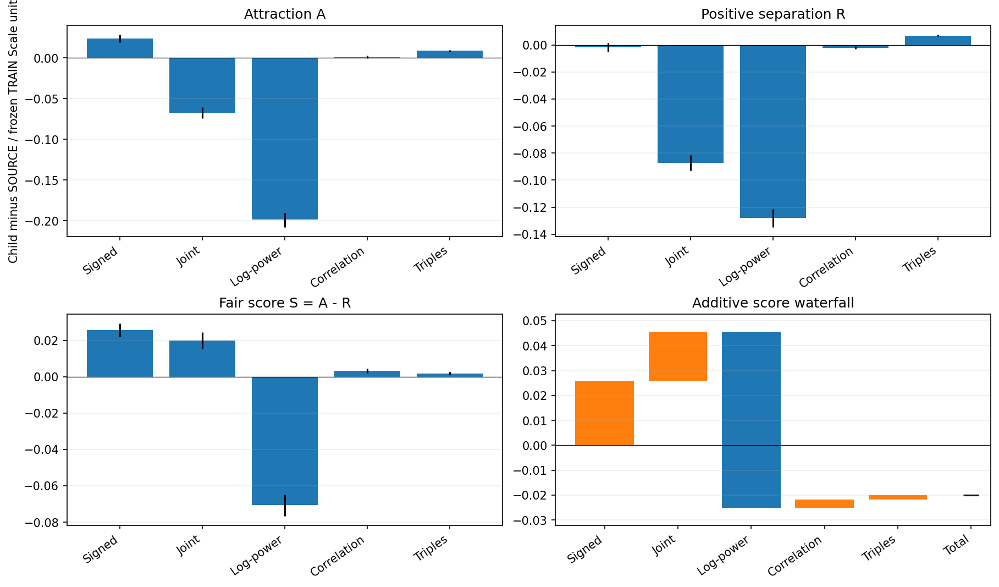

FFM_Round7_Composite_Scale_Control, epoch 100, train: all complete expanded Q4096 prefit Scale blocks; bars are weighted paired changes and whiskers are condition-bootstrap 95% intervals. Positive separation R is shown separately; score S = A - R. [PDF master](figures/scale_blocks_ffm_round7_composite_scale_control_epoch100_train.pdf)

## Figure scale blocks ffm round7 joint anchor scale epoch100 train

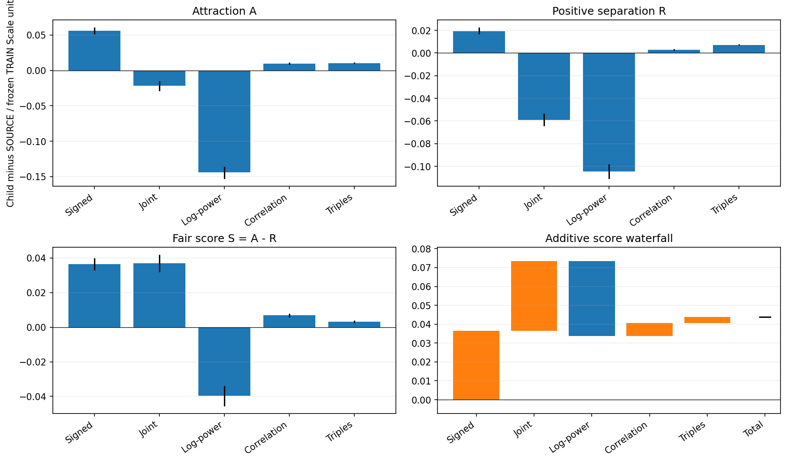

FFM_Round7_Joint_Anchor_Scale, epoch 100, train: all complete expanded Q4096 prefit Scale blocks; bars are weighted paired changes and whiskers are condition-bootstrap 95% intervals. Positive separation R is shown separately; score S = A - R. [PDF master](figures/scale_blocks_ffm_round7_joint_anchor_scale_epoch100_train.pdf)

## Figure scale blocks ffm round7 composite scale control epoch100 validation

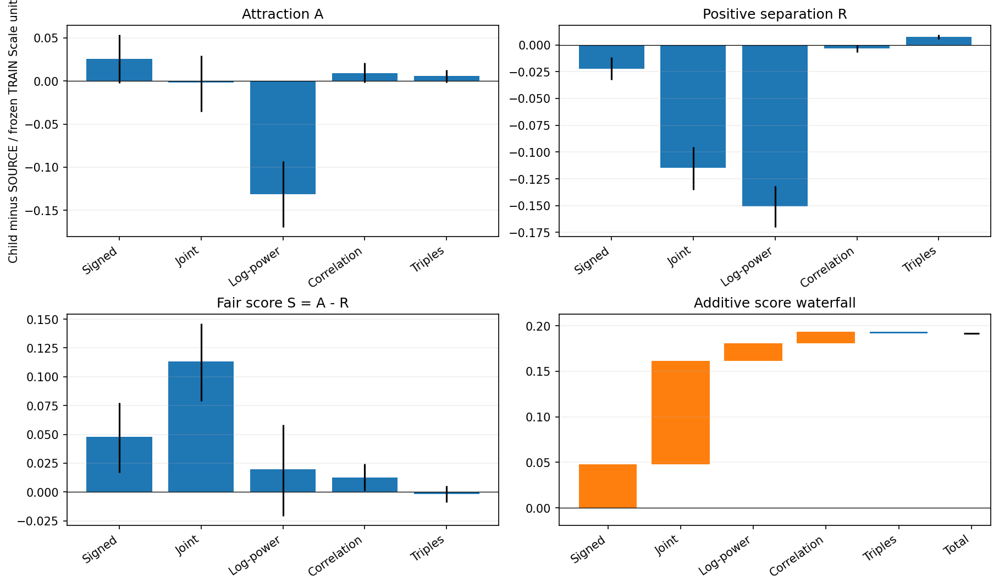

FFM_Round7_Composite_Scale_Control, epoch 100, validation: all complete expanded Q4096 prefit Scale blocks; bars are weighted paired changes and whiskers are condition-bootstrap 95% intervals. Positive separation R is shown separately; score S = A - R. [PDF master](figures/scale_blocks_ffm_round7_composite_scale_control_epoch100_validation.pdf)

## Figure scale blocks ffm round7 joint anchor scale epoch100 validation

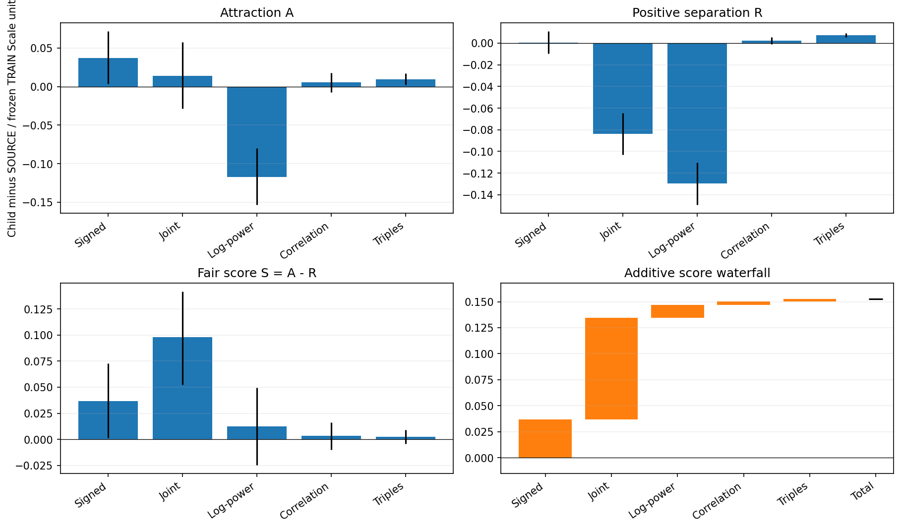

FFM_Round7_Joint_Anchor_Scale, epoch 100, validation: all complete expanded Q4096 prefit Scale blocks; bars are weighted paired changes and whiskers are condition-bootstrap 95% intervals. Positive separation R is shown separately; score S = A - R. [PDF master](figures/scale_blocks_ffm_round7_joint_anchor_scale_epoch100_validation.pdf)

## Figure scale blocks ffm round7 joint anchor scale epoch500 train

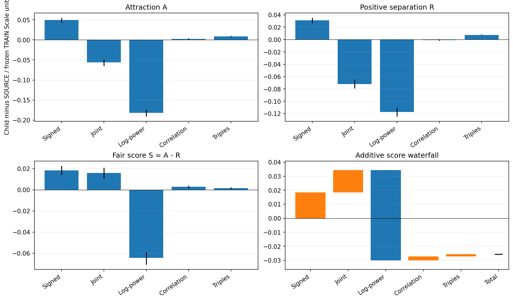

FFM_Round7_Joint_Anchor_Scale, epoch 500, train: all complete expanded Q4096 prefit Scale blocks; bars are weighted paired changes and whiskers are condition-bootstrap 95% intervals. Positive separation R is shown separately; score S = A - R. [PDF master](figures/scale_blocks_ffm_round7_joint_anchor_scale_epoch500_train.pdf)

## Figure scale blocks ffm round7 joint anchor scale epoch500 validation

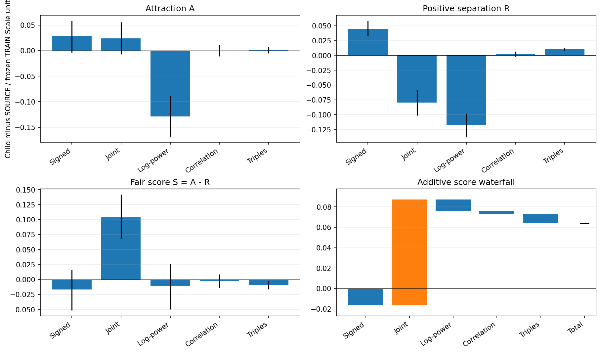

FFM_Round7_Joint_Anchor_Scale, epoch 500, validation: all complete expanded Q4096 prefit Scale blocks; bars are weighted paired changes and whiskers are condition-bootstrap 95% intervals. Positive separation R is shown separately; score S = A - R. [PDF master](figures/scale_blocks_ffm_round7_joint_anchor_scale_epoch500_validation.pdf)

## Figure scale split trajectories

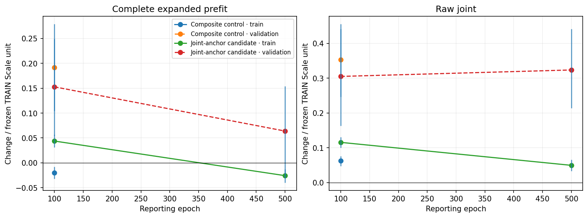

Declared checkpoint effects on TRAIN800 and reused development VALIDATION100. Whiskers are paired condition-bootstrap 95% intervals; lower scores favor the child. Intermediate points are not implied. [PDF master](figures/scale_split_trajectories.pdf)

## Figure scale localization ffm round7 composite scale control epoch100 train fields

Composite control, epoch 100, train: localized Scale views. Values are raw block changes divided by the frozen TRAIN Scale unit, before prefit block weights; color scales are specific to each panel. Joint and log-power allocations partition a vector norm and are descriptive, not independently proper scores. Band wavelengths use the original unspecified coordinate units; CO labels are bold. The joint and log-power allocations and weighted triple leaves sum to their reported blocks. [PDF master](figures/scale_localization_ffm_round7_composite_scale_control_epoch100_train_fields.pdf)

## Figure scale localization ffm round7 composite scale control epoch100 train pairs

Composite control, epoch 100, train: localized Scale views. Values are raw block changes divided by the frozen TRAIN Scale unit, before prefit block weights; color scales are specific to each panel. Joint and log-power allocations partition a vector norm and are descriptive, not independently proper scores. Band wavelengths use the original unspecified coordinate units; CO labels are bold. The joint and log-power allocations and weighted triple leaves sum to their reported blocks. [PDF master](figures/scale_localization_ffm_round7_composite_scale_control_epoch100_train_pairs.pdf)

## Figure scale localization ffm round7 joint anchor scale epoch100 train fields

Joint-anchor candidate, epoch 100, train: localized Scale views. Values are raw block changes divided by the frozen TRAIN Scale unit, before prefit block weights; color scales are specific to each panel. Joint and log-power allocations partition a vector norm and are descriptive, not independently proper scores. Band wavelengths use the original unspecified coordinate units; CO labels are bold. The joint and log-power allocations and weighted triple leaves sum to their reported blocks. [PDF master](figures/scale_localization_ffm_round7_joint_anchor_scale_epoch100_train_fields.pdf)

## Figure scale localization ffm round7 joint anchor scale epoch100 train pairs

Joint-anchor candidate, epoch 100, train: localized Scale views. Values are raw block changes divided by the frozen TRAIN Scale unit, before prefit block weights; color scales are specific to each panel. Joint and log-power allocations partition a vector norm and are descriptive, not independently proper scores. Band wavelengths use the original unspecified coordinate units; CO labels are bold. The joint and log-power allocations and weighted triple leaves sum to their reported blocks. [PDF master](figures/scale_localization_ffm_round7_joint_anchor_scale_epoch100_train_pairs.pdf)

## Figure scale localization ffm round7 composite scale control epoch100 validation fields

Composite control, epoch 100, validation: localized Scale views. Values are raw block changes divided by the frozen TRAIN Scale unit, before prefit block weights; color scales are specific to each panel. Joint and log-power allocations partition a vector norm and are descriptive, not independently proper scores. Band wavelengths use the original unspecified coordinate units; CO labels are bold. The joint and log-power allocations and weighted triple leaves sum to their reported blocks. [PDF master](figures/scale_localization_ffm_round7_composite_scale_control_epoch100_validation_fields.pdf)

## Figure scale localization ffm round7 composite scale control epoch100 validation pairs

Composite control, epoch 100, validation: localized Scale views. Values are raw block changes divided by the frozen TRAIN Scale unit, before prefit block weights; color scales are specific to each panel. Joint and log-power allocations partition a vector norm and are descriptive, not independently proper scores. Band wavelengths use the original unspecified coordinate units; CO labels are bold. The joint and log-power allocations and weighted triple leaves sum to their reported blocks. [PDF master](figures/scale_localization_ffm_round7_composite_scale_control_epoch100_validation_pairs.pdf)

## Figure scale localization ffm round7 joint anchor scale epoch100 validation fields

Joint-anchor candidate, epoch 100, validation: localized Scale views. Values are raw block changes divided by the frozen TRAIN Scale unit, before prefit block weights; color scales are specific to each panel. Joint and log-power allocations partition a vector norm and are descriptive, not independently proper scores. Band wavelengths use the original unspecified coordinate units; CO labels are bold. The joint and log-power allocations and weighted triple leaves sum to their reported blocks. [PDF master](figures/scale_localization_ffm_round7_joint_anchor_scale_epoch100_validation_fields.pdf)

## Figure scale localization ffm round7 joint anchor scale epoch100 validation pairs

Joint-anchor candidate, epoch 100, validation: localized Scale views. Values are raw block changes divided by the frozen TRAIN Scale unit, before prefit block weights; color scales are specific to each panel. Joint and log-power allocations partition a vector norm and are descriptive, not independently proper scores. Band wavelengths use the original unspecified coordinate units; CO labels are bold. The joint and log-power allocations and weighted triple leaves sum to their reported blocks. [PDF master](figures/scale_localization_ffm_round7_joint_anchor_scale_epoch100_validation_pairs.pdf)

## Figure scale localization ffm round7 joint anchor scale epoch500 train fields

Joint-anchor candidate, epoch 500, train: localized Scale views. Values are raw block changes divided by the frozen TRAIN Scale unit, before prefit block weights; color scales are specific to each panel. Joint and log-power allocations partition a vector norm and are descriptive, not independently proper scores. Band wavelengths use the original unspecified coordinate units; CO labels are bold. The joint and log-power allocations and weighted triple leaves sum to their reported blocks. [PDF master](figures/scale_localization_ffm_round7_joint_anchor_scale_epoch500_train_fields.pdf)

## Figure scale localization ffm round7 joint anchor scale epoch500 train pairs

Joint-anchor candidate, epoch 500, train: localized Scale views. Values are raw block changes divided by the frozen TRAIN Scale unit, before prefit block weights; color scales are specific to each panel. Joint and log-power allocations partition a vector norm and are descriptive, not independently proper scores. Band wavelengths use the original unspecified coordinate units; CO labels are bold. The joint and log-power allocations and weighted triple leaves sum to their reported blocks. [PDF master](figures/scale_localization_ffm_round7_joint_anchor_scale_epoch500_train_pairs.pdf)

## Figure scale localization ffm round7 joint anchor scale epoch500 validation fields

Joint-anchor candidate, epoch 500, validation: localized Scale views. Values are raw block changes divided by the frozen TRAIN Scale unit, before prefit block weights; color scales are specific to each panel. Joint and log-power allocations partition a vector norm and are descriptive, not independently proper scores. Band wavelengths use the original unspecified coordinate units; CO labels are bold. The joint and log-power allocations and weighted triple leaves sum to their reported blocks. [PDF master](figures/scale_localization_ffm_round7_joint_anchor_scale_epoch500_validation_fields.pdf)

## Figure scale localization ffm round7 joint anchor scale epoch500 validation pairs

Joint-anchor candidate, epoch 500, validation: localized Scale views. Values are raw block changes divided by the frozen TRAIN Scale unit, before prefit block weights; color scales are specific to each panel. Joint and log-power allocations partition a vector norm and are descriptive, not independently proper scores. Band wavelengths use the original unspecified coordinate units; CO labels are bold. The joint and log-power allocations and weighted triple leaves sum to their reported blocks. [PDF master](figures/scale_localization_ffm_round7_joint_anchor_scale_epoch500_validation_pairs.pdf)

## Figure shape components ffm round7 composite scale control epoch100 train

Composite control, epoch 100, train: complete Shape self and mutual contributions with finite and essential attraction and positive separation. Bars are paired child-minus-SOURCE changes in the frozen TRAIN Shape unit; available paired 95% condition-bootstrap intervals are shown. Primitive finite/essential score intervals and total A/R intervals are not inferred from separate interval endpoints; all terms sum to the frozen Shape score. [PDF master](figures/shape_components_ffm_round7_composite_scale_control_epoch100_train.pdf)

## Figure shape components ffm round7 joint anchor scale epoch100 train

Joint-anchor candidate, epoch 100, train: complete Shape self and mutual contributions with finite and essential attraction and positive separation. Bars are paired child-minus-SOURCE changes in the frozen TRAIN Shape unit; available paired 95% condition-bootstrap intervals are shown. Primitive finite/essential score intervals and total A/R intervals are not inferred from separate interval endpoints; all terms sum to the frozen Shape score. [PDF master](figures/shape_components_ffm_round7_joint_anchor_scale_epoch100_train.pdf)

## Figure shape components ffm round7 composite scale control epoch100 validation

Composite control, epoch 100, validation: complete Shape self and mutual contributions with finite and essential attraction and positive separation. Bars are paired child-minus-SOURCE changes in the frozen TRAIN Shape unit; available paired 95% condition-bootstrap intervals are shown. Primitive finite/essential score intervals and total A/R intervals are not inferred from separate interval endpoints; all terms sum to the frozen Shape score. [PDF master](figures/shape_components_ffm_round7_composite_scale_control_epoch100_validation.pdf)

## Figure shape components ffm round7 joint anchor scale epoch100 validation

Joint-anchor candidate, epoch 100, validation: complete Shape self and mutual contributions with finite and essential attraction and positive separation. Bars are paired child-minus-SOURCE changes in the frozen TRAIN Shape unit; available paired 95% condition-bootstrap intervals are shown. Primitive finite/essential score intervals and total A/R intervals are not inferred from separate interval endpoints; all terms sum to the frozen Shape score. [PDF master](figures/shape_components_ffm_round7_joint_anchor_scale_epoch100_validation.pdf)

## Figure shape components ffm round7 joint anchor scale epoch500 train

Joint-anchor candidate, epoch 500, train: complete Shape self and mutual contributions with finite and essential attraction and positive separation. Bars are paired child-minus-SOURCE changes in the frozen TRAIN Shape unit; available paired 95% condition-bootstrap intervals are shown. Primitive finite/essential score intervals and total A/R intervals are not inferred from separate interval endpoints; all terms sum to the frozen Shape score. [PDF master](figures/shape_components_ffm_round7_joint_anchor_scale_epoch500_train.pdf)

## Figure shape components ffm round7 joint anchor scale epoch500 validation

Joint-anchor candidate, epoch 500, validation: complete Shape self and mutual contributions with finite and essential attraction and positive separation. Bars are paired child-minus-SOURCE changes in the frozen TRAIN Shape unit; available paired 95% condition-bootstrap intervals are shown. Primitive finite/essential score intervals and total A/R intervals are not inferred from separate interval endpoints; all terms sum to the frozen Shape score. [PDF master](figures/shape_components_ffm_round7_joint_anchor_scale_epoch500_validation.pdf)

## Figure native field safeguards

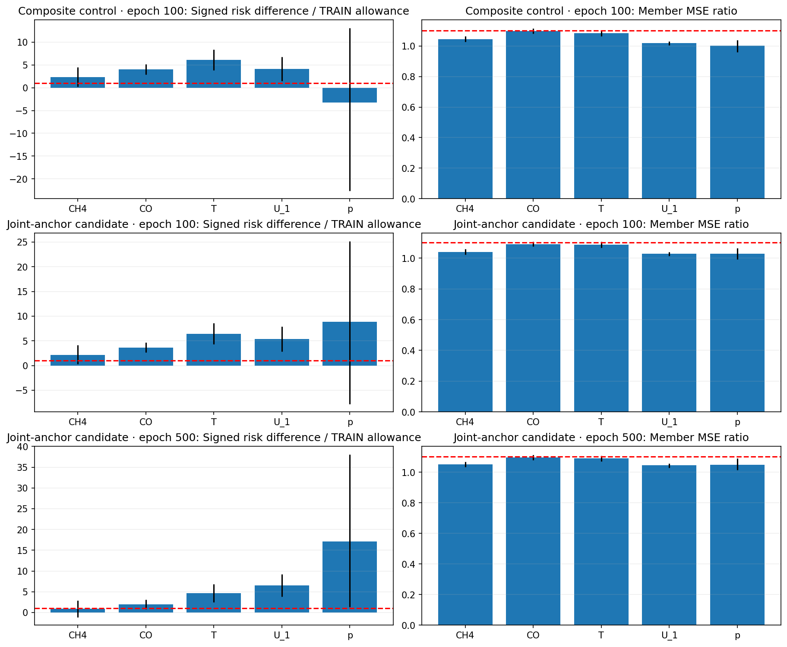

Native physical field signed-risk allowance ratios and member MSE ratios on development VALIDATION100. Whiskers are paired condition-bootstrap 95% intervals; dashed lines show the frozen allowances and 1.10 member threshold. [PDF master](figures/native_field_safeguards.pdf)

## Figure training ffm round7 composite scale control

FFM_Round7_Composite_Scale_Control: complete recorded training history through epoch 100. The family losses are sampled training signals, the field feedback and actual displacement products are separate diagnostics, and no scalar ConFIG objective is implied. [PDF master](figures/training_ffm_round7_composite_scale_control.pdf)

## Figure training components ffm round7 composite scale control 1

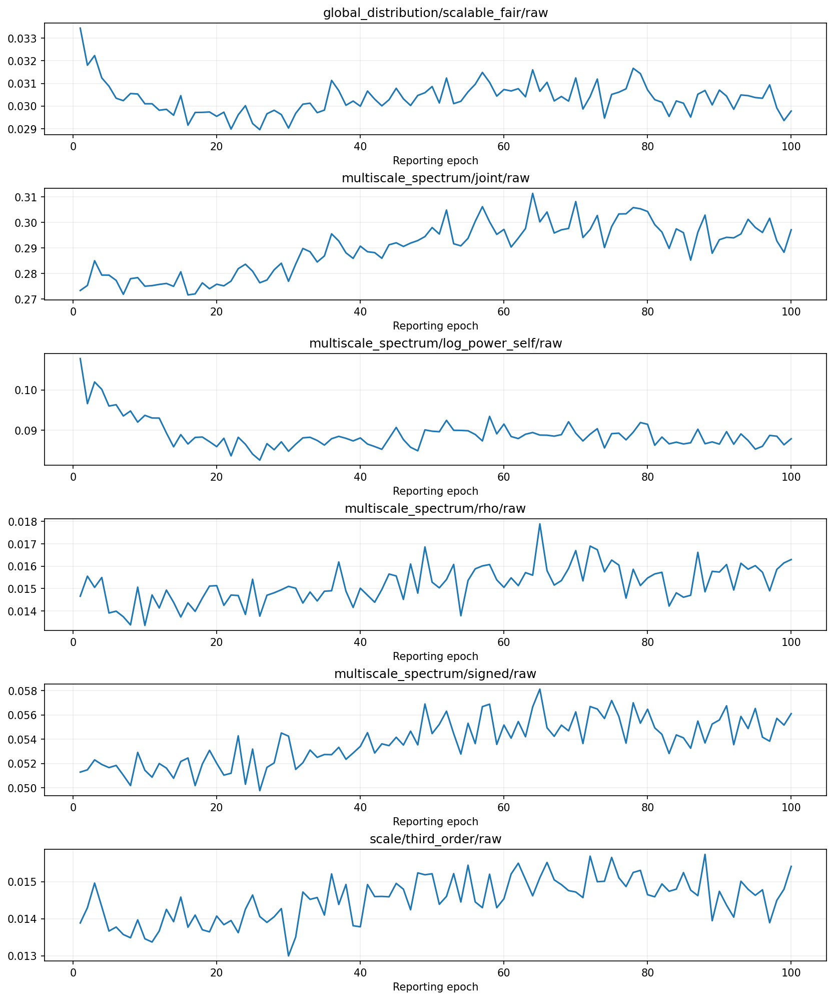

FFM_Round7_Composite_Scale_Control: sampled training component histories through epoch 100. These are optimization diagnostics, not complete panel assessments. [PDF master](figures/training_components_ffm_round7_composite_scale_control_1.pdf)

## Figure training components ffm round7 composite scale control 2

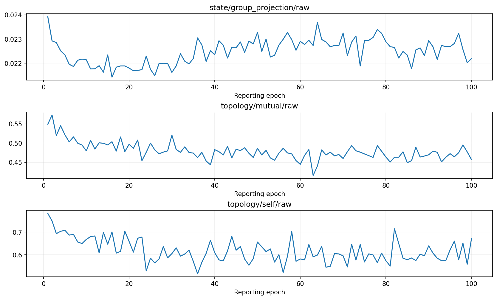

FFM_Round7_Composite_Scale_Control: sampled training component histories through epoch 100. These are optimization diagnostics, not complete panel assessments. [PDF master](figures/training_components_ffm_round7_composite_scale_control_2.pdf)

## Figure training ffm round7 joint anchor scale

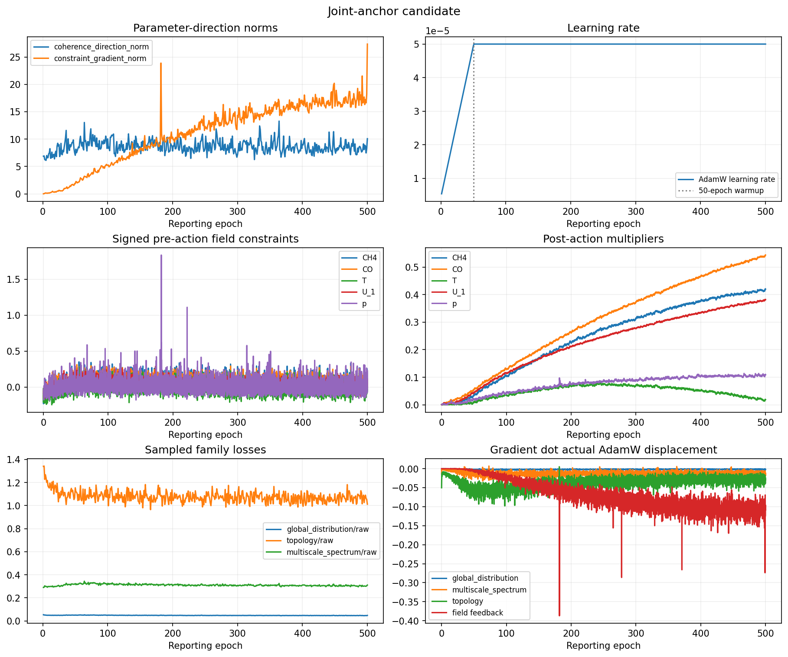

FFM_Round7_Joint_Anchor_Scale: complete recorded training history through epoch 500. The family losses are sampled training signals, the field feedback and actual displacement products are separate diagnostics, and no scalar ConFIG objective is implied. [PDF master](figures/training_ffm_round7_joint_anchor_scale.pdf)

## Figure training components ffm round7 joint anchor scale 1

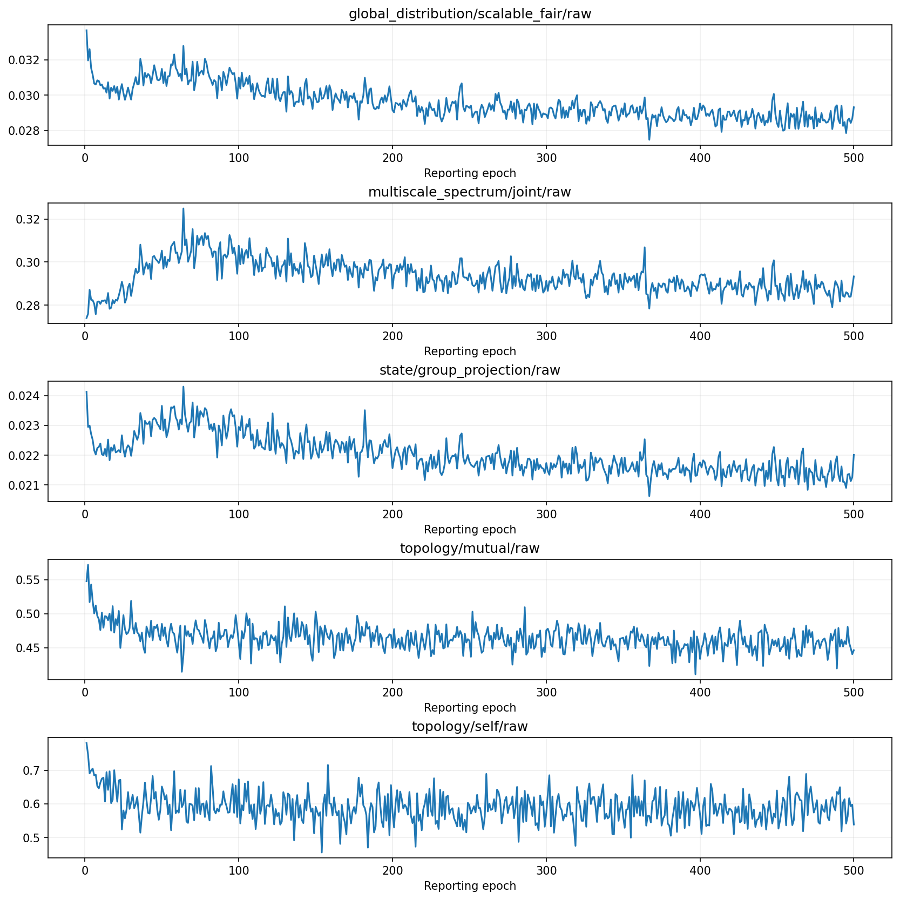

FFM_Round7_Joint_Anchor_Scale: sampled training component histories through epoch 500. These are optimization diagnostics, not complete panel assessments. [PDF master](figures/training_components_ffm_round7_joint_anchor_scale_1.pdf)

## Figure executor time memory breakdown

Measured executor epoch wall times and allocated/reserved GPU memory on NVIDIA RTX 6000 Ada Generation; scope measurements are shown separately and may overlap, so they must not be added as exclusive costs. Measurements use the referenced full-epoch and trace evidence. [PDF master](figures/executor_time_memory_breakdown.pdf)

## Figure same state action audit

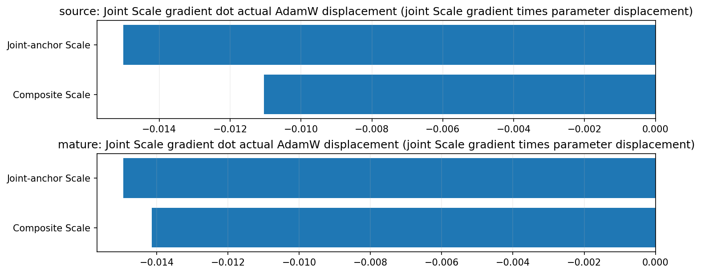

Independently reset same-state composite and joint-anchored action measurements from the bound TRAIN action audit. Each panel uses the recorded units and checkpoint; these local actions do not establish learning or transfer. [PDF master](figures/same_state_action_audit.pdf)

## Figure field example 1 part 1

Fixed panel case 1, trajectory_000000:8000, fields CH4, CO: reference, SOURCE and repair use shared physical color limits. Residual badges show mass-weighted ensemble-mean RMSE on the displayed native positive-mass mask, in the declared field units; units marked unknown are unchanged from the data. [PDF master](figures/field_example_1_part_1.pdf)

## Figure field example 1 part 2

Fixed panel case 1, trajectory_000000:8000, fields T, U_1: reference, SOURCE and repair use shared physical color limits. Residual badges show mass-weighted ensemble-mean RMSE on the displayed native positive-mass mask, in the declared field units; units marked unknown are unchanged from the data. [PDF master](figures/field_example_1_part_2.pdf)

## Figure field example 1 part 3

Fixed panel case 1, trajectory_000000:8000, fields p: reference, SOURCE and repair use shared physical color limits. Residual badges show mass-weighted ensemble-mean RMSE on the displayed native positive-mass mask, in the declared field units; units marked unknown are unchanged from the data. [PDF master](figures/field_example_1_part_3.pdf)

## Figure field example 2 part 1

Fixed panel case 2, trajectory_000000:8001, fields CH4, CO: reference, SOURCE and repair use shared physical color limits. Residual badges show mass-weighted ensemble-mean RMSE on the displayed native positive-mass mask, in the declared field units; units marked unknown are unchanged from the data. [PDF master](figures/field_example_2_part_1.pdf)

## Figure field example 2 part 2

Fixed panel case 2, trajectory_000000:8001, fields T, U_1: reference, SOURCE and repair use shared physical color limits. Residual badges show mass-weighted ensemble-mean RMSE on the displayed native positive-mass mask, in the declared field units; units marked unknown are unchanged from the data. [PDF master](figures/field_example_2_part_2.pdf)

## Figure field example 2 part 3

Fixed panel case 2, trajectory_000000:8001, fields p: reference, SOURCE and repair use shared physical color limits. Residual badges show mass-weighted ensemble-mean RMSE on the displayed native positive-mass mask, in the declared field units; units marked unknown are unchanged from the data. [PDF master](figures/field_example_2_part_3.pdf)

## Figure field example 3 part 1

Representative worst, trajectory_000000:8013, fields CH4, CO: reference, SOURCE and repair use shared physical color limits. Residual badges show mass-weighted ensemble-mean RMSE on the displayed native positive-mass mask, in the declared field units; units marked unknown are unchanged from the data. [PDF master](figures/field_example_3_part_1.pdf)

## Figure field example 3 part 2

Representative worst, trajectory_000000:8013, fields T, U_1: reference, SOURCE and repair use shared physical color limits. Residual badges show mass-weighted ensemble-mean RMSE on the displayed native positive-mass mask, in the declared field units; units marked unknown are unchanged from the data. [PDF master](figures/field_example_3_part_2.pdf)

## Figure field example 3 part 3

Representative worst, trajectory_000000:8013, fields p: reference, SOURCE and repair use shared physical color limits. Residual badges show mass-weighted ensemble-mean RMSE on the displayed native positive-mass mask, in the declared field units; units marked unknown are unchanged from the data. [PDF master](figures/field_example_3_part_3.pdf)

## Figure regional and event

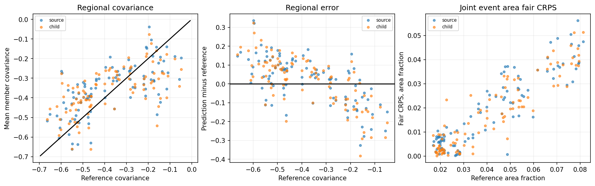

Frozen CO–U_1 regional covariance and the joint event task on the reused development validation panel. The covariance is normalized by TRAIN-truth scales; event values use the frozen area fair score. [PDF master](figures/regional_and_event.pdf)
