# Coherence Adaptive Repair Round 8: member fidelity and spatial Shape

## Round 8 decisions

Retain the optimized execution package and SOURCE/C8. Close MemberMSE_BaseShape and MemberMSE_SpatialShape at 100 reporting epochs each; select no extension or corrective training phase. Adopt the explicit member-MSE/J1/JN and spatial-support interfaces as qualified opt-in engineering, and retain positional Shape as an optional observer. Do not adopt the positional Shape package as a training default or replace the operational model with either new child.

The current-objective balanced executor check confirms retained acceleration: complete first-epoch wall time was 137.210 seconds with separate VJPs and 83.499 seconds with factored VJPs, a 39.15% reduction. Mean whole-worker peak allocation increased from 17.834 to 36.995 GiB; reserved memory was unavailable in this probe. All workers used the same actual device, SOURCE scientific state, reference, J2/B64 and twelve coupled actions, in separate/factored/factored/separate order. Field feedback was active in 75% of actions. This warmup measurement supports retention and does not establish a further speed gain over Round 7's separate mature-state 39.97% result. Cross-executor trajectories have small finite differences and are not claimed bitwise equal.

For the substantive runs, mature epochs 51–100 averaged 82.108 seconds for BaseShape and 82.681 seconds for SpatialShape. The measured package overhead was 0.70%, with allocated peaks 37.035 and 37.074 GiB. These changed-objective timings are kept separate from the historical executor comparison. Shared activation checkpointing, factored family VJPs, cached static context, fresh three-row parameter-space ConFIG, weighted fidelity feedback, clipping, AdamW, PI and saved recording semantics are retained. No additional gradient-execution optimization was justified by the available profile.

## Scientific learning decision

Both children pass all five prospective native member-MSE point allowances, and their paired field-margin 95% intervals stay below zero. The saved observed-temperature checks have 256 observations per condition, zero SOURCE/child sensor MSE and the declared absolute allowance. The member-MSE/SOURCE ratios are 1.0267/1.0766/1.0668/1.0235/0.9874 for BaseShape and 1.0311/1.0755/1.0561/1.0268/1.0029 for SpatialShape, in CH4/CO/T/U_1/p order. Passing these new limits does not revise Round 7's four-of-five historical signed-risk failures.

Complete expanded fair Scale S=A−R worsened by 5.3975% for BaseShape and 5.4722% for SpatialShape relative to SOURCE. The paired changes were +0.118872 [0.094281, 0.141928] and +0.120517 [0.095283, 0.144756]. Direct discrepancy A decreased, but separation R decreased more; every raw Scale block had a worse fair point score. PH Shape improved by 10.6359% and 10.1852%, while State and half(PH + normalized location) supplied no clear SOURCE-relative gain. These separate effects do not establish overall field or coherence improvement.

SpatialShape minus BaseShape location S was +0.065231 [−0.122234, +0.241834], and its SOURCE-relative location change was +0.257641 [+0.016673, +0.480479]. Native-to-raster location also supplied no clear improvement. The comparison attributes the complete declared Shape package, including its changed PH weight, rather than isolating the position feature alone. It supplies no matched positional advantage that compensates for the Scale loss.

The two arms each made 1,200 accepted actions and 76,800 objective-bearing condition visits, or 9.6 TRAIN8000 pass equivalents. All eight recorded coupling identities match across every action. They started from the same SOURCE under the common complete expanded Scale, observations, prefit, member law, optimizer, PI, warmup and query/complement streams. This is a matched Shape-package comparison under member-MSE feedback; it does not isolate changing the risk policy from the historical signed recipe.

## Diagnosis and stopping rationale

The complete action journals do not show a widespread destruction of coherence descent by field composition: fresh, composed and clipped State/Scale/Shape products have the favorable local sign at all 1,200 actions in each child, and actual AdamW displacements have the favorable first-order sign in at least 1,199/1,200 actions for each family. These are local diagnostics, not guarantees about the next finite endpoint score. Late sampled Scale histories plateau or rebound. CO and velocity feedback pressure emerges, but there is no demonstrated feature saturation, broken gradient path or action-composition failure for a narrow corrective knob to repair.

Both adequate epoch-100 reviews therefore close without a 500-epoch extension. Remaining budget alone does not supply an extension question. The sealed reason (`operations/Matched100_Decision_Reason_v1.md`) and complete training diagnosis (`assessment/Matched100_Training_Diagnosis_v1/section.md`) retain the windowed violations, multipliers and action counts. Complete combined-Shape histories are available; separate PH and location epoch series were not recorded, so their learning curves cannot be decomposed retrospectively. Their endpoint observer results are reported separately.

## Reserved task utility

Event and regional task readouts were released only after the no-continuation decision was sealed, using the saved native J4 predictions on the same VALIDATION100 panel. In frozen TRAIN task units, BaseShape minus SOURCE event score was +0.145192 [+0.005837, +0.281488], while SpatialShape minus SOURCE was −0.078088 [−0.213772, +0.065956]. The corresponding regional changes were +0.006141 [−0.010915, +0.023361] and +0.016926 [−0.002085, +0.035082]. These are normalized changes, not percentages of pooled VALIDATION scores.

The direct matched package contrast does show an event improvement: SpatialShape minus BaseShape is −0.223280 [−0.293732, −0.150100]. Its regional contrast is +0.010786 [−0.006729, +0.028356]. This event gain over the weaker child is retained as a result, but SOURCE-relative event utility remains unresolved and it does not offset the Scale deterioration. The operational decision remains SOURCE/C8. The cached task companion (`assessment/Matched100_Task_Package_Companion_v1/section.md`) preserves both arrays and the paired calculation; no extra model inference or task-based tuning occurred.

## Engineering scope and evidence boundaries

The generic expected-member-MSE path keeps absolute epsilon/delta allowance and denominator floor roles explicit, uses genuine deterministic J1 predictions, and permits signed correction only with independent J>=2. Linear field quadrature and the nonlinear SSS query law are separate contracts. Compatible SOURCE transforms and each generated native/selected bank are reused for field, coherence, task and figure readouts. Position-disabled PH values/gradients remain qualified. No teacher, native-field training supervision or scalar ConFIG objective is introduced.

Real fresh-process save/reload/resume/append comparisons passed for FFM J2/B64, position-enabled J2/B64, FFM J3/B32 with chunk-one VJP, and strict Senseiver J1/B8 during online unit-coefficient calibration. Position-enabled J3 has a finite B2 actual-action diagnostic, rather than full recovery or B64 capacity evidence. The J1 horizon-guard and non-strict numerical failures were diagnosed and retained; strict pre-CUDA determinism resolved the observed recovery discrepancy at the original tolerance. Ordered recording definitions, histories, first/every-ten-epoch/final curves and immutable SOURCE state are retained. The current-source final-report guards passed; overlapping earlier suites are reported separately rather than added into one test count.

All model evaluations use the declared matched approximately-10% panels: TRAIN800 where needed for fitting/reassessment, and VALIDATION100 for development assessment. Full native support means all 40,300 physical nodes within each selected frame, not full-population sample evaluation. TEST remains locked. Frame-bootstrap intervals use one correlated trajectory and one training seed; repeated validation development does not provide independent confirmation. No uncertainty-calibration, unseen-system, PDE/flux, deployment or causal risk-policy claim follows. Dataset units are retained where named physical units are unavailable, and all reconstruction panels state masked relative L2 or RMSE with their declared units.

## Historical cached reassessment

The historical reassessment uses the sealed Round 7 Joint100 and nominated raw Joint500 endpoints on cached matched SOURCE panels. Joint500 is a continuation endpoint with greater exposure than the separate Composite100 arm. This cached analysis adds no model inference, training, TEST access or full-population assessment. Round 8 engineering and the matched learning evidence are reported separately below.

The held-out development panel contains 100 ordered frames and TRAIN contains 800 selected frames, both from one trajectory. All uncertainty intervals are paired frame bootstraps, not independent trajectory-transfer evidence. VALIDATION contributed to development and is not independent confirmation. Field and coordinate units in the frozen metadata are unspecified dataset units.

The SOURCE checkpoint SHA256 is `2d1da713538f6e9613560f3a7eb4a9df2a95d1ad1f56dd11a1a8a4f9ef65050c`; the nominated Joint500 checkpoint SHA256 is `5f55028b99f83434ef9b60279e1a0e975439cec9337e19ff923ee97d797dd033`. Native assessment uses all 40,300 positive-mass sites, the fixed 256 temperature observations and J4 independent member streams. State/Scale/Shape use the separately reconstructed, fixed Q4096 support and the same matched condition/member identities.

## Field accuracy and the two contracts

Native physical-area member MSE is averaged over J4 independent members and then equally over conditions. The prospective member margin is child MSE − 1.10 × the same-split SOURCE MSE, in dataset units squared; point passes are descriptive and intervals spanning zero do not certify population noninferiority. The old signed verdict uses the separate frozen TRAIN-law absolute signed-risk allowance and is not changed retroactively.

| Field | SOURCE MSE | Joint500 MSE | Ratio [95% CI] | Member margin [95% CI] | Old signed verdict |
| --- | ---: | ---: | ---: | ---: | --- |
| CH4 | 8.5883e-05 | 9.0212e-05 | 1.0504 [1.0328, 1.0676] | -4.2584e-06 [-5.8116e-06, -2.7707e-06] | pass |
| CO | 4.2179e-05 | 4.6248e-05 | 1.0965 [1.0795, 1.1132] | -1.4836e-07 [-8.7205e-07, 5.5689e-07] | fail |
| T | 74409 | 81050 | 1.0893 [1.0702, 1.1078] | -799.86 [-2241.2, 586.6] | fail |
| U_1 | 1183.3 | 1235.1 | 1.0438 [1.0295, 1.0577] | -66.455 [-84.167, -48.814] | fail |
| p | 3.1801e+07 | 3.3341e+07 | 1.0484 [1.0147, 1.089] | -1.6401e+06 [-2.6626e+06, -3.6821e+05] | fail |

Mean-output risk and unbiased member spread are distinct quantities. Member MSE equals finite-J mean-output MSE plus 3/4 of unbiased member variance; the historical signed estimator equals mean-output MSE minus one quarter of that variance.

| Field | SOURCE mean MSE | Joint500 mean MSE | SOURCE spread | Joint500 spread | Old signed Δ / allowance |
| --- | ---: | ---: | ---: | ---: | ---: |
| CH4 | 8.2485e-05 | 8.4079e-05 | 4.53e-06 | 8.1782e-06 | 0.91237 |
| CO | 3.9719e-05 | 4.1641e-05 | 3.2793e-06 | 6.1426e-06 | 2.0065 |
| T | 71911 | 75891 | 3330.6 | 6878 | 4.7024 |
| U_1 | 1158.6 | 1200.9 | 32.83 | 45.608 | 6.572 |
| p | 3.1637e+07 | 3.291e+07 | 2.1889e+05 | 5.7515e+05 | 17.083 |

Joint500 satisfies the prospective point limit in 5 of 5 VALIDATION fields; the intervals crossing 1.10 are CO, T. The old signed criterion fails 4 fields, while the recorded sensor safeguard passes. These are different scientific contracts, and neither point check is a posterior-calibration claim.

## Direct discrepancy, member separation and fair score

For each fixed feature distance, A is mean member-to-reference discrepancy, R is the positive unordered member-pair sum divided by J(J−1), and S = A − R. R is half the mean unordered-pair distance. A, R and S answer different questions; a lower A alone does not establish calibrated uncertainty.

| Family | SOURCE A / R / S | Joint500 A / R / S | Definition |
| --- | --- | --- | --- |
| State | 0.41663 / 0.056181 / 0.36045 | 0.41297 / 0.04786 / 0.36511 | Exact weighted-CDF norm |
| Scale | 2.6972 / 0.49482 / 2.2023 | 2.6774 / 0.45851 / 2.2189 | Complete expanded prefit |
| Shape | 3.6315 / 0.87443 / 2.7571 | 3.3604 / 1.0345 / 2.3259 | Existing PH, self + mutual |

The following paired changes and frame-bootstrap intervals use raw fixed-observer units; each family has its own scale.

| Family | ΔA [95% CI] | ΔR [95% CI] | ΔS [95% CI] |
| --- | ---: | ---: | ---: |
| State | -0.0036587 [-0.010801, 0.0042141] | -0.008321 [-0.010407, -0.0063932] | 0.0046623 [-0.0027028, 0.013011] |
| Scale | -0.01972 [-0.041468, 0.0017876] | -0.036311 [-0.049572, -0.023248] | 0.016591 [-0.0076825, 0.039901] |
| Shape | -0.27109 [-0.31645, -0.22668] | 0.16009 [0.14501, 0.17482] | -0.43118 [-0.47969, -0.38436] |

Raw joint Scale A / R / S is 2.9046 / 0.55674 / 2.3478 for SOURCE and 2.9241 / 0.49222 / 2.4318 for Joint500. For historical comparison only, the saved Published Scale and State paired score deltas are 0.046529 and 0.12937, respectively, each divided by its frozen TRAIN normalizer (0.25979 and 0.036038). These values are not percentages of pooled VALIDATION SOURCE scores. Complete expanded, Published and raw joint Scale are distinct definitions.

Each Scale row below is an unweighted represented-distance block. Its fixed multiplier is the saved prefit coefficient, including the existing 0.25 joint coefficient. Weighted changes sum to Complete Expanded Prefit Scale; raw block magnitudes have different units and are not additive without those multipliers. Intervals are paired frame bootstraps, not differences of separate interval endpoints.

| Scale block | SOURCE raw A / R / S | Joint500 raw A / R / S | Raw ΔS [95% CI] | Fixed multiplier | Weighted ΔS [95% CI] |
| --- | --- | --- | ---: | ---: | ---: |
| signed | 0.53228 / 0.08174 / 0.45054 | 0.53595 / 0.087564 / 0.44839 | -0.0021518 [-0.0066693, 0.0020418] | 2 | -0.0043035 [-0.013339, 0.0040836] |
| joint | 2.9046 / 0.55674 / 2.3478 | 2.9241 / 0.49222 / 2.4318 | 0.084029 [0.055545, 0.11461] | 0.32088 | 0.026963 [0.017823, 0.036776] |
| log_power_self | 1.0094 / 0.23158 / 0.77786 | 0.94251 / 0.1705 / 0.77201 | -0.0058456 [-0.025942, 0.013601] | 0.5 | -0.0029228 [-0.012971, 0.0068006] |
| rho | 0.16245 / 0.031654 / 0.1308 | 0.16226 / 0.03238 / 0.12988 | -0.00092228 [-0.0044771, 0.0027571] | 0.81908 | -0.00075542 [-0.0036671, 0.0022583] |
| third_order | 0.12565 / 0.021957 / 0.10369 | 0.12624 / 0.027328 / 0.09891 | -0.0047799 [-0.0085329, -0.0011309] | 0.5 | -0.0023899 [-0.0042665, -0.00056543] |

The joint block contributes 0.026963 to the complete Scale score change; the other four blocks together contribute -0.010372, giving 0.016591 overall. In raw joint units, ΔA is 0.019515 [-0.0056293, 0.045073] and ΔR is -0.064513 [-0.082319, -0.04723]. Since S = A − R, the reduced joint separation contributes to the worse joint fair score. This is a decomposition of the saved score, not a calibration claim.

The four PH leaves below retain their frozen query and component weights and sum to the PH Shape total; they are distinct from the optional location observation.

| PH Shape component | SOURCE A / R / S | Joint500 A / R / S | ΔS [95% CI] |
| --- | --- | --- | ---: |
| self.finite | 1.8229 / 0.46437 / 1.3586 | 1.6543 / 0.54711 / 1.1072 | -0.25139 [-0.28306, -0.22041] |
| self.essential | 0.09951 / 0.016226 / 0.083284 | 0.086764 / 0.01167 / 0.075094 | -0.00819 [-0.012164, -0.0039536] |
| mutual.finite | 1.544 / 0.36901 / 1.175 | 1.4715 / 0.44733 / 1.0242 | -0.15081 [-0.16772, -0.13386] |
| mutual.essential | 0.16504 / 0.024822 / 0.14022 | 0.14783 / 0.0284 / 0.11943 | -0.020782 [-0.026991, -0.014722] |

The complete fixed pair/band mean absolute rho error is 0.16245 for SOURCE and 0.16226 for Joint500. Averaged over fields, bands and conditions, the fractions of power at or below the frozen floor are 0 for references, 0 for SOURCE members and 0 for Joint500 members. The floor and band definitions are the frozen Scale definitions, not tuning choices.

The signed-rho panels show member-minus-reference error on the fixed Q4096 spectral basis; the absolute-rho panel displays the change in direct magnitude error. Log-power panels show mean member error in log1p(power/floor). The floor-coverage panel prevents a normalized rho from being read without its amplitude context. These are selected-band within-snapshot relationships, not posterior covariance or full-native spectra.

## Spatial support and error structure

The field-risk plot decomposes each native MSE into the fixed Q4096 contribution and its exact native complement using native total area. The C512 estimator samples the complement uniformly and is a sampling diagnostic of saved native fields. A fixed-only self-normalized MSE is a different quantity. The same-grid raster comparison applies either native physical-cell overlap or sparse inverse-distance reconstruction followed by overlap to both prediction and reference; separately queried endpoints are also displayed. Slicing a native prediction need not reproduce another model's separately queried endpoint.

The selected support's outside-convex-hull native area is 0.14% of native area. The compared support/raster definitions change numerical errors; the SOURCE–Joint500 member-MSE ordering is the same for all five fields on this panel. This finite comparison does not establish an unbiased nonlinear Shape score or a general query-invariance theorem.

SOURCE risk differs strongly between panels: the figure reports condition-level 10th–90th percentile ranges, medians and pooled means relative to each field's TRAIN SOURCE mean. This describes the saved panel gap rather than its cause.

| Field | TRAIN SOURCE member MSE | VALIDATION SOURCE member MSE | VALIDATION / TRAIN |
| --- | ---: | ---: | ---: |
| CH4 | 7.7238e-06 | 8.5883e-05 | 11.119 |
| CO | 6.2894e-06 | 4.2179e-05 | 6.7063 |
| T | 6793.3 | 74409 | 10.953 |
| U_1 | 61.225 | 1183.3 | 19.327 |
| p | 7.2259e+05 | 3.1801e+07 | 44.01 |

The cached reference-energy strata use native physical masses, compute centered per-frame spatial variance separately for each field, and divide conditions within each split at that field's own median. Different split medians are descriptive, and the resulting groups are not matched treatments.

| Field | TRAIN member risk / reference variance | VALIDATION member risk / reference variance | TRAIN lower / upper risk | VALIDATION lower / upper risk |
| --- | ---: | ---: | ---: | ---: |
| CH4 | 0.010981 | 0.1232 | 8.9437e-06 / 6.5039e-06 | 8.9422e-05 / 8.2343e-05 |
| CO | 0.06129 | 0.37747 | 5.7565e-06 / 6.8223e-06 | 3.9886e-05 / 4.4471e-05 |
| T | 0.010543 | 0.11496 | 7424.5 / 6162.2 | 74828 / 73989 |
| U_1 | 0.052938 | 0.82161 | 51.592 / 70.858 | 982.55 / 1384 |
| p | 0.033556 | 1.6291 | 5.9188e+05 / 8.5329e+05 | 2.8937e+07 / 3.4666e+07 |

The VALIDATION-to-TRAIN SOURCE risk gap persists in every field after this descriptive normalization by pooled per-frame reference spatial variance. This observation does not identify why the panels differ.

## Unoptimized scientific tasks and selected fields

The frozen joint event is T > 2068.4599609375, CO > 0.02208459936082363, and CH4 < 0.00012806802988052368 in the declared dataset units. Maps show the native binary reference and the fraction of four independent members satisfying the event at each site; the adjacent dots are physically mass-weighted member event areas. Four-member event frequencies are not a calibration test.

Joint500 minus SOURCE event-area fair score is -0.17092 [-0.28356, -0.054542] in units of the frozen TRAIN task normalizer 0.0089175. The reserved regional CO–U₁ covariance fair-score change is 0.015069 [-0.0018234, 0.032012] in units of its frozen TRAIN normalizer 0.35407. These are not percentages of the VALIDATION SOURCE scores. The covariance is a dimensionless TRAIN-scaled association, not a conservation or density-weighted flux estimate.

The representative trajectory_000000:8086 and difficult trajectory_000000:8049 frames were selected only from SOURCE native member errors, using equal field weighting after normalization by each SOURCE pooled field risk. The member-mean reconstruction plots preserve that selection, common color scales and physical-area relative L2 labels.

## Scope and diagnostic cost

The cached VALIDATION support/State/rho readout used 41.999 wall seconds and 72.394 CPU seconds with 2 CPU threads and no GPU. This diagnostic cost excludes earlier prediction generation and is not a training-speed improvement. The following sections identify the completed engineering and positional measurements and the learning decision separately.

## Positional Shape evidence

The position observation was fitted on cached TRAIN800 reference fields and all four SOURCE members, with the complete 130 fixed target queries. Its frozen location unit is 0.0063870914; no VALIDATION values fitted thresholds, windows, temperatures or units. It reuses the existing filtrations and adds no persistence calculations.

The TRAIN reference and member absolute derivatives range from 0.1094 to 0.3039 over 14 filtration categories; 0 categories have coincident thresholds. At most 0.577% of SOURCE windows within a category/threshold are nearly empty and at most 0.112% nearly full. These are properties of this fitted raster observation, not a guarantee for every future input.

| Observer | SOURCE A / R / S | Joint500 A / R / S | Joint500 − SOURCE S [paired 95% interval] |
| --- | --- | --- | --- |
| PH | 3.63152 / 0.874429 / 2.75709 | 3.36043 / 1.03452 / 2.32592 | -0.431176 [-0.479693, -0.384357] |
| Location / TRAIN unit | 12.8194 / 1.71335 / 11.1061 | 12.9045 / 1.70197 / 11.2025 | 0.096437 [-0.0764462, 0.268829] |
| Declared half-sum | 8.22548 / 1.29389 / 6.93159 | 8.13247 / 1.36824 / 6.76422 | -0.167369 [-0.264023, -0.0726522] |
| Native-to-raster location / TRAIN unit | 12.8359 / 1.69594 / 11.1399 | 12.9263 / 1.69207 / 11.2342 | 0.0942604 [-0.0803475, 0.2663] |

On the matched VALIDATION panel, the JointAnchor500 PH fair score decreased by 0.43118 relative to SOURCE. For selected-support location, the fair-score change is +0.096437 and its paired 95% interval includes zero [-0.076446, 0.26883]. For native-to-raster location, the fair-score change is +0.09426 and its paired 95% interval includes zero [-0.080348, 0.2663]. The location feature also responds to excursion amplitude and extent; it does not isolate geometric misregistration. The half-sum changes PH weighting as well as adding position, so the matched learning comparison attributes its complete package. Frame uncertainty is development evidence from one trajectory.

## Matched real-SOURCE J3 actions

One matched batch of 2 TRAIN conditions used three independent SOURCE members per condition, factored parameter gradients with chunk size one, and the saved composite Scale objective. Both shadow actions began from identical SOURCE, sampler, RNG and fresh AdamW states at learning rate 5e-06, with the same declared nonzero field multipliers; the PI state was not advanced. Field risk is average member MSE in each field's model units squared.

The saved SOURCE member-MSE reference was calibrated on 800 TRAIN conditions, including these action conditions, with J2 under the selected-plus-complement field law. The J3 action reuses the same population member-MSE estimand; its different member count changes Monte Carlo precision, and this action does not fit a new SOURCE reference.

| Package | Shape row norm | PH row norm | Position row norm | Weighted field row norm | Clip input / limit / factor | Adam displacement norm |
| --- | ---: | ---: | ---: | ---: | ---: | ---: |
| PH only | 56.4608 | 56.4608 | not enabled | 21.2236 | 43.9836 / 1 / 0.0227357 | 0.0116448 |
| PH + position | 95.8262 | 28.2304 | 83.5271 | 21.2236 | 63.2853 / 1 / 0.0158015 | 0.0116448 |

The clipping factor is reconstructed from the recorded pre-clip norm and limit using the implemented global-norm clipping rule. With position enabled, the Shape vector row is the sum of the PH and position contribution vectors. Their individual weighted norms need not sum to the complete Shape row norm because the gradient directions can differ.

| Field | Multiplier | Starting member MSE | PH-only change | PH + position change |
| --- | ---: | ---: | ---: | ---: |
| CH4 | 0.1 | 0.00883719 | -0.00206233 | -0.00188021 |
| CO | 0.1 | 0.0751814 | -0.0122702 | -0.0114081 |
| T | 0.1 | 0.00914838 | -0.00153891 | -0.0013944 |
| U_1 | 0.1 | 0.0399514 | -0.00260399 | -0.0025055 |
| p | 0.1 | 0.010293 | -0.000416599 | -0.000437668 |

Field changes are finite post-action differences on the identical selected-plus-complement query law, in each field's model units squared. Member MSE decreased in 5/5 fields for PH only and 5/5 for PH + position in this diagnostic action; these changes do not establish training retention.

| Package | Main action phases (s) | Extra component reverse (s) | Field replay (s) | Action peak / increment (GiB) | Component reverse peak (GiB) |
| --- | ---: | ---: | ---: | ---: | ---: |
| PH only | 1.507 | 0.1224 | 0.08567 | 1.761 / 1.736 | 1.384 |
| PH + position | 0.9016 | 0.244 | 0.08751 | 1.763 / 1.721 | 1.43 |

The main phase total is the sum of recorded forward, parameter-row reverse and optimizer timings. Additional component reverse and post-action field replay are reported separately. The first PH-only action included cold-start overhead. These sequential, instrumented small-batch actions establish execution behavior; they do not measure an epoch, model learning or a training speedup.

## Engineering qualification of fidelity and spatial Shape

The execution route is qualified for the tested scopes. Adopt explicit member-MSE, historical corrected signed mean-risk, units and sampling-law separation; retain strict numerical algorithms and the spatial-position observer as explicit opt-ins. These checks establish execution and recovery, not model improvement. Sealed decision (`operations/learning_decision.json`)

| Completed qualification | Scope and result | Driver / occupied lease | Peak allocated memory |
| --- | --- | --- | --- |
| FFM J2 BaseShape | B64, 12 accepted actions per epoch; two epochs with a fresh-process pause after epoch 1 and saved-configuration reload: passed. | 356.1 / 365.2 s | Not instrumented. |
| FFM J2 SpatialShape v2 | Same B64/12 clock and SOURCE reference, with frozen position payload: passed the same two-epoch recovery. | 357.6 / 360.3 s | 39,749,760,512 bytes (37.02 GiB), entire continuous worker including setup and training. |
| FFM J3 | B32, 12 actions, VJP chunk 1; three genuine members, two-epoch recovery: passed. | 298.7 / 301.5 s | Not instrumented. |
| Senseiver J1 v4 | B8, one action per epoch, two epochs, strict algorithms enabled: passed. | 35.8 / 38.6 s | Up to 1,091,681,792 bytes (1.02 GiB), entire fresh worker. |
| FFM J3 position | Two matched single-step SOURCE/TRAIN actions at B2, with and without position, three members, chunk 1: completed diagnostic. | 5.3 / 8.4 s | Up to 1,893,086,208 bytes (1.76 GiB), action-scoped; not a full worker peak. |

The resume drivers compared the scientific checkpoint state, recording definitions, SOURCE reference, recorded history, PI updates and contiguous per-action coupling through epoch 2 at absolute tolerance `1e-7` and relative tolerance `1e-6`; elapsed-time-only metadata is excluded. Definitions and saved references match within each uninterrupted/resumed pair, and all referenced loss and coherence PNGs decode and all PDF pages render on both trajectories. The B64 BaseShape and SpatialShape runs have 24 matched coupling records, including conditions, observations, queries, member seeds/generator state, rotating complement and acceptance. Their second complete epochs took 83.32 and 83.45 seconds, respectively; these are warmup qualification timings, not a stable speedup claim. Matched cost and coupling (`operations/SpatialShape_Epoch_Cost_v1.json`), curve and hash index (`assessment/Engineering_Qualification_Readout_v1/evidence_index.json`)

Member-MSE is the physical-measure-weighted mean of per-member squared field error, in squared model units; it accepts a genuine deterministic J1 output. The historical signed mean-risk estimator corrects finite-member variance and requires at least two independent members, so it remains a separate diagnostic with no fabricated J1 pair. The J3 B32 reference is a named derivation using the same SOURCE field law and pooled J2 member-MSE calibration; changing the member count changes Monte Carlo precision, not the target expectation. It does not qualify J3 B64 capacity. The J3 position action is a small B2 matched-action diagnostic with an explicitly fixed nonzero field multiplier and no PI update; it establishes neither position-enabled J3 recovery nor full-batch memory. An early J3 recording caption says B64/12 although its saved configuration and execution were B32/12; signed-risk and violation values denote the last accepted batch. The original definitions and logs were preserved. J3 observer derivation (`artifacts/FFM_J3_B32_Observer_Qualification_v1/derivation.json`), J3 caption note (`operations/J3_Recording_Description_Note_v1.json`), position action (`operations/J3_Position_Action_v1/receipt.json`)

Senseiver v1 spent 702.0 occupied seconds before a minimum-ten-epoch calibration-horizon guard stopped training; its own hash-bound TRAIN SOURCE calibration was reused after correcting the declared horizon. Nonstrict v2 and v3 failed final resume comparison. The v3 epoch-1 comparison passed the original tolerance but showed model drift up to `2.24e-8` under an exact comparison. With the saved strict-algorithm opt-in and CUBLAS workspace configured before CUDA initialization, v4 passed at unchanged tolerances; all 72 model and 213 optimizer tensors at its epoch-1 boundary were bitwise equal between independent trajectories. This resolves the observed mismatch without identifying a particular kernel. V4 executed two genuine parameter-space ConFIG actions with online unit coefficients and one nonzero weighted field-gradient action (norms `0` and `0.7427169`); calibration was not frozen, so this does not qualify the later frozen-calibration phase. J1 v3 exact audit (`operations/Senseiver_J1_EpochOne_Exact_v1.json`), J1 v4 (`operations/Senseiver_MemberMSE_J1_Qualification_Resume_v4/receipt.json`)

At learning admission, the immutable preparation ledger records **1,856.38 occupied GPU seconds (0.515661 GPU-hours)**, including the failed attempts; the sealed conservative maximum-600-epoch forecast is **22.615661 GPU-hours**, including preparation. The fixed-at-seal snapshot resolves the decision's historical ledger hash; no live ledger or active learning run was inspected. CPU checks include the transcribed strict-runtime suite (25 passed, one CUDA-only skip) and positional suite (65 passed); their source hashes, commands and narrower scopes are retained in the evidence index. Sealed ledger snapshot (`operations/Learning_Admission_Preparation_Ledger_v1.json`), ledger resolution (`operations/Learning_Admission_Ledger_Resolution_v1.json`), strict test receipt (`operations/tests/Strict_Runtime_OptIn_v1/receipt.json`)

## Tested engineering evidence

These closed checks establish execution and reporting behavior. Suites overlap, use different source versions and must not be summed. A source-parity audit matched 210 production `src/` Python files to formal freeze `e00672a87f76aaca031058ab782710728b6228c4d349ddf9e74630b585262b8d`; scripts and tests have separate identities. Exact commands, hashes and receipts are in `assessment/Engineering_Verification_Readout_v1/evidence_index.json`.

| Closed check | Measured result and scope |
| --- | --- |
| CPU integration | The broad v2 run recorded 182 passes and two skips across 18 files; its receipt lacks source hashes. Later source-bound suites recorded 20 runner/assessment/qualification/readout/report passes and 40 direct-readout/report passes, with overlapping coverage and earlier source versions. |
| Disabled PH | Two synthetic J1/J2 cases compare disabled-position PH self/mutual values and gradients exactly against pre-Round-8 commit `f303d464aab2bd970a805de484a41c01a015f4da`. An earlier positional suite recorded 65 passes. The pinned-test receipt identifies the test but does not independently hash the evaluated Shape implementation. |
| Strict runtime and GPU recovery | The frozen-code-matched strict opt-in suite recorded 25 passes and one CUDA-only skip. Fresh-process, two-epoch GPU recovery passed for FFM BaseShape and SpatialShape J2 (B64/12 actions per epoch), FFM J3 (B32/12) and strict Senseiver J1 (B8/one). Scientific checkpoint comparison used `atol=1e-7`, `rtol=1e-6`; J1 additionally matched 72 model and 213 optimizer tensors bitwise at epoch 1. J1 covered online calibration, not its later frozen phase. |
| Endpoint and continuation | Twelve assessment/runner tests preserve the epoch-100 checkpoint after `last.pt` advances and reject corruption. A later 21-test learning-summary suite covers bounded epoch-100 records, synthetic 100-to-500 continuation, full-history labels, unique lease costs and panel title bounds. |
| Final-report guard and fixture | Ten tests cover a sealed nomination and post-nomination task releases for each required endpoint. An earlier, differently versioned assembly fixture had 55 pages, 21 PNG/PDF pairs and 63 resolving local links; relocated hashes matched. Its contact-sheet review and later automated QA concern that same fixture. |

The first integration attempt failed during collection on a read-only KeOps cache; v2 used a writable task-owned cache. Its two skip reasons were not recorded; the strict skip was CUDA-only, and a separate fidelity CPU check skipped an optional real compact-HDF5 fixture. Nonstrict Senseiver recovery v2/v3 failed before strict v4 passed; no kernel cause was established. Fixture QA left manual acceptance pending. Verification of this report's pages, figures, portable links and clean export is recorded separately in its compact evidence index. No TEST data, model evaluation or new tests were used for this readout.

## Executor retention and historical qualification

The following completed audit records the earlier measurements and qualified mechanism. The final decision and any later matched benchmark are reported separately.

| Measurement | Objective/state and reporting clock | Complete epoch span, seconds | Peak allocated / reserved |
| --- | --- | --- | --- |
| Round 7 separate, two restored repeats | Same mature checkpoint, composite, J2/B64, 12 actions; active field row on all actions | 142.928, 143.618; mean **143.273** | **17.85 / 21.76 GiB** |
| Round 7 factored/static, two restored repeats | Same checkpoint, objective, device and coupling; chunk two and checkpointed rollout | 86.028, 85.993; mean **86.011** | **37.02 / 41.97 GiB** |
| Round 8 BaseShape, two successive warmup epochs | Member-MSE, J2/B64, 12 actions, factored/static chunk two | **81.591, 83.321** | Not instrumented in that worker. |
| Round 8 SpatialShape, two successive warmup epochs | Same member-MSE and matched streams, with changed Shape package; J2/B64 | **81.899, 83.454** | Up to **37.02 GiB allocated** for a whole fresh worker including setup; reserved unavailable. |
| Round 8 J3, two successive warmup epochs | Member-MSE, J3/B32, 12 actions, factored/static chunk one | **68.238, 67.130** | Not instrumented; no B64 capacity claim. |

The Round 7 sequence was separate/factored/factored/separate; the 12 condition, observation, query, member and complement identities matched, and the effective separate path was chunk one even though the worker's unused argument said two. Mean run-return time fell 39.339%. Epoch spans include normal callbacks and exclude offline pauses; peak memory is per isolated process. The two executor trajectories are not bitwise equivalent: their maximum normalized signed-field violation difference reached `0.00747` within 12 actions, despite qualified same-state float32 family/field rows and clipped actions. The Round 8 base-versus-spatial mean span increment was 0.2204 seconds across two warmup epochs with 24 identical coupling records; this is a changed-Shape package comparison, not a stable speed estimate. J3 and J1 timings are not speed comparisons. Selection and matched receipts (`../round_7/operations/Executor_Selection_v1.json`), Round 8 timings (`operations/SpatialShape_Epoch_Cost_v1.json`)

### Execution and recovery retained

The Round 7 timing snapshot, its numerical-qualification snapshot, three completed Round 8 qualification snapshots and the frozen formal snapshot have identical Python abstract syntax for the endpoint boundary, fresh ConFIG aggregation, checkpointed differentiable rollout, query-context preparation, parameter-space policy update and PI feedback commit. The full callers and objective are intentionally not claimed identical: Round 8 adds member-MSE/J1/J3 handling and optional position. In the frozen path, each selected or complement endpoint registers a live model output and a detached differentiable leaf; descriptor derivatives at those leaves are replayed as chunked model VJPs. Three fresh State/Scale/Shape parameter rows enter ConFIG, its direction is divided by the saved SOURCE objective scale, the multiplier-weighted selected-plus-complement field row is added, and clipping precedes AdamW. PI state advances only after a successful update. Static query features are shared within each rollout graph, with non-reentrant activation checkpointing and preserved RNG state. Code identities and lines (`assessment/Executor_Retention_Audit_v1/evidence_index.json`)

Both prepared formal configs explicitly set `factored`, chunk two, `static_features`, checkpointing, B64/12, `torchjd_config`, the epoch-calibrated PI and a 10-epoch plot interval. Completed BaseShape and SpatialShape histories confirm these settings and three family-gradient evaluations per action; their active field fractions were 9/12 and 12/12 in the two epochs. The J3 qualification explicitly records chunk one and three members. All three completed real fresh-process save, saved-configuration reload, resume and append comparisons at `atol=1e-7`, `rtol=1e-6`, including scientific state, reference, PI/coupling journals and ordered recording definitions. Definitions retain ordered typed columns, units, meanings and loss accumulation order. The earlier frozen J3 clock caption says B64/12 although the actual cap was B32; its companion note corrects the description without rewriting history. Qualification evidence (`assessment/Engineering_Qualification_Readout_v1/section.md`), J3 note (`operations/J3_Recording_Description_Note_v1.json`)

The frozen monitor treats `plot_every_steps: 10` as an epoch interval, plots after epoch 1 and every tenth epoch, and refreshes on validation and final/pause closure. Completed two-epoch qualification loss and coherence PNG/PDF artifacts were decoded for both uninterrupted and resumed paths. That proves the tested first/pause/final path; a ten-epoch Round 8 run was not inspected for this audit. Existing focused CPU receipts cover fidelity, position and strict-mode recording; the optional comparison's CPU preflight validated both executor configurations and its four-command dry run without GPU work. Prior curve index (`assessment/Engineering_Qualification_Readout_v1/evidence_index.json`), comparison preflight (`operations/Executor_Retention_Comparison_v1/preflight.json`), coordinator review (`operations/Executor_Retention_Comparison_v1/Coordinator_Review_v1.json`)

### Cost and remaining opportunity

Round 7's closed GPU accounting is **62,719.706 seconds (17.4221 hours)** including failed attempts: **57,647.001 seconds learning**, **1,704.226 seconds assessment**, and **3,368.480 seconds preparation**. Its selected 500-epoch lineage recorded **49,382.746 seconds** of epoch spans, including **49,265.866 seconds training** and **116.880 seconds callbacks**; wait and update estimates are components of training, not additive extra cost. The final report records 3,358.21 seconds of known CPU score/task wall-work and 4,605.01 CPU seconds, but the complete elapsed CPU scoring/delivery tail and consumed CPU time of the first failed selected-500 score are unavailable. These costs are not a Round 8 timing or speedup. Round 7 accounting (`../round_7/operations/Final_GPU_Accounting_v1.json`), final cost statement (`../round_7/reports/Final_Report_v2/report.md`)

## Direct State groups and Scale piece means

The cached VALIDATION100 J4 SOURCE and JointAnchor500 selected-support banks now include direct marginal and mixed-direction State readouts and actual connected-piece mean errors. The 100 ordered frames, Q4096 selected support, physical mask, observer, TRAIN prefit and SOURCE identities are unchanged. These are direct diagnostics on the reused development panel, not independent confirmation or a new model-selection decision. SOURCE and Joint500 companion (`assessment/State_Scale_Direct_VALIDATION100_v1/source_companion.json`), child-path output (`assessment/State_Scale_Direct_VALIDATION100_v1/JointAnchor500_relation_context.json`)

| State group | SOURCE A / R / S | JointAnchor500 A / R / S | Paired change in S [95% frame interval] |
| --- | --- | --- | --- |
| Marginal | 0.310421 / 0.038297 / 0.272123 | 0.309367 / 0.035106 / 0.274261 | +0.002138 [-0.003322, +0.008546] |
| Mixed directions | 0.277368 / 0.040922 / 0.236446 | 0.273156 / 0.032247 / 0.240909 | +0.004463 [-0.000553, +0.009978] |

A is the mean member-to-reference distance, R is the positive half mean unordered-pair distance, and S = A - R. Both group weights are 1.0. Each group is the root norm of its weighted subspace of the **same** exact common occupation-quantile embedding used by total State. The group scores do not sum to total State; spatial pooling does not observe location. Intervals resample paired frames from one trajectory, not independent trajectories. The complete paired summaries, including A and R and normalization by the fixed TRAIN State unit, are in summary.json (`assessment/State_Scale_Direct_VALIDATION100_v1/summary.json`).

| Field | SOURCE signed / absolute piece-mean error | JointAnchor500 signed / absolute piece-mean error |
| --- | --- | --- |
| CH4 | -0.014269 / 0.029825 | -0.015770 / 0.030862 |
| CO | +0.001334 / 0.045836 | +0.015398 / 0.042819 |
| T | +0.013485 / 0.032629 | +0.016170 / 0.034407 |
| U_1 | -0.020597 / 0.105124 | -0.021918 / 0.104329 |
| p | -0.243059 / 0.499401 | -0.240798 / 0.511384 |

These are in each field's **model-normalized units**, not squared units; original dataset units are unspecified. The fixed selected-support Scale geometry has one connected piece with mass fraction 1. Its mean uses the frozen piece measure. Signed error averages member-minus-reference piece means; absolute error takes the absolute value for each member before averaging. No cross-piece pooling or norm attribution is presented as a mean error. Paired intervals and ordered arrays are retained in the companion and schema (`assessment/State_Scale_Direct_VALIDATION100_v1/schema.json`).

Across all 100 conditions, every existing SOURCE and JointAnchor500 total-State triplet and rho/power context value matched the saved readout exactly; the new SOURCE and Joint500 records also matched the separately exercised child path exactly. The 14 focused tests passed, covering the single-embedding calculation, weighted group semantics, real piece-mean aggregation, identity checks and explicit companion forwarding/reuse. The independent learning adapter also reproduced 40 summary and interval comparisons exactly across the same 100 rows. Parity receipt (`assessment/State_Scale_Direct_VALIDATION100_v1/parity.json`), learning-adapter parity (`assessment/State_Scale_Direct_VALIDATION100_v1/Learning_Adapter_Parity_v1.json`), source hashes and test receipt (`assessment/State_Scale_Direct_VALIDATION100_v1/evidence_index.json`)

The SOURCE+Joint500 companion took **10.714 seconds wall / 21.446 CPU seconds**; the cached child-path check took **5.170 seconds wall / 10.494 CPU seconds**, each using two CPU threads. Test and parity bookkeeping CPU time was not separately recorded. No model inference, persistence computation, training, GPU work or TEST access was added. Companion source and schema (`assessment/State_Scale_Direct_VALIDATION100_v1/schema.json`)

## Round 8 matched learning endpoints

The two descriptive packages are compared at the same 100 reporting epochs on the same cached VALIDATION100 conditions, four independent members, SOURCE banks, native physical mask and fixed Q4096 common observer. VALIDATION is a development panel; its paired frame-bootstrap intervals use one trajectory and do not establish independent trajectory transfer.

Package intervals pair SpatialShape and BaseShape within frames. Field ratios use pooled member MSE; margins equal child − 1.10 × matched SOURCE in squared dataset units.

| Field | BaseShape ratio [95% CI] | BaseShape margin [95% CI] | SpatialShape ratio [95% CI] | SpatialShape margin [95% CI] | SpatialShape − BaseShape / SOURCE [95% CI] |
| --- | ---: | ---: | ---: | ---: | ---: |
| CH4 | 1.0267 [1.01, 1.0443] | -6.298e-06 [-7.8324e-06, -4.7361e-06] | 1.0311 [1.0123, 1.0497] | -5.9133e-06 [-7.5962e-06, -4.2584e-06] | 0.0044785 [-0.010425, 0.018434] |
| CO | 1.0766 [1.0628, 1.0911] | -9.8592e-07 [-1.607e-06, -3.7609e-07] | 1.0755 [1.0608, 1.0905] | -1.0321e-06 [-1.6727e-06, -3.9461e-07] | -0.0010945 [-0.012853, 0.011151] |
| T | 1.0668 [1.0492, 1.0849] | -2469.3 [-3870, -1113.5] | 1.0561 [1.0365, 1.0754] | -3267.7 [-4780.5, -1800.2] | -0.010731 [-0.026304, 0.0036143] |
| U_1 | 1.0235 [1.0097, 1.037] | -90.524 [-108.8, -73.394] | 1.0268 [1.0123, 1.041] | -86.646 [-105.1, -68.997] | 0.0032774 [-0.0082137, 0.014567] |
| p | 0.98739 [0.9506, 1.0247] | -3.5811e+06 [-5.0147e+06, -2.2856e+06] | 1.0029 [0.96617, 1.0357] | -3.0875e+06 [-4.3989e+06, -1.9495e+06] | 0.015521 [-0.009244, 0.039931] |

Each cell below gives finite-J mean-output MSE / signed mean-risk estimate / unbiased member variance, in the field's squared dataset units on the native physical mask. For J = 4, member MSE = mean-output MSE + 3/4 variance and signed mean risk = mean-output MSE − variance/4. The signed estimate may be negative; these separate diagnostics do not establish posterior calibration.

| Field | SOURCE | MemberMSE_BaseShape | MemberMSE_SpatialShape |
| --- | ---: | ---: | ---: |
| CH4 | 8.2485e-05 / 8.1353e-05 / 4.53e-06 | 8.6362e-05 / 8.5759e-05 / 2.4139e-06 | 8.6117e-05 / 8.5304e-05 / 3.2537e-06 |
| CO | 3.9719e-05 / 3.8899e-05 / 3.2793e-06 | 4.3945e-05 / 4.3456e-05 / 1.9545e-06 | 4.3469e-05 / 4.2837e-05 / 2.5278e-06 |
| T | 71911 / 71078 / 3330.6 | 77676 / 77108 / 2272.6 | 76552 / 75876 / 2706 |
| U_1 | 1158.6 / 1150.4 / 32.83 | 1196.1 / 1191.1 / 19.97 | 1199.2 / 1193.9 / 21.054 |
| p | 3.1637e+07 / 3.1582e+07 / 2.1889e+05 | 3.1271e+07 / 3.1228e+07 / 1.7211e+05 | 3.1727e+07 / 3.1672e+07 / 2.2204e+05 |

The saved observation safeguard concerns only fields with actual observations. Sensor MSE and its allowed increase are in each field's squared dataset units; errors are averaged over the matched conditions. Unobserved fields are omitted.

| Observed field | Count range | SOURCE sensor MSE | BaseShape sensor MSE | SpatialShape sensor MSE | Allowed increase |
| --- | ---: | ---: | ---: | ---: | ---: |
| T | 256–256 | 0 | 0 | 0 | 9.2582e-09 |

The saved rule is child sensor MSE minus SOURCE sensor MSE <= allowed increase. When SOURCE sensor MSE is zero, the saved allowance is its declared absolute numerical tolerance; no zero-baseline ratio is formed.

The saved overall sensor-safeguard result is BaseShape: True; SpatialShape: True.

A is direct member-to-reference discrepancy, R is positive member separation and S = A − R. State uses the exact common State observer; Scale is the complete expanded prefit definition; PH and position use the same frozen observation and target weights for both packages. Raw observer units differ by family.

| Common observer | SOURCE A / R / S | BaseShape A / R / S | SpatialShape A / R / S | SpatialShape − BaseShape S [95% CI] |
| --- | --- | --- | --- | --- |
| State | 0.41663 / 0.056181 / 0.36045 | 0.40096 / 0.0371 / 0.36386 | 0.40509 / 0.038686 / 0.3664 | 0.0025446 [-0.0040555, 0.0085184] |
| Complete expanded Scale | 2.6972 / 0.49482 / 2.2023 | 2.6494 / 0.32813 / 2.3212 | 2.65 / 0.32714 / 2.3229 | 0.0016445 [-0.01572, 0.018616] |
| PH Shape | 3.6315 / 0.87443 / 2.7571 | 3.4018 / 0.93793 / 2.4639 | 3.3987 / 0.92239 / 2.4763 | 0.012427 [-0.011868, 0.037154] |
| Location / TRAIN unit | 12.819 / 1.7134 / 11.106 | 12.525 / 1.2268 / 11.299 | 12.504 / 1.1404 / 11.364 | 0.065231 [-0.12223, 0.24183] |
| Half(PH + location / TRAIN unit) | 8.2255 / 1.2939 / 6.9316 | 7.9636 / 1.0824 / 6.8812 | 7.9514 / 1.0314 / 6.92 | 0.038829 [-0.058882, 0.13314] |
| Native-to-raster location / TRAIN unit | 12.836 / 1.6959 / 11.14 | 12.514 / 1.2152 / 11.298 | 12.483 / 1.1315 / 11.352 | 0.05333 [-0.13356, 0.2331] |

Scale block entries below are raw A / R / S before prefit weighting, in their frozen observer units. Their fixed contribution factor multiplies each raw block in Complete Expanded Prefit. Frozen prefit coefficients are signed=2, joint=1.2835, log_power_self=0.5, rho=0.81908, third_order=0.5; the joint factor additionally includes the fixed 0.25 multiplier. Weighted differences are contributions to the complete score, not separately refitted scores.

| Raw Scale block | SOURCE A / R / S | MemberMSE_BaseShape A / R / S | MemberMSE_SpatialShape A / R / S |
| --- | --- | --- | --- |
| signed | 0.53228 / 0.08174 / 0.45054 | 0.5296 / 0.058128 / 0.47147 | 0.53038 / 0.059602 / 0.47078 |
| joint | 2.9046 / 0.55674 / 2.3478 | 2.8847 / 0.36731 / 2.5174 | 2.8713 / 0.35815 / 2.5131 |
| log_power_self | 1.0094 / 0.23158 / 0.77786 | 0.93584 / 0.13469 / 0.80115 | 0.94203 / 0.12923 / 0.8128 |
| rho | 0.16245 / 0.031654 / 0.1308 | 0.16239 / 0.022575 / 0.13982 | 0.16311 / 0.023684 / 0.13943 |
| third_order | 0.12565 / 0.021957 / 0.10369 | 0.12717 / 0.01636 / 0.11081 | 0.12659 / 0.018002 / 0.10859 |

| Scale block | Fixed factor | SpatialShape − BaseShape raw S [95% CI] | SpatialShape − BaseShape weighted S [95% CI] |
| --- | ---: | ---: | ---: |
| signed | 2 | -0.00068793 [-0.0044353, 0.0029282] | -0.0013759 [-0.0088706, 0.0058565] |
| joint | 0.32088 | -0.0042696 [-0.028411, 0.018422] | -0.00137 [-0.0091165, 0.0059111] |
| log_power_self | 0.5 | 0.011642 [-0.0026976, 0.025287] | 0.005821 [-0.0013488, 0.012643] |
| rho | 0.81908 | -0.00039185 [-0.0034246, 0.0025738] | -0.00032096 [-0.002805, 0.0021082] |
| third_order | 0.5 | -0.0022193 [-0.0050281, 0.00057427] | -0.0011097 [-0.0025141, 0.00028714] |

PH components use the same frozen self/mutual and finite/essential definitions as the common PH observer; their sum is the reported PH Shape score.

| PH component | SOURCE A / R / S | MemberMSE_BaseShape A / R / S | MemberMSE_SpatialShape A / R / S | SpatialShape − BaseShape S [95% CI] |
| --- | --- | --- | --- | ---: |
| self.finite | 1.8229 / 0.46437 / 1.3586 | 1.6912 / 0.49979 / 1.1914 | 1.6882 / 0.49477 / 1.1934 | 0.0019964 [-0.014544, 0.018364] |
| self.essential | 0.09951 / 0.016226 / 0.083284 | 0.084742 / 0.011627 / 0.073115 | 0.085687 / 0.012692 / 0.072995 | -0.00012038 [-0.0039159, 0.0038716] |
| mutual.finite | 1.544 / 0.36901 / 1.175 | 1.475 / 0.40357 / 1.0714 | 1.4736 / 0.39274 / 1.0809 | 0.0094994 [-5.8964e-05, 0.018731] |
| mutual.essential | 0.16504 / 0.024822 / 0.14022 | 0.15084 / 0.022938 / 0.12791 | 0.15114 / 0.022187 / 0.12896 | 0.0010513 [-0.0032268, 0.0049859] |

State marginal and mixed groups below use their separate weighted distances (frozen weights 1 and 1). Each reports direct A / R / S; their scores are not additive components of the total root-norm State score.

| State group | SOURCE A / R / S | MemberMSE_BaseShape A / R / S | MemberMSE_SpatialShape A / R / S | SpatialShape − BaseShape S [95% CI] |
| --- | --- | --- | --- | ---: |
| marginal | 0.31042 / 0.038297 / 0.27212 | 0.29854 / 0.026211 / 0.27233 | 0.3018 / 0.027782 / 0.27401 | 0.0016884 [-0.0031936, 0.0062764] |
| mixed | 0.27737 / 0.040922 / 0.23645 | 0.26726 / 0.026121 / 0.24114 | 0.26983 / 0.026759 / 0.24307 | 0.0019274 [-0.0025871, 0.0059256] |

Selected-support piece-mean entries are signed / absolute member-minus-reference errors, averaged over members and frames in each field's model-normalized units. Absolute values are taken before member averaging. Frozen physical-mass fractions by piece are 0: 1; these are not squared field errors or joint-norm attributions.

| Piece | Field | SOURCE signed / absolute | MemberMSE_BaseShape signed / absolute | MemberMSE_SpatialShape signed / absolute |
| ---: | --- | ---: | ---: | ---: |
| 0 | CH4 | -0.014269 / 0.029825 | -0.018149 / 0.02834 | -0.014153 / 0.027073 |
| 0 | CO | 0.0013338 / 0.045836 | 0.00095997 / 0.04122 | 0.00017603 / 0.041677 |
| 0 | T | 0.013485 / 0.032629 | 0.018234 / 0.031385 | 0.012997 / 0.030407 |
| 0 | U_1 | -0.020597 / 0.10512 | -0.019145 / 0.10515 | -0.022406 / 0.10166 |
| 0 | p | -0.24306 / 0.4994 | -0.23167 / 0.49137 | -0.23631 / 0.49807 |

| Piece | Field | SpatialShape − BaseShape signed [95% CI] | SpatialShape − BaseShape absolute [95% CI] |
| ---: | --- | ---: | ---: |
| 0 | CH4 | 0.0039953 [0.0024916, 0.0055128] | -0.0012668 [-0.0025984, 0.00010732] |
| 0 | CO | -0.00078394 [-0.0030096, 0.0015462] | 0.00045706 [-0.0014744, 0.0025143] |
| 0 | T | -0.005237 [-0.0068683, -0.0036292] | -0.0009775 [-0.0026484, 0.00075919] |
| 0 | U_1 | -0.0032609 [-0.0076159, 0.0010242] | -0.0034878 [-0.0076696, 0.00042125] |
| 0 | p | -0.0046403 [-0.020265, 0.010312] | 0.0066952 [-0.0095442, 0.020781] |

The signed rho and signed log1p(power/floor) panels show member-minus-reference errors on the fixed selected spectral basis. Mean reference low-energy fraction is 0; SOURCE, BaseShape and SpatialShape member low-energy fractions are 0, 0 and 0. Band and floor definitions are frozen, and basis bands are not physical wavelengths.

| Package | Completed epochs | Objective-bearing visits | TRAIN dataset-pass equivalents | Mean recorded epoch wall seconds | Occupied GPU seconds in recorded lease segment |
| --- | ---: | ---: | ---: | ---: | ---: |
| MemberMSE_BaseShape | 100 | 76800 | 9.6 | 82.083 | 8217.3 |
| MemberMSE_SpatialShape | 100 | 76800 | 9.6 | 82.734 | 8282.4 |

| Package | Mature epoch coverage | Mean wall s | Mean training-span s | Mean callback/reporting s | Worker peak allocated / reserved GiB |
| --- | ---: | ---: | ---: | ---: | ---: |
| MemberMSE_BaseShape | 50/50 | 82.108 | 81.85 | 0.25803 | 37.035 / 42.129 |
| MemberMSE_SpatialShape | 50/50 | 82.681 | 82.425 | 0.2555 | 37.074 / 42.154 |

Mature timing uses completed reporting epochs 51–100. Peak allocated and reserved values are each current-worker PyTorch measurements including model/artifact setup and training, with the original scope recorded in the evidence. These measurements do not by themselves transfer a previous same-objective speedup to this changed objective.

Recorded training coupling and the declared epoch exposures matched. Coupling mismatch counts by identity are {"accepted": 0, "field_complement_seed": 0, "field_complement_sha256": 0, "first_member_generator_state_sha256": 0, "member_seeds": 0, "observation_sha256": 0, "query_sha256": 0, "sample_ids": 0}; deviations from 12 accepted actions, 768 objective-bearing visits and two training members per epoch are {"MemberMSE_BaseShape": [], "MemberMSE_SpatialShape": []}. Complete-epoch timing coverage is {"MemberMSE_BaseShape": "100/100", "MemberMSE_SpatialShape": "100/100"}. Epoch timing includes data waiting; saved histories separately retain measured update and data-wait timing where recorded. A lease segment includes startup and shutdown and is not a complete resumed-run cost unless all segments are included.

Saved loss and component histories are training diagnostics, while the endpoint scores above are cached held-out measurements. The update uses a ConFIG direction, so no scalar training objective is inferred from its components.

For MemberMSE_BaseShape at epoch 100, cached-bank generation occupied its assessment GPU lease for 45.268 seconds; the final CPU scoring invocation used 77.003 wall seconds and 113.2 CPU seconds. The invocation reused prior completed CPU scores: false.

For MemberMSE_SpatialShape at epoch 100, cached-bank generation occupied its assessment GPU lease for 45.022 seconds; the final CPU scoring invocation used 77.302 wall seconds and 114.45 CPU seconds. The invocation reused prior completed CPU scores: false.

### Released task readouts

These cached event and regional task scores were released only after the sealed epoch-100 nomination and were not used in that decision. Paired differences use the frozen TRAIN task normalizers; they are not percentages of VALIDATION SOURCE scores.

| Endpoint | Epoch | Event score change [95% CI] | Regional score change [95% CI] |
| --- | ---: | ---: | ---: |
| MemberMSE_BaseShape | 100 | 0.14519 [0.0058374, 0.28149] | 0.0061405 [-0.010915, 0.023361] |
| MemberMSE_SpatialShape | 100 | -0.078088 [-0.21377, 0.065956] | 0.016926 [-0.0020847, 0.035082] |

## Matched Round 8 executor retention

The balanced comparison used the same fresh SOURCE scientific state and reference, common member-MSE objective, J2/B64 and twelve accepted actions in separate/factored/factored/separate order. It is a first-epoch warmup measurement; per-worker field-feedback activity is shown below. The comparison does not estimate a mature-state speedup or a Round 8 versus Round 7 acceleration.

| Serial worker | Complete epoch s | Fresh worker s | Peak allocated GiB | Field row active |
| --- | ---: | ---: | ---: | ---: |
| ExecutorRetention_Separate_J2_B64_Repeat01 | 137.419 | 143.167 | 17.833 | 75.0% |
| ExecutorRetention_Factored_J2_B64_Repeat01 | 83.598 | 89.313 | 36.995 | 75.0% |
| ExecutorRetention_Factored_J2_B64_Repeat02 | 83.399 | 89.053 | 36.995 | 75.0% |
| ExecutorRetention_Separate_J2_B64_Repeat02 | 137.001 | 142.696 | 17.835 | 75.0% |

Mean complete-epoch time was 137.210 seconds separate and 83.499 seconds factored, a signed reduction of +39.15%. Fresh-worker means were 142.932 and 89.183 seconds, a signed reduction of +37.60%. Mean allocated peaks were 17.834 and 36.995 GiB, a factored change of +107.44%. Allocated peak scope as recorded: entire fresh worker, including model/artifact setup and training. Reserved memory was unavailable.

All four workers shared the lease-visible device; the completed enclosing preparation lease reports `NVIDIA RTX 6000 Ada Generation` (`GPU-f6a4ddbb-ad44-5ef5-0421-eecf7120df39`) and 480.326 occupied GPU seconds. The lease includes the worker spans and is not added to them.

The three comparisons against the first worker have exact epoch-zero scientific-state and reference agreement and identical twelve-action coupling. All seven action diagnostics were finite. The following tables give maximum absolute differences over twelve actions; complete serial worker IDs and all per-action values remain in the indexed summary.

| Comparator | Field violation | Multipliers before | Multipliers after | PI state after |
| --- | ---: | ---: | ---: | ---: |
| Factored repeat 01 | 0.0004913 | 1.05815e-05 | 1.05815e-05 | 8.27809e-05 |
| Factored repeat 02 | 0.0004913 | 1.05815e-05 | 1.05815e-05 | 8.27809e-05 |
| Separate repeat 02 | 0 | 0 | 0 | 0 |

| Comparator | Family products | Constraint product | Displacement norm |
| --- | ---: | ---: | ---: |
| Factored repeat 01 | 1.19448 | 3.7844e-07 | 8.16405e-06 |
| Factored repeat 02 | 1.19448 | 3.7844e-07 | 8.16405e-06 |
| Separate repeat 02 | 0 | 0 | 0 |

These matched values and durations do not establish bitwise-equivalent trajectories.

The complete saved learning histories, coupling journals and ordered recording definitions remain in `assessment/Matched_MemberMSE100_Final_Summary_v1/recordings`. Individual recording files and hashes are identified in the compact evidence index.

## Campaign execution cost

The explicitly included declared_terminal ledger scope contains 14 distinct closed leases: 18926.732 occupied GPU seconds (5.257 hours), comprising 2336.706 preparation, 16499.736 learning and 90.290 assessment seconds. Failed attempts account for 782.361 of those seconds. All fourteen owned GPU leases are closed, including failed qualification and the four discarded executor-preparation epochs. Formal learning totals 200 reporting epochs. The CPU inventory has a pre-publication cutoff; final render, visual review, documentation and Git-delivery time are recorded separately where measured and are not assumed zero.

Lease duration includes startup, child execution and shutdown. Child CPU, epoch and callback times are breakdowns, not additional GPU charges. Missing or unleased work remains unknown.

| Failed attempt | Phase | Occupied GPU seconds |
| --- | --- | ---: |
| Senseiver_MemberMSE_J1_Qualification | preparation | 702.026 |
| FFM_MemberMSE_SpatialShape_J2_Qualification | preparation | 5.138 |
| Senseiver_MemberMSE_J1_Qualification_v2 | preparation | 37.445 |
| Senseiver_MemberMSE_J1_Qualification_v3 | preparation | 37.753 |

| Training segment | Epoch coverage | Complete-epoch wall s | Training-span s | Callback/reporting s | Outside completed epochs within lease s |
| --- | --- | ---: | ---: | ---: | ---: |
| MemberMSE_BaseShape | 100/100 | 8208.258 | 8181.909 | 26.349 | 9.077 |
| MemberMSE_SpatialShape | 100/100 | 8273.388 | 8247.728 | 25.660 | 9.014 |

Outside-epoch time includes setup, shutdown and other non-epoch work; it is not a direct measurement of setup alone. Timing for a partial/multi-trajectory lease does not yield this remainder.

| Independent CPU work | Jobs | Known summed wall s | Known process CPU s | Missing wall / CPU timers |
| --- | ---: | ---: | ---: | ---: |
| cached_evaluation | 15 | 94.066 | 159.905 | 0 / 0 |
| preparation | 2 | 142.235 | 241.924 | 0 / 0 |
| quality_assurance | 6 | 152.752 | unavailable | 0 / 6 |
| report | 7 | 121.522 | unavailable | 0 / 7 |
| score | 2 | 154.304 | 227.643 | 0 / 0 |
| task_score | 2 | 7.240 | 13.989 | 0 / 0 |

Summed job wall times are work totals, not elapsed makespan. Nested timers are excluded from those sums; process CPU may exclude subprocess CPU. A reused scoring invocation does not measure earlier work.

| Explicit clock interval | Signed elapsed wall s | Scope |
| --- | ---: | --- |
| Position TRAIN800 fit worker wall | 104.298 | Encloses fit scorer; do not add to its inner wall or CPU timer. |
| Position TRAIN800 sensitivity worker wall | 48.635 | Encloses sensitivity scorer; independent from common readout, not additive to inner timer. |
| Common position readout worker wall | 11.220 | Encloses common-position scorer; not additive to inner timer. |
| State/Scale support worker wall | 43.685 | Encloses the support scorer; not additive to inner timer. |
| BaseShape100 CPU assessment worker wall | 78.382 | Encloses the Base100 assessment timer; do not add to its in-process subtimers. |
| Engineering report build v1 worker wall | 20.140 | Encloses corresponding generator timer; not additive to that timer. |
| Engineering report build v3 worker wall | 18.989 | Encloses corresponding generator timer; not additive to that timer. |
| MemberMSE_BaseShape reserved task process | 4.795 | enclosing CPU process interval, not an extra charge |
| MemberMSE_SpatialShape reserved task process | 4.891 | enclosing CPU process interval, not an extra charge |

These boundary intervals can overlap; they are neither automatically queue delay nor additional GPU occupancy.

Unmeasured or incomplete scope: Four JointAnchor cached summary files contain no saved wall or process-CPU timer; retain their Round 8 work as unmeasured.; Direct State/Scale parity.json and Learning_Adapter_Parity_v1.json contain no elapsed or process-CPU timer; their checks are not inferred to be free.; The JointAnchor relation parity receipt repeats the child relation timer; any additional parity wrapper work is unmeasured.; Report build v2 has an enclosing measured wall duration but no absolute boundaries or process-CPU timer; other report generator process-CPU and actual final report/QA work are unmeasured.; BaseShape100 score launcher process CPU and setup are outside the in-process assessment timer; the full outer wall is recorded separately.; Position-summary timers cover their saved in-process scope; startup and output writing outside those scopes remain unmeasured.; Historical Round 7 failed CPU scoring and its unrecorded process time remain Round 7 unknowns, not a Round 8 charge.; Tests, report inspection, preparation and bookkeeping with no closed timer remain unknown, not zero.; Some readout authoring, hash inspection, test/figure review and the executor-readout rendering have no complete CPU timer; The matched training-diagnosis readout has no complete process timer; The first failed Round 7 CPU scoring attempt is outside the Round 8 ledger and remains unknown in its historical report; The first final-report assembly failed on mixed-case figure anchors before PDF generation; complete process CPU/wall was not captured. It used no GPU or model inference. Its raw outputs and source freeze remain preserved..

Preparation occupied 0.649085/6 GPU-hours; the terminal total is 5.257426/24 GPU-hours. No further training or GPU evaluation is selected.

The two new endpoint generations used 90.290 occupied GPU seconds. Their core CPU scoring used 154.304 summed wall seconds and the released tasks 7.240 summed wall seconds. This 251.835-second serial work allowance is 1.528% of recorded formal epoch wall time, below the 20% planning target. It excludes report/QA and other earlier cached diagnostics, which are itemized separately; summed work is not elapsed makespan. The CPU task processes finished in under five seconds each, so no long final scoring tail remained.

Raw artifact locators in this report are relative to the DATA2-owned Round 8 campaign. The compact evidence index identifies the immutable input hashes; native histories remain in that campaign.

## Figure field member ratios

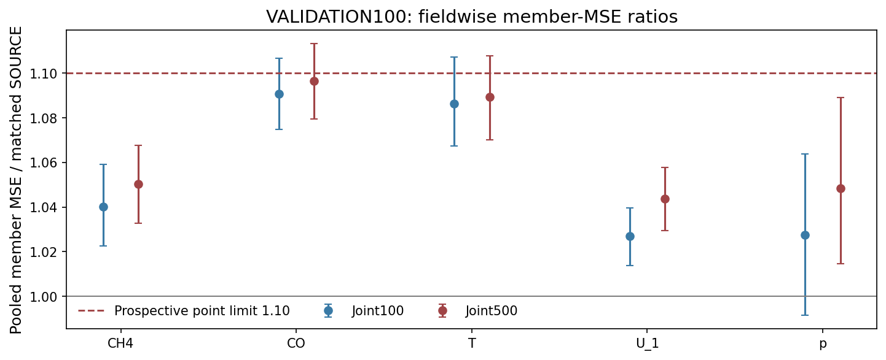

Joint100 and Joint500 native member-MSE ratios versus matched SOURCE with paired frame-bootstrap 95% intervals. The dashed line is the prospective 1.10 point limit, not the historical signed-risk allowance. [PDF master](figures/field_member_ratios.pdf)

## Figure direct fair scores

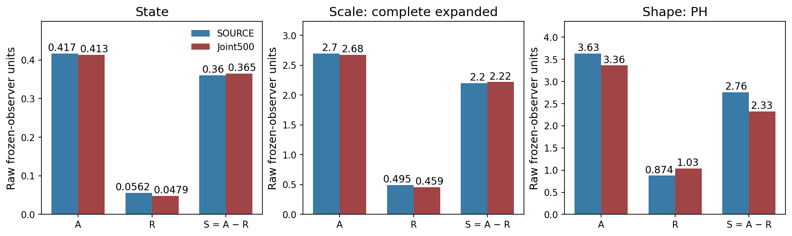

Direct member-to-reference discrepancy A, positive member separation R and fair score S = A − R in raw frozen-observer units for State, complete-expanded Scale and existing PH Shape. [PDF master](figures/direct_fair_scores.pdf)

## Figure signed rho pair band

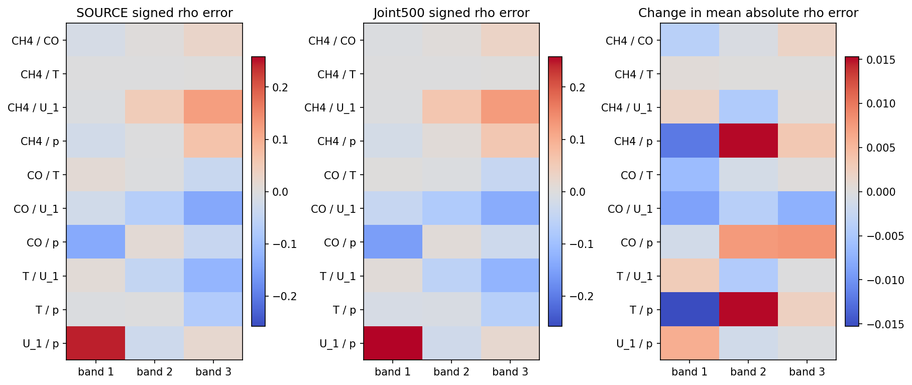

Fixed-Q4096 pair/band signed rho errors and the change in mean absolute rho error. Bands are fixed basis bands, not physical wavelengths. [PDF master](figures/signed_rho_pair_band.pdf)

## Figure floor aware power

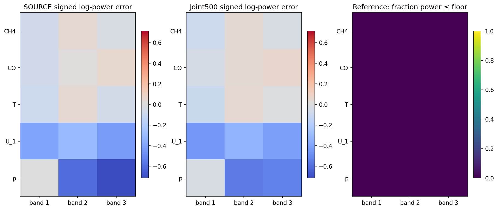

Fixed-Q4096 floor-aware signed log-power errors and the fraction of reference band powers at or below their frozen floors. The retained bands are not physical wavelengths. [PDF master](figures/floor_aware_power.pdf)

## Figure support and raster

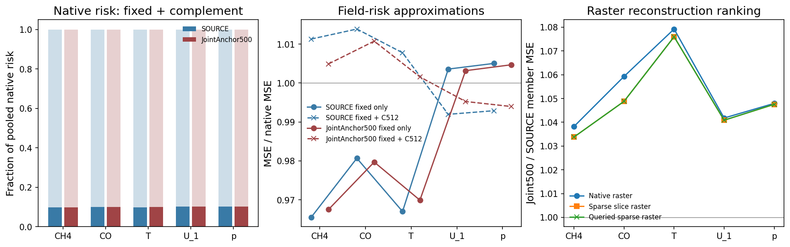

Exact native-risk contributions from fixed sites and their complement; fixed-only and selected-plus-C512 estimates relative to native risk; and the Joint500/SOURCE member-MSE ratio after native or sparse reconstruction to the same physical raster. [PDF master](figures/support_and_raster.pdf)

## Figure source error strata

For each field, SOURCE condition-level native member-MSE 10th–90th percentile whiskers and medians (dots), with pooled means (crosses), all divided by that field's TRAIN SOURCE pooled mean. The panels share one trajectory and have different condition-selection laws. [PDF master](figures/source_error_strata.pdf)

## Figure joint event representative median

Native joint-event reference mask and four-member event frequencies for the SOURCE-selected representative frame. Each frequency panel displays its physical-mass-weighted probability RMSE versus the binary event reference. Dots show each member's native-area event fraction; the dashed line shows its matched reference. Axes are stretched independently for readability. [PDF master](figures/joint_event_representative_median.pdf)

## Figure joint event difficult maximum

Native joint-event reference mask and four-member event frequencies for the SOURCE-selected difficult frame. Each frequency panel displays its physical-mass-weighted probability RMSE versus the binary event reference. Dots show each member's native-area event fraction; the dashed line shows its matched reference. Axes are stretched independently for readability. [PDF master](figures/joint_event_difficult_maximum.pdf)

## Figure regional relation

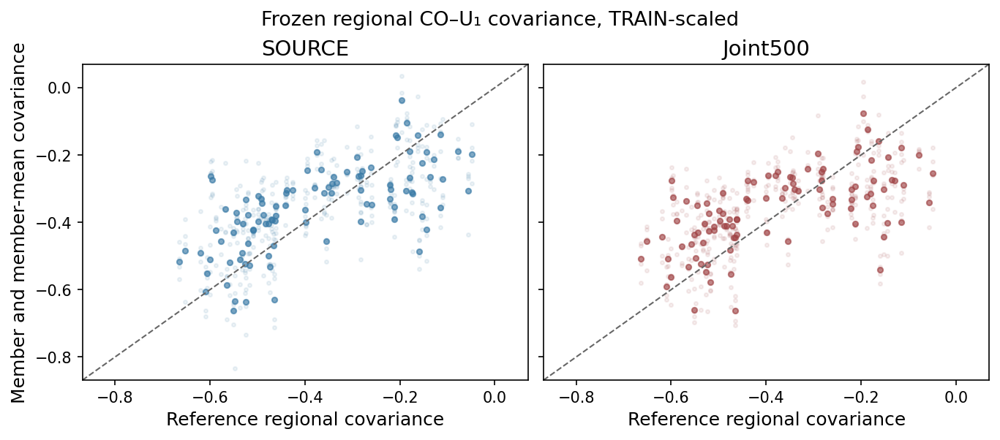

Reference versus SOURCE and Joint500 member and member-mean regional CO–U₁ signed covariance over VALIDATION100. Covariance is dimensionless after frozen TRAIN-truth scaling; faint points are individual members and solid points their means. [PDF master](figures/regional_relation.pdf)

## Figure representative median fields 1

Representative SOURCE-selected condition trajectory_000000:8086, fields CH4, CO. Reference, SOURCE and Joint500 share fieldwise color limits; errors share symmetric fieldwise limits. Each prediction and error panel shows relative L2 computed on the displayed positive-mass native mask; coordinate and field units are dataset units. Axes are stretched independently for readability. [PDF master](figures/representative_median_fields_1.pdf)

## Figure representative median fields 2

Representative SOURCE-selected condition trajectory_000000:8086, fields T, U_1. Reference, SOURCE and Joint500 share fieldwise color limits; errors share symmetric fieldwise limits. Each prediction and error panel shows relative L2 computed on the displayed positive-mass native mask; coordinate and field units are dataset units. Axes are stretched independently for readability. [PDF master](figures/representative_median_fields_2.pdf)

## Figure representative median fields 3

Representative SOURCE-selected condition trajectory_000000:8086, fields p. Reference, SOURCE and Joint500 share fieldwise color limits; errors share symmetric fieldwise limits. Each prediction and error panel shows relative L2 computed on the displayed positive-mass native mask; coordinate and field units are dataset units. Axes are stretched independently for readability. [PDF master](figures/representative_median_fields_3.pdf)

## Figure difficult maximum fields 1

Difficult SOURCE-selected condition trajectory_000000:8049, fields CH4, CO. Reference, SOURCE and Joint500 share fieldwise color limits; errors share symmetric fieldwise limits. Each prediction and error panel shows relative L2 computed on the displayed positive-mass native mask; coordinate and field units are dataset units. Axes are stretched independently for readability. [PDF master](figures/difficult_maximum_fields_1.pdf)

## Figure difficult maximum fields 2

Difficult SOURCE-selected condition trajectory_000000:8049, fields T, U_1. Reference, SOURCE and Joint500 share fieldwise color limits; errors share symmetric fieldwise limits. Each prediction and error panel shows relative L2 computed on the displayed positive-mass native mask; coordinate and field units are dataset units. Axes are stretched independently for readability. [PDF master](figures/difficult_maximum_fields_2.pdf)

## Figure difficult maximum fields 3

Difficult SOURCE-selected condition trajectory_000000:8049, fields p. Reference, SOURCE and Joint500 share fieldwise color limits; errors share symmetric fieldwise limits. Each prediction and error panel shows relative L2 computed on the displayed positive-mass native mask; coordinate and field units are dataset units. Axes are stretched independently for readability. [PDF master](figures/difficult_maximum_fields_3.pdf)

## Figure position common scores

Matched cached VALIDATION100 J4 scores under the unchanged PH observer, the TRAIN-fitted regional-excursion observation, and their declared half-sum. A/R/S are shown separately. Absolute scores from different observers are not comparable; each endpoint is compared to SOURCE under the same observer. [PDF master](figures/position_common_scores.pdf)

## Figure position train sensitivity

Frozen TRAIN800 sensitivity over complete fixed target queries and all J4 SOURCE members. Absolute sigmoid derivatives have inverse standardized-filtration units; saturated windows have occupancy at or below 0.01 or at or above 0.99. Category and threshold pooling retains the declared physical raster mass and fixed query weights. [PDF master](figures/position_train_sensitivity.pdf)

## Figure j3 action rows

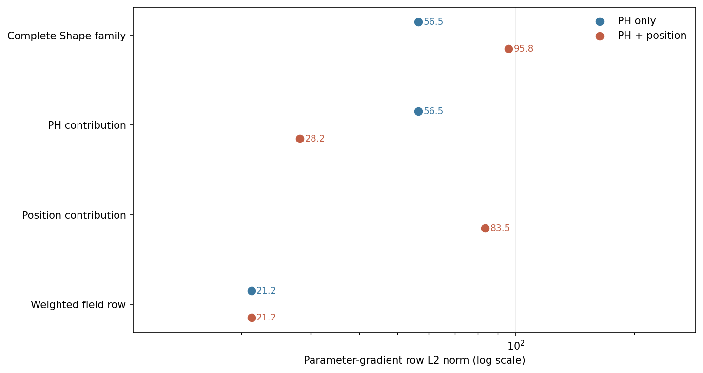

Parameter-gradient norms from one matched J3 SOURCE/TRAIN shadow action. PH and position are weighted contributions to the Shape row, while the field row uses the declared nonzero multiplier; the PH-only action has no position contribution. [PDF master](figures/j3_action_rows.pdf)

## Figure j3 field risk changes

Finite selected-plus-complement field member-MSE changes after the two same-state actions, relative to each field's own starting value. A zero starting value has no percentage; absolute changes are reported in the table. One action does not establish learning or field retention. [PDF master](figures/j3_field_risk_changes.pdf)

## Figure j3 action cost

Main action phases sum the recorded forward, parameter-row reverse, and optimizer phases; extra component-gradient reverse and finite-difference replay are separate. Memory is PyTorch allocated memory for this small sequential diagnostic, with the extra component-reverse peak shown separately; it is not a full-epoch benchmark or evidence of a speedup. The first PH-only action included cold-start overhead. [PDF master](figures/j3_action_cost.pdf)

## Figure learning field ratios

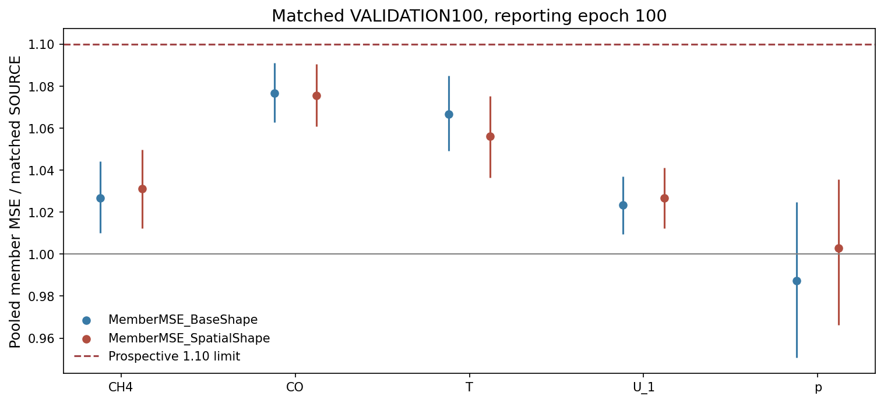

Native physical-mass member-MSE ratios at matched reporting epoch 100, each a ratio of pooled risks; whiskers are paired-frame 95% intervals and the dashed line is the prospective 1.10 point limit. [PDF master](figures/learning_field_ratios.pdf)

## Figure learning paired direct ars

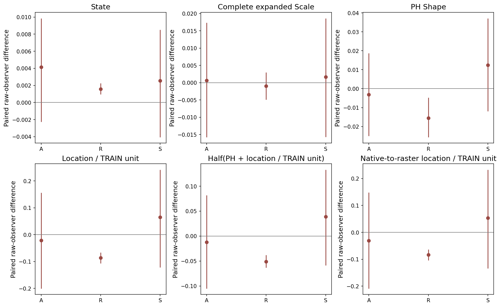

SpatialShape minus BaseShape at matched reporting epoch 100 on the same conditions: direct member discrepancy A, positive member separation R and fair score S = A − R, with paired-frame 95% intervals. Each panel has its own observer units. [PDF master](figures/learning_paired_direct_ars.pdf)

## Figure learning signed rho power

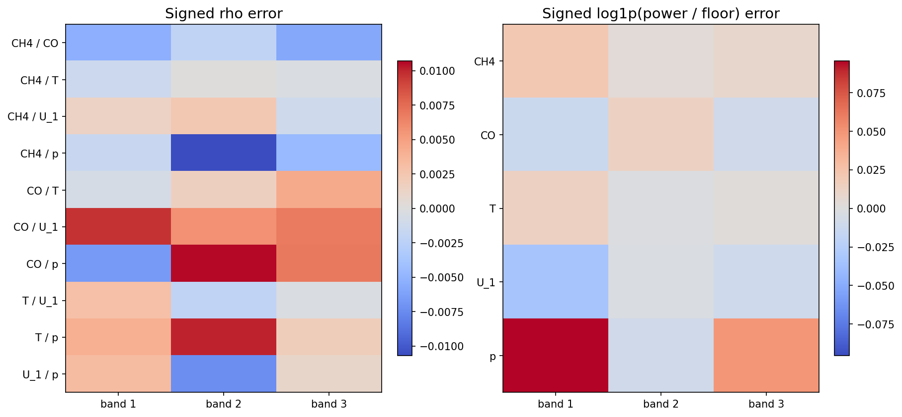

Matched-epoch SpatialShape minus BaseShape mean signed member-minus-reference rho and log1p(power/floor) errors on the frozen selected support. Fixed basis bands are not physical wavelengths; power and low-energy floor context is retained in the summary. [PDF master](figures/learning_signed_rho_power.pdf)

## Figure learning representative median co t

Representative previously SOURCE-selected frame trajectory_000000:8086. Each native CO and T row shares physical field color limits across reference and model means; every reconstruction is annotated with physical-mass-weighted RMSE in dataset units. Axes are stretched independently for readability. [PDF master](figures/learning_representative_median_co_t.pdf)

## Figure learning difficult maximum co t

Difficult previously SOURCE-selected frame trajectory_000000:8049. Each native CO and T row shares physical field color limits across reference and model means; every reconstruction is annotated with physical-mass-weighted RMSE in dataset units. Axes are stretched independently for readability. [PDF master](figures/learning_difficult_maximum_co_t.pdf)

## Figure training membermse baseshape coherence history

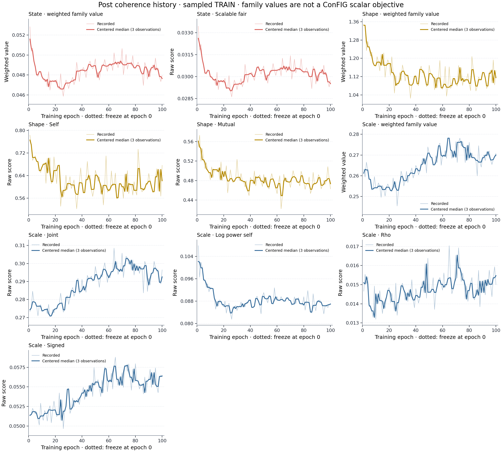

Saved coherence history for MemberMSE_BaseShape, through reporting epoch 100. Sampled training components, validation metrics and gradient diagnostics retain their recorded meanings; ConFIG has no invented scalar objective. [PDF master](figures/training_membermse_baseshape_coherence_history.pdf)

## Figure training membermse baseshape loss history

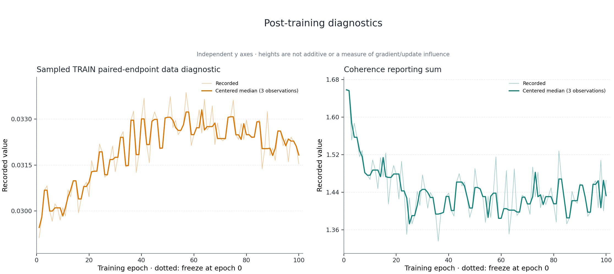

Saved loss history for MemberMSE_BaseShape, through reporting epoch 100. Sampled training components, validation metrics and gradient diagnostics retain their recorded meanings; ConFIG has no invented scalar objective. [PDF master](figures/training_membermse_baseshape_loss_history.pdf)

## Figure training membermse spatialshape coherence history

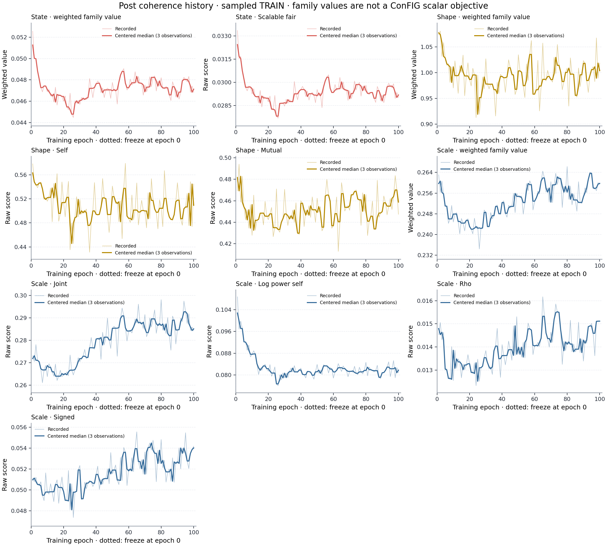

Saved coherence history for MemberMSE_SpatialShape, through reporting epoch 100. Sampled training components, validation metrics and gradient diagnostics retain their recorded meanings; ConFIG has no invented scalar objective. [PDF master](figures/training_membermse_spatialshape_coherence_history.pdf)

## Figure training membermse spatialshape loss history

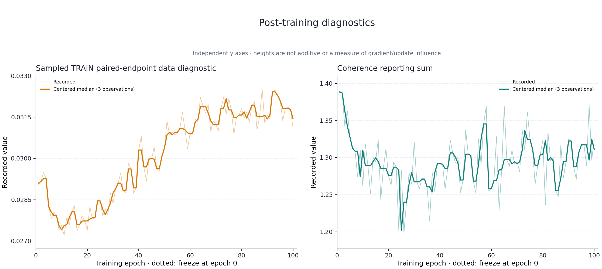

Saved loss history for MemberMSE_SpatialShape, through reporting epoch 100. Sampled training components, validation metrics and gradient diagnostics retain their recorded meanings; ConFIG has no invented scalar objective. [PDF master](figures/training_membermse_spatialshape_loss_history.pdf)

## Figure executor retention comparison

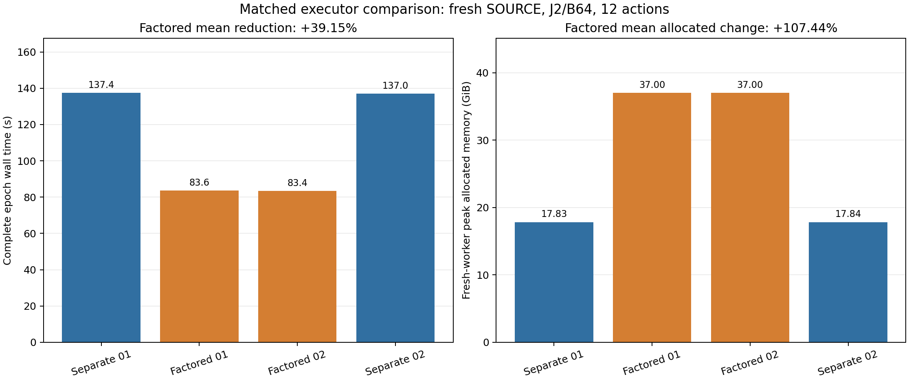

Balanced fresh-SOURCE J2/B64 first-epoch complete wall times and full-worker peak allocated memory. All four workers are shown in serial order; reserved memory is unavailable. [PDF master](figures/executor_retention_comparison.pdf)

## Figure index

- [Figure field member ratios](#figure-field-member-ratios)
- [Figure direct fair scores](#figure-direct-fair-scores)
- [Figure signed rho pair band](#figure-signed-rho-pair-band)
- [Figure floor aware power](#figure-floor-aware-power)
- [Figure support and raster](#figure-support-and-raster)
- [Figure source error strata](#figure-source-error-strata)
- [Figure joint event representative median](#figure-joint-event-representative-median)
- [Figure joint event difficult maximum](#figure-joint-event-difficult-maximum)
- [Figure regional relation](#figure-regional-relation)
- [Figure representative median fields 1](#figure-representative-median-fields-1)
- [Figure representative median fields 2](#figure-representative-median-fields-2)
- [Figure representative median fields 3](#figure-representative-median-fields-3)
- [Figure difficult maximum fields 1](#figure-difficult-maximum-fields-1)
- [Figure difficult maximum fields 2](#figure-difficult-maximum-fields-2)
- [Figure difficult maximum fields 3](#figure-difficult-maximum-fields-3)
- [Figure position common scores](#figure-position-common-scores)
- [Figure position train sensitivity](#figure-position-train-sensitivity)
- [Figure j3 action rows](#figure-j3-action-rows)
- [Figure j3 field risk changes](#figure-j3-field-risk-changes)
- [Figure j3 action cost](#figure-j3-action-cost)
- [Figure learning field ratios](#figure-learning-field-ratios)
- [Figure learning paired direct ars](#figure-learning-paired-direct-ars)
- [Figure learning signed rho power](#figure-learning-signed-rho-power)
- [Figure learning representative median co t](#figure-learning-representative-median-co-t)
- [Figure learning difficult maximum co t](#figure-learning-difficult-maximum-co-t)
- [Figure training membermse baseshape coherence history](#figure-training-membermse-baseshape-coherence-history)
- [Figure training membermse baseshape loss history](#figure-training-membermse-baseshape-loss-history)
- [Figure training membermse spatialshape coherence history](#figure-training-membermse-spatialshape-coherence-history)
- [Figure training membermse spatialshape loss history](#figure-training-membermse-spatialshape-loss-history)
- [Figure executor retention comparison](#figure-executor-retention-comparison)
