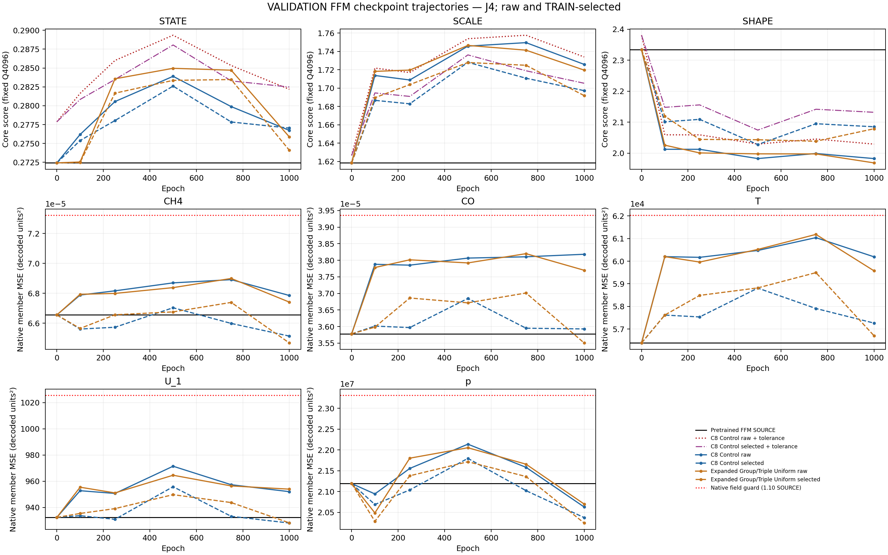
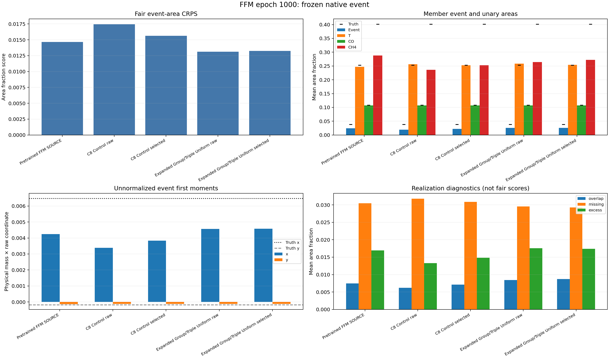
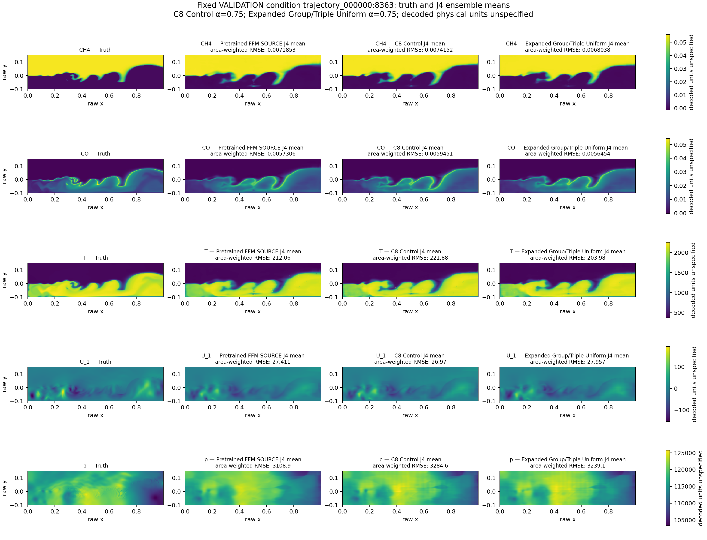
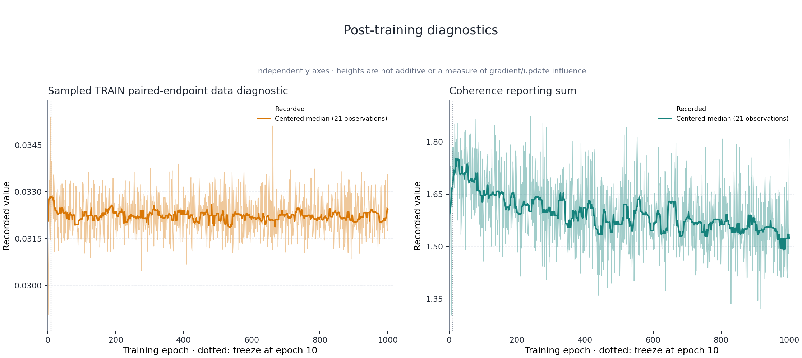
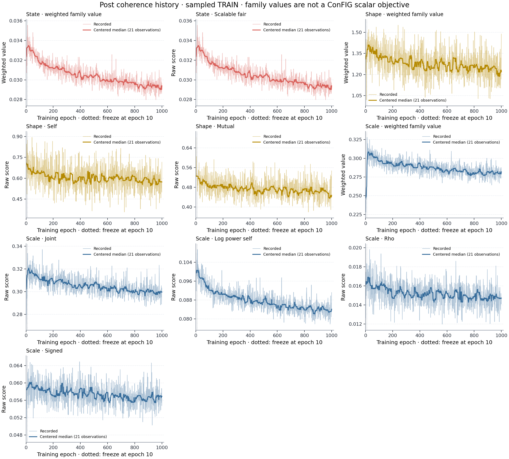
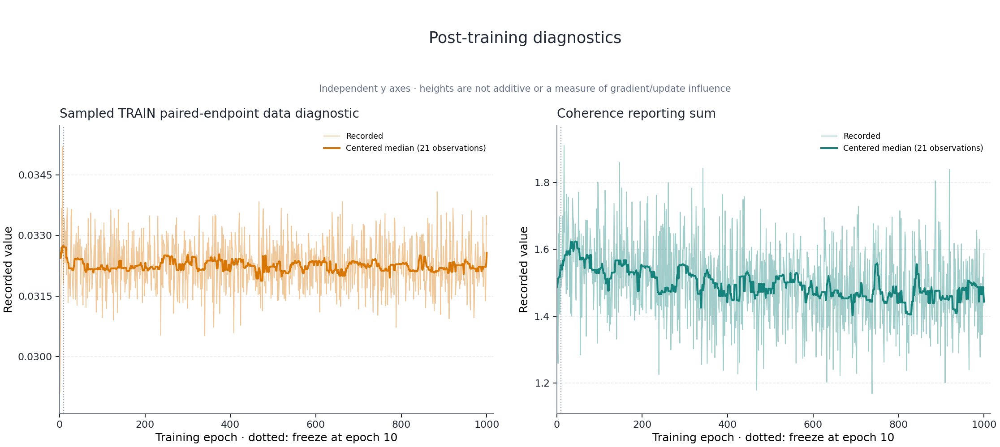
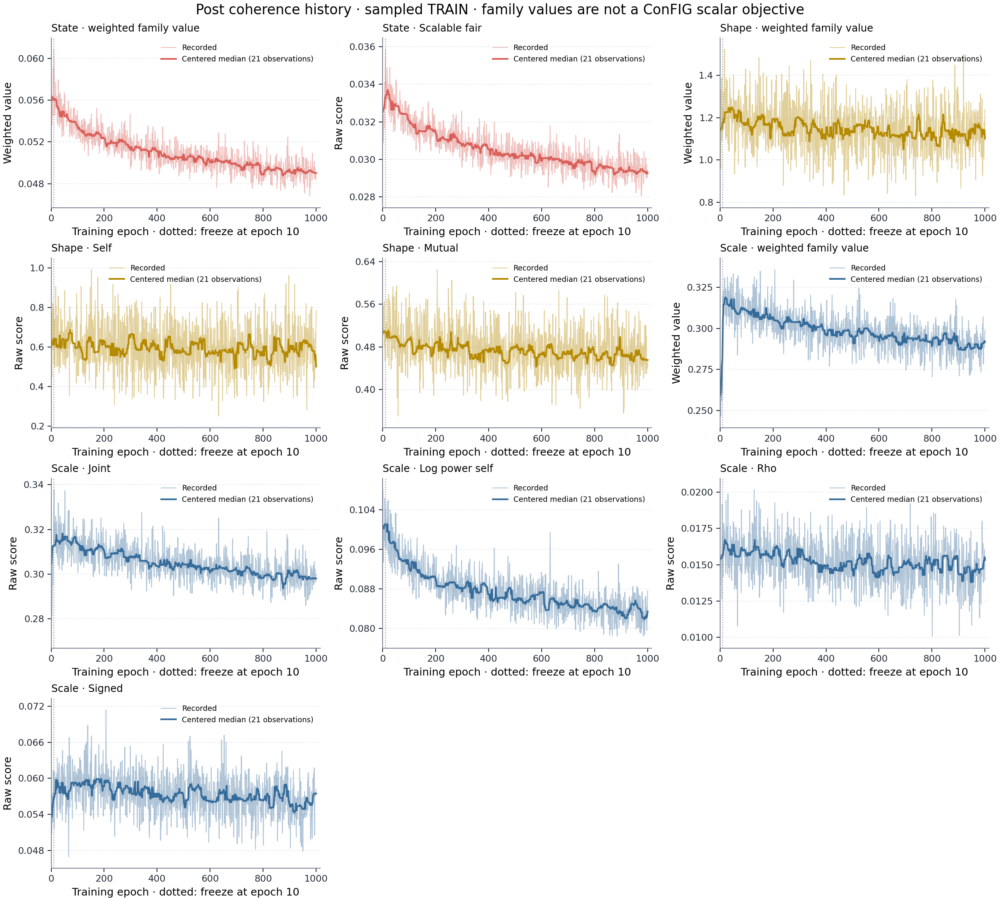

# Coherence Adaptive Repair: FFM Round 1 closeout

Publication snapshot from the accepted campaign report. Figure previews and PDF masters are copied unchanged; the [evidence index](evidence/INDEX.md) identifies the original report and local research evidence. [Publication PDF](report.pdf).

## Figure index

- [Matched validation trajectories](#figure-matched-validation-trajectories)
- [Native event diagnostics](#figure-native-event-diagnostics)
- [Native reconstruction](#figure-native-reconstruction)
- [C8 Control loss history](#figure-c8-control-loss-history)
- [C8 Control coherence history](#figure-c8-control-coherence-history)
- [Expanded Group Triple Uniform loss history](#figure-expanded-group-triple-uniform-loss-history)
- [Expanded Group Triple Uniform coherence history](#figure-expanded-group-triple-uniform-coherence-history)

**Adopt the qualified exact observer reuse; reject adaptive allocation and do not promote either expanded learned output this round.** Expanded Group/Triple Uniform improves the held-out event witness, but the complete research-cost gate remains unqualified because historical timers are missing. The efficiency route fails its preregistered quality crossing. Retain the existing SOURCE/C8 recommendation and preserve the expanded checkpoints and blends as measured research results. EDM remains paused pending the owner's command.

Display labels are C8 Control (`FFM_B1`), Expanded Group/Triple Uniform (`FFM_A1`) and Pretrained FFM SOURCE (`SOURCE`). Historical identifiers, source artifacts and frozen protocols are preserved. This report closes the FFM comparison; it makes no EDM lifecycle or efficacy claim.

## Comparison and execution

Both methods completed 1000 reporting epochs: 13000 accepted B32 updates and 416000 condition visits, equivalent to 52 TRAIN8000 passes per method. All 13000 recorded coupling rows match. The fixed assessment epochs are 0, 100, 250, 500, 750 and 1000. Each method uses the same EMA-materialized epoch-5000 FFM source, four Euler steps, J2 training, shared C8 calibration and native member-risk contract; Expanded Group/Triple Uniform adds four signed State group directions and eight distinct-field regional Scale triples, with uniform expanded-target sampling. Child EMA is disabled. The source checkpoint SHA256 is `2d1da713538f6e9613560f3a7eb4a9df2a95d1ad1f56dd11a1a8a4f9ef65050c`.

Matched evaluation uses 800 of 8000 TRAIN and 100 of 1000 VALIDATION conditions, T256 observations and J4 members. Complete State/Scale and the frozen Shape pack use Q4096; decoded field-risk and event measurements use all 40300 native points within each sampled condition. TEST remains locked. Nine alpha values from 0 to 1 were assessed on TRAIN; all twelve nominations were frozen before VALIDATION. No held-out tuning or new experiment was added for closeout.

Both mature trainings ran on GPU1. All amended native SOURCE, control and expanded assessment inference ran on the same runtime-selected GPU2, an NVIDIA RTX 6000 Ada, driver 580.178.04. GPU0 remained excluded after the owner's restriction. The [device-only amendment](evidence/INDEX.md#evidence-01) preserves the original training capsule and scientific freeze while selecting the assessment capsule through mutable runtime configuration. Samples, checkpoints, seeds, metrics, alpha rules and held-out gates are unchanged. The [terminal attempt](evidence/INDEX.md#evidence-02) completed successfully at 2026-11-15 04:37 UTC; the dependency supervisor records child return code zero. Its whole child wall is 3270.293 seconds, including nested jobs.

The [methods companion](evidence/INDEX.md#evidence-03) supplies mathematical definitions, physical measures, proper-score and signed-risk identities, retained-Scale conditioning, discovery and exact-execution contracts. The [static evidence ledger](evidence/INDEX.md#evidence-04) identifies the actual qualified assertions; its pending-assessment entries are historical and superseded by this closeout.

## Final held-out measurements

Lower scores are better. The final selections are alpha 0.75 for both methods. Fixed-half outputs are shown because their TRAIN feasibility was established; they are diagnostic comparators and were not selected from VALIDATION. All six checkpoints, raw/selected/feasible-half results and absolute native MSEs are retained in the [complete matched tables](evidence/INDEX.md#evidence-05), bound to the [decision receipt](evidence/INDEX.md#evidence-06).

| Final output | Alpha | State | Scale | Shape | Event-area CRPS |
| --- | ---: | ---: | ---: | ---: | ---: |
| Pretrained FFM SOURCE | 0 | 0.272422 | 1.618485 | 2.334048 | 0.0146636 |
| C8 Control raw | 1 | 0.276729 | 1.725915 | 1.982725 | 0.0174355 |
| C8 Control TRAIN-selected | 0.75 | 0.277033 | 1.697244 | 2.085358 | 0.0156309 |
| C8 Control fixed half | 0.5 | 0.276891 | 1.669083 | 2.214503 | 0.0146861 |
| Expanded Group/Triple Uniform raw | 1 | 0.275860 | 1.719670 | 1.968816 | 0.0131311 |
| Expanded Group/Triple Uniform TRAIN-selected | 0.75 | 0.274093 | 1.691851 | 2.078985 | 0.0132326 |
| Expanded Group/Triple Uniform fixed half | 0.5 | 0.273565 | 1.664409 | 2.214550 | 0.0135625 |

Relative to C8 Control, the expanded raw output reduces event-area CRPS by **24.69%**, and the selected blend reduces it by **15.34%**. The corresponding gains against SOURCE are **10.45%** and **9.76%**. Absolute gains over control, 0.00430433 raw and 0.00239827 selected, both exceed the frozen 0.000733182 threshold, equal to 5% of SOURCE event CRPS. All final field, sensor, control-relative core and event regression guards pass for both policies.

The expanded-minus-control State/Scale/Shape differences are -0.000869 / -0.006245 / -0.013909 raw, and -0.002940 / -0.005392 / -0.006373 selected. Against SOURCE, however, the expanded raw State and Scale worsen by 1.26% and 6.25%, while Shape improves by 15.65%; the selected blend worsens State and Scale by 0.61% and 4.53%, while improving Shape by 10.93%. No method/policy reaches the required Scale improvement at any scheduled checkpoint, so none achieves two consecutive qualifying checkpoints. This rejects the efficiency route independently of missing costs; improved event performance does not establish universal coherence repair.

### Figure Matched validation trajectories

All fixed checkpoints are retained; raw and TRAIN-selected policies remain separate. The retrospective crossing does not select a deployment checkpoint. [PDF master](figures/ffm_validation_trajectories.pdf)

Native member-MSE ratios relative to the matched VALIDATION SOURCE are below. Each field must be at most 1.10; all listed final outputs pass, and all sensor errors are zero model units. The SOURCE MSE vector in CH4/CO/T/U_1/p order is `[6.65562008e-5, 3.57798779e-5, 56388.14149, 932.34046, 21191840.87875]`, in squared decoded dataset units; physical units are unspecified.

| Final output | CH4 | CO | T | U_1 | p |
| --- | ---: | ---: | ---: | ---: | ---: |
| Pretrained FFM SOURCE | 1.00000 | 1.00000 | 1.00000 | 1.00000 | 1.00000 |
| C8 Control raw | 1.01951 | 1.06711 | 1.06746 | 1.02109 | 0.97344 |
| C8 Control TRAIN-selected | 0.97875 | 1.00415 | 1.01555 | 0.99539 | 0.96142 |
| C8 Control fixed half | 0.96192 | 0.97197 | 0.98700 | 0.98332 | 0.96184 |
| Expanded Group/Triple Uniform raw | 1.01287 | 1.05363 | 1.05648 | 1.02315 | 0.97678 |
| Expanded Group/Triple Uniform TRAIN-selected | 0.97188 | 0.99232 | 1.00562 | 0.99552 | 0.95526 |
| Expanded Group/Triple Uniform fixed half | 0.95608 | 0.96294 | 0.97925 | 0.98245 | 0.95196 |

The TRAIN result is different and remains explicit: both final raw models fail all five TRAIN native field guards, while their selected blends pass. C8 Control uses alphas 0, 0.75, 0.75, 0.875, 0.75 and 0.75 across the six checkpoints; Expanded Group/Triple Uniform uses 0, 0.75, 0.875, 0.875, 0.875 and 0.75. The [reviewed TRAIN audit](evidence/INDEX.md#evidence-07) retains the frontiers and field ratios. TRAIN and VALIDATION are different fixed populations; held-out eligibility does not erase the TRAIN failures or turn the online Q4096 risk proxy into an exact native guard.

## Task, spread and reconstruction

The event is a frozen mixed co-excursion of T, CO and CH4, not a heat-release or reaction-rate measurement. Its thresholds and redesign were frozen from TRAIN before learning; CH4 is nearly redundant in this witness. The historical SOURCE margin bound passed but was vacuous because all raw bounds were at least one. Event CRPS measures conditional event-area performance; overlap, missing/excess areas and unnormalized first moments are realization diagnostics. Their complete means and input hashes are in the [event receipt](evidence/INDEX.md#evidence-08).

### Figure Native event diagnostics

Matched VALIDATION100 J4 outputs use the frozen task. Event performance is evaluated only at the final prescribed checkpoint and was excluded from alpha selection. [PDF master](figures/ffm_native_event_epoch1000.pdf)

For J4, member MSE equals ensemble-mean squared error plus 0.75 times unbiased member variance; corrected signed mean risk equals ensemble-mean error minus variance/4. The [complete spread table](evidence/INDEX.md#evidence-09) records all five fields and eligible policies. For T, SOURCE ensemble-mean MSE / variance is 54020.33 / 3157.08; C8 raw is 58837.73 / 1805.74, and expanded raw is 58212.93 / 1813.13. Selected C8 is 55998.63 / 1688.38, and selected expanded is 55474.07 / 1641.23. Thus smaller member risk does not imply recovered conditional spread; mean error is not identified bias, and these panel averages are distinct from the single-condition figure below. The mean-risk primitive is numerically qualified but was not the mature training contract.

The paired expanded-minus-control raw Shape difference is -0.0139094 with query MCSE 0.0069732 across eight common query batches. The selected difference is -0.0063726 with descriptive replay dispersion 0.0063386; the pack was also used for TRAIN selection, so that quantity is not an unbiased post-selection error bar. The [Shape receipt](evidence/INDEX.md#evidence-10) retains fixed/raw MCSEs and selected replay values; no confidence interval is claimed.

The added scores show mixed differences: expanded raw/selected target-weighted triple scores are 0.094395 / 0.091569 versus control 0.094883 / 0.091737; State-group scores are 0.232900 / 0.231776 versus control 0.232390 / 0.233480. Added triples are deterministic functions of the complete retained positive-weight Scale embedding: they change loss geometry and gradients rather than retained-subspace identifiability. Their scientific value is bounded by these measured outcomes.

### Figure Native reconstruction

The declared first matched VALIDATION condition is shown without outcome-based selection. Every prediction panel annotates physical-mass-weighted RMSE on the positive-mass native mask; decoded physical units are unspecified. The original figure labels this as area-weighted; the saved plotting code weights by the recorded native masses. This example is descriptive and is not the panel-average metric. [PDF master](figures/ffm_reconstruction.pdf)

## Costs, performance and decisions

The [final cost worksheet](evidence/INDEX.md#evidence-11) binds the saved closed ledger, completed TRAIN and VALIDATION journals, mature leases and parallel CPU accounting. The ledger's 42 closed entries total **29.18036 occupied GPU-hours**, conservatively using the terminated control attempt's recorded closure as an upper bound. This leaves **50.81964 hours** under the 80-hour cap and preserves the six-hour reserve on recorded occupation. The total includes 1.02991 hours of identified EDM work already incurred; that work is excluded from FFM adoption costs. Unrecorded historical occupation cannot be reconstructed from this ledger.

| Measured scope | C8 Control | Expanded Group/Triple Uniform |
| --- | ---: | ---: |
| Complete mature training GPU lease | 44966.558 s | 45456.358 s |
| Known arm-specific GPU subtotal | 45629.008 s | 49717.689 s |
| Known arm-specific offline CPU subtotal | 24520.337 s | 25773.096 s |

Known common FFM infrastructure adds 3862.364 GPU seconds and 2142.329 offline CPU seconds before allocation. These are partial research subtotals, not complete totals or a cost ratio. The expanded mature training lease is 1.09% longer. The twelve TRAIN frontiers were all charged: independent parallel score wall is summed despite elapsed overlap with control scoring, and nested GPU/CPU parent intervals are counted once. VALIDATION adds 167.894 GPU seconds, 3051.818 CPU-child seconds, 36.600 GPU-child nonlease seconds and 13.763 parent seconds; its enclosing wall is not another charge. Dependency waiting is excluded.

Historical whole-job observer/event-freeze timers, the first failed bank-audit process timer, and some preparation and attribution scopes remain unavailable or unclassified. Neither zero costs nor an assumption that all gaps are shared is justified. Consequently the frozen limit of at most 10% extra total serial research cost is **unqualified**, and no complete arm-cost ratio is reported. This is the bounded final disposition, not a request for another experiment.

On the same GPU2, measured native J4 inference totals per condition are 0.136037 s SOURCE, 0.136056 s C8 raw and 0.136052 s expanded raw, including each bank's first condition. Selected-blend execution needs both SOURCE and child; their measured inference components sum to about 0.2721 s per condition, before unmeasured mixing/end-to-end overhead. These component timings do not establish a deployment speedup. Training callbacks and assessment scoring have their own timing scopes.

| Component or output | Final decision | Basis |
| --- | --- | --- |
| Exact observer reuse | Adopt within qualified scope | TRAIN800 parity passes; warm CPU callbacks 382.83 s versus 576.11 s direct, 33.55% less. |
| Adaptive allocation | Reject for this round | Corrected both-source native gradient-MSE/cost gate unqualified; recorded preformal overhead exceeds 5% forecast gate. Uniform expanded-target sampling remains active. |
| Expanded raw learned output | Reject promotion this round | VALIDATION task and eligibility pass; complete cost-dependent quality route unqualified, efficiency route fails. Preserve the scientific gain and checkpoint. |
| Expanded TRAIN-selected blend | Reject promotion this round | VALIDATION task and eligibility pass; same cost failure to qualify and no efficiency crossing. Preserve alpha-0.75 policy and bank. |
| Fixed-half blends | Retain as diagnostics only | TRAIN-feasible fixed comparators; no held-out selection or new adoption route. |
| Code extraction | Adopt independent qualified capabilities only | Extract physical-risk/source contracts and exact observer reuse with dependencies; keep added target and allocation opt-in, with no default promotion. |
| EDM | Paused | Prepared artifacts preserved; native lifecycle work awaits owner's command. |

Observer cold setup took 78.22 s; setup plus warm callbacks is 19.97% below direct callbacks alone after the shared constructor, an asymmetric comparison. Differentiable State/Scale reuse is qualified; differentiated Shape retains the per-pack path. No full-GPU training throughput or general law-identification claim follows. The [extraction map](evidence/INDEX.md#evidence-12) and [methods companion](evidence/INDEX.md#evidence-03) state the dependency and numerical boundaries.

## Recording, preservation and checks

Both complete training histories and final curves are retained in the case-owned logs; the prescribed first/every-ten-epoch/checkpoint/end cadence is preserved. They are sampled training diagnostics, not a scalar ConFIG objective or held-out metric.

### Figure C8 Control loss history

C8 Control training diagnostics over all 1000 reporting epochs. [PDF master](figures/control_loss_history.pdf)

### Figure C8 Control coherence history

State, Scale and Shape components retain separate scales and their recorded calibration. [PDF master](figures/control_coherence_history.pdf)

### Figure Expanded Group Triple Uniform loss history

Expanded Group/Triple Uniform training diagnostics over all 1000 reporting epochs. [PDF master](figures/expanded_loss_history.pdf)

### Figure Expanded Group Triple Uniform coherence history

Expanded-family diagnostics include the frozen added-query bank; these are not the final common-observer scores. [PDF master](figures/expanded_coherence_history.pdf)

The [terminal pair verifier](evidence/INDEX.md#evidence-13) checked mature endpoints, all coupling rows, histories and curves. The final frozen calculator checked all twelve TRAIN/VALIDATION checkpoint bindings and final guards; the reviewed formatter replayed the existing CPU validator and produced all matched tables. The [diagnostic review](evidence/INDEX.md#evidence-14) checked receipt/figure hashes, event means, J4 decomposition, expanded-score aggregation and eight-batch dispersion. Closeout used existing outputs only, without inference, optimizer updates, new experiments or TEST access. Final render acceptance is recorded with the report artifacts.

All generated Round 1 payloads are physically on DATA2 through verified stable aliases. The redundant 15.1 GiB HOME backup was removed only after inventory/hash/metadata verification and independent recovery review; source artifacts, frozen capsules, checkpoints, failed attempts and differing historical links were preserved. Ten pre-existing dangling historical links remain and none was introduced by relocation. See the [migration and cleanup evidence](evidence/INDEX.md#evidence-15). Project organization rules are in `docs/Experiment_Artifacts.md` relative to the repository root. The HOME review alias targets the entire campaign so relative figures and PDF links keep working.
