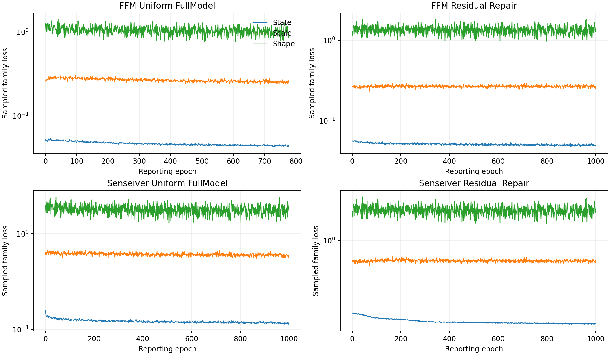
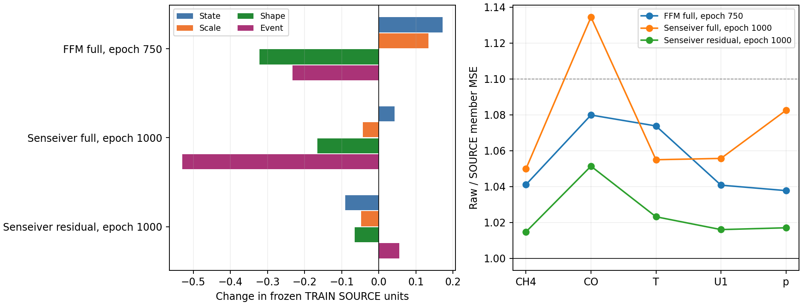
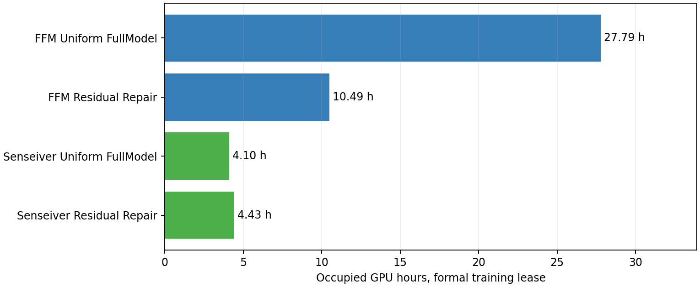

# Coherence Adaptive Repair: Round 2 early closeout

Publication snapshot from the accepted campaign report. Figure previews and PDF masters are copied unchanged; the [evidence index](evidence/INDEX.md) identifies the original report and local research evidence. [Publication PDF](report.pdf).

**Decision: retain FFM SOURCE/C8 and the native Senseiver SOURCE.** Reject the three evaluated learned outputs under the declared field, sensor, core and task evidence. The FFM residual final TRAIN nomination also retained SOURCE. These scientific decisions do not depend on deployment latency, which the user removed from the remaining study.

## Scope and training

The user stopped training early. FFM full-model history ends at epoch 778 (9,336 accepted updates); its latest intact scheduled checkpoint is epoch 750 (9,000 updates). FFM residual and both Senseiver arms completed epoch 1000 (12,000 updates). At B64 and 12 updates per reporting epoch, checkpoint ages 750 and 1000 correspond to 72 and 96 TRAIN8000 pass equivalents. The comparison therefore has unequal training exposure. The interrupted FFM completion remains recorded as `KeyboardInterrupt`.

Before held-out access, the protocol froze the literal SOURCE and checkpoint identities, panel and coupling. It fixed raw amplitude 1 for all three endpoints; no checkpoint or amplitude search used VALIDATION. The fixed VALIDATION panel contains 100 matched conditions from one trajectory, with 256 observations and 40,300 native sites per condition. FFM uses four matched stochastic members; Senseiver is a deterministic point prediction. SOURCE and raw child endpoints share the frozen input, observer and coupling. This is a bounded held-out comparison, not independent-trajectory confirmation. TEST remains locked and EDM remains paused.

## Decisions and tradeoffs

- **FFM full, epoch 750:** Reject as a replacement. Legacy member MSE stays within 1.10 times SOURCE for every field, but the signed mean-risk field gate fails for CO, T, U1 and p. State and Scale core guards fail. Shape and reused-event scores improve, while the reserved regional task worsens by 0.2863 TRAIN-normalized units.
- **Senseiver full, epoch 1000:** Reject. CO member MSE rises to 1.1344 times SOURCE and the State guard fails, despite improvements in Scale, Shape and reused event. The reserved task worsens by 0.2224 units.
- **Senseiver residual, epoch 1000:** Reject promotion. Field and sensor gates pass, with maximum member-MSE ratio 1.0514. State, Scale and Shape improve, but event continuity worsens by 0.05495 frozen TRAIN units, exceeding the 0.05 allowance; the reserved task worsens by 0.2689 units.
- **FFM residual, epoch 1000:** Retain SOURCE from the completed TRAIN decision. All nonzero amplitudes failed its reused-event continuity guard; no held-out rescue or new search was performed.
- **Observer and selected bank:** Retain the previously qualified exact observer reuse. Keep the source-specific selected banks as the frozen research representation; this comparison does not isolate their contribution or establish independent bank adoption.
- **Allocation:** Reject nonuniform allocation and retain uniform. The FFM and Senseiver residual-head gradient-error-times-full-cost ratios were 1.5264 and 1.4874 versus uniform, above the 0.8 qualification threshold. The audit used the matched TRAIN800 panel and 128 numerical estimator replicates, not 128 independent dataset samples.
- **Fidelity and deployment:** Keep signed FFM mean risk, legacy member risk and sensor checks distinct; passing the mean-risk gate would not establish calibrated conditional laws. Deployment latency, throughput and memory were not newly measured at closeout, so no deployment-performance claim is made.

The following core/event differences are raw child minus SOURCE divided by the frozen TRAIN SOURCE normalizer; they are not percentages of VALIDATION SOURCE. Negative values mean improvement for the score. The reserved task is right-half physical-mass-weighted CO-U1 covariance normalized by frozen TRAIN field scales. FFM uses fair J4 CRPS and Senseiver uses paired absolute error; SOURCE-minus-child gain is expressed in frozen TRAIN SOURCE score units, so a negative value is worse.

| Fixed raw endpoint | State | Scale | Shape | Reused event | Reserved gain |
|---|---:|---:|---:|---:|---:|
| FFM full, epoch 750 | +0.1714 | +0.1340 | -0.3218 | -0.2331 | -0.2863 |
| Senseiver full, epoch 1000 | +0.0422 | -0.0427 | -0.1657 | -0.5290 | -0.2224 |
| Senseiver residual, epoch 1000 | -0.0910 | -0.0471 | -0.0653 | +0.0550 | -0.2689 |

## Fieldwise native errors

Member MSE uses native physical-mass weights over the declared physical mask and averages members and matched conditions; values are in each field's squared physical units. Senseiver has one member, so its member and ensemble-mean errors coincide. The SOURCE and raw rows use the same 100 conditions.

| Endpoint | Field | SOURCE member MSE | Raw member MSE | Raw / SOURCE |
|---|---|---:|---:|---:|
| FFM full, epoch 750 | CH4 | 8.5883e-05 | 8.9411e-05 | 1.0411 |
| FFM full, epoch 750 | CO | 4.2179e-05 | 4.5547e-05 | 1.0798 |
| FFM full, epoch 750 | T | 74409 | 79897 | 1.0738 |
| FFM full, epoch 750 | U1 | 1183.3 | 1231.5 | 1.0408 |
| FFM full, epoch 750 | p | 3.1801e+07 | 3.3001e+07 | 1.0377 |
| Senseiver full, epoch 1000 | CH4 | 0.00011129 | 0.00011684 | 1.0499 |
| Senseiver full, epoch 1000 | CO | 4.8882e-05 | 5.5451e-05 | 1.1344 |
| Senseiver full, epoch 1000 | T | 1.0156e+05 | 1.0714e+05 | 1.0549 |
| Senseiver full, epoch 1000 | U1 | 1141.9 | 1205.4 | 1.0557 |
| Senseiver full, epoch 1000 | p | 3.4217e+07 | 3.7039e+07 | 1.0825 |
| Senseiver residual, epoch 1000 | CH4 | 0.00011129 | 0.00011293 | 1.0148 |
| Senseiver residual, epoch 1000 | CO | 4.8882e-05 | 5.1392e-05 | 1.0513 |
| Senseiver residual, epoch 1000 | T | 1.0156e+05 | 1.0391e+05 | 1.0232 |
| Senseiver residual, epoch 1000 | U1 | 1141.9 | 1160.1 | 1.0160 |
| Senseiver residual, epoch 1000 | p | 3.4217e+07 | 3.4799e+07 | 1.0170 |

FFM ensemble-mean MSE, signed mean-risk change and unbiased member variance are shown separately below, in squared physical field units. The allowance is the frozen absolute signed mean-risk limit; the scientific comparison is the signed change against that allowance.

| Field | SOURCE mean MSE | Raw mean MSE | Signed risk change | Allowance | SOURCE variance | Raw variance |
|---|---:|---:|---:|---:|---:|---:|
| CH4 | 8.2485e-05 | 8.3529e-05 | 2.1632e-07 | 7.2357e-07 | 4.53e-06 | 7.842e-06 |
| CO | 3.9719e-05 | 4.112e-05 | 7.4491e-07 | 6.0674e-07 | 3.2793e-06 | 5.9023e-06 |
| T | 71911 | 74997 | 2285.7 | 646.4 | 3330.6 | 6533 |
| U1 | 1158.6 | 1196.6 | 34.56 | 6.1 | 32.83 | 46.517 |
| p | 3.1637e+07 | 3.2569e+07 | 8.4264e+05 | 74097 | 2.1889e+05 | 5.7618e+05 |

Temperature is the observed field in this panel. FFM SOURCE and child sensor MSE are both zero; Senseiver SOURCE and residual are both 87,790.6 and full model is 94,697.6 in squared T units. Other fields have no observed sites in this panel and their sensor MSE is unavailable. All three candidate sensor gates pass their declared source-specific tolerances.

## Costs and limits

The four formal training leases were 27.79 h for FFM full on GPU0, 10.49 h for FFM residual on GPU1, 4.10 h for Senseiver full on GPU1 and 4.43 h for Senseiver residual on GPU1. Each lease includes that job's startup and callbacks; these are not complete research costs. The ledger records 293,115.26 closed GPU seconds against the 468,000-second ceiling, with no active lease at closeout. The bounded evaluation added 69.34 GPU-lease seconds; its 77.97-second GPU phase and 336.75-second enclosing job wall overlap and must not be added to that lease. Missing complete external CPU/research cost attribution leaves total efficiency and time-to-quality claims unavailable. Hardware and exposure differ across the FFM arms.

## Figure index

- [Recorded sampled training losses](#recorded-sampled-training-losses)
- [VALIDATION tradeoffs](#validation-tradeoffs)
- [Formal training GPU leases](#formal-training-gpu-leases)

## Recorded sampled training losses

Raw family losses are sampled training diagnostics; FFM full ends at the last complete history epoch 778. [PDF master](figures/training_losses.pdf)

## VALIDATION tradeoffs

Left: normalized raw-minus-SOURCE score differences; lower is better. Right: native member MSE ratios, with SOURCE at one and the legacy 1.10 reference dashed; FFM's separate signed mean-risk condition still applies. [PDF master](figures/validation_tradeoffs.pdf)

## Formal training GPU leases

Lease walls include each training job's own startup and callbacks, while excluding external campaign work and other jobs. [PDF master](figures/training_lease_cost.pdf)

## Evidence

The [evidence index](evidence/INDEX.md#evidence-01) records original paths and SHA-256 hashes for exact local copies of the frozen protocol, three assessments, allocation decisions, training evidence, evaluation receipt, ledger and FFM residual TRAIN nomination. The [report source](evidence/INDEX.md#evidence-02) regenerates the figures and text from those inputs. Results are descriptive for the selected contiguous VALIDATION panel.
