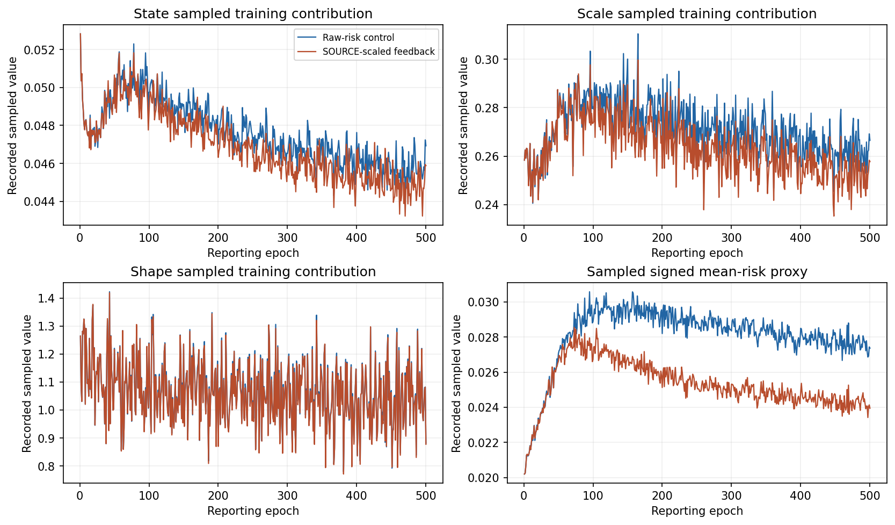
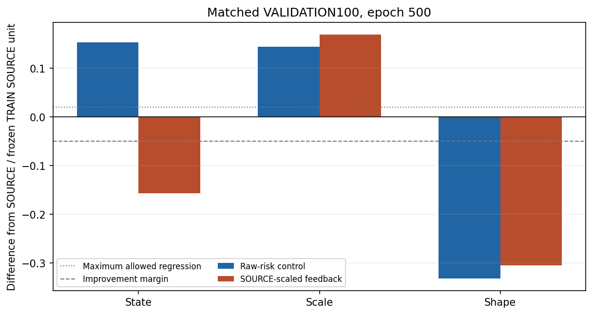
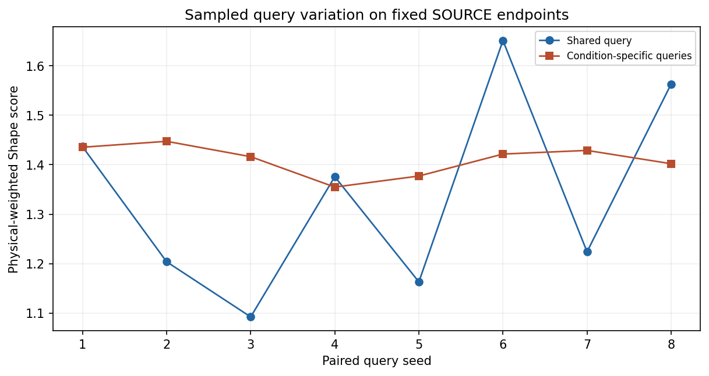

# Coherence Adaptive Repair: Round 3

Publication snapshot from the accepted campaign report. Figure previews and PDF masters are copied unchanged; the [evidence index](evidence/INDEX.md) identifies the original report and local research evidence. [Publication PDF](report.pdf). This publication PDF is newly rendered from the accepted Markdown; no standalone main PDF existed in the original report directory.

**Status:** COMPLETE — bounded endpoint decision.

**Recommendation:** retain SOURCE/C8. Reject both learned raw outputs at the maximum authorized epoch. SOURCE-scaled feedback improves State and pressure retention, but fails four signed-field constraints, the Scale guard and regional-task utility; RawRisk fails all five signed-field constraints, State/Scale guards and regional-task utility. Both improve Shape and the reused event. No continuation or additional arm is authorized by this outcome.

**Raw-risk control:** Reject: five of five signed-field conditions fail; member-risk and State/Scale guards fail; regional normalized improvement is -0.63442 despite improved Shape and event.

**SOURCE-scaled feedback:** Reject as a replacement: four of five signed-field conditions fail; member-risk and Scale guards fail; regional normalized improvement is -0.47563 despite improved State, Shape, pressure retention and event.

## Evidence and scientific scope

The compared paths use one FFM SOURCE, uniform allocation, a 50-epoch warmup and matched reporting epochs. This previously accessed same-trajectory VALIDATION100 panel is development evidence, not independent confirmation; TEST remains locked.

RawRisk uses unit risk scales and a dual step of 0.01; SourceScaledRisk uses fieldwise max(TRAIN SOURCE member MSE, 1e-8) risk scales and a dual step of 0.0001. Both use identical fixed allowances and the same feasible set. This compares two feedback rules and does not causally isolate denominator scaling.

The latest matched assessment is epoch 500 with J4 members and 100 conditions. The following identities bind the comparison:

- SOURCE checkpoint SHA-256: `2d1da713538f6e9613560f3a7eb4a9df2a95d1ad1f56dd11a1a8a4f9ef65050c`.
- Panel SHA-256: `dd204000424d1298e4654717d632ae30a91999de0b3c711054c60e5678543001`.
- SOURCE bank receipt SHA-256: `471bb91325888546ca897cf79d3703973220cb557077b1467e378105a695211d`.

| Field | SOURCE member MSE | Raw-risk member MSE | SOURCE-scaled member MSE | Raw signed-risk difference | Scaled signed-risk difference | Fixed TRAIN allowance |
| --- | ---: | ---: | ---: | ---: | ---: | ---: |
| CH4 | 8.5883e-05 | 9.3965e-05 | 9.2379e-05 | 4.0975e-06 | 4.5277e-06 | 7.2357e-07 |
| CO | 4.2179e-05 | 4.7093e-05 | 4.7683e-05 | 2.0638e-06 | 3.5723e-06 | 6.0674e-07 |
| T | 74409 | 84240 | 82925 | 6143.8 | 6445.8 | 646.4 |
| U_1 | 1183.3 | 1245.8 | 1234.7 | 51.848 | 44.193 | 6.1 |
| p | 3.1801e+07 | 3.314e+07 | 3.1328e+07 | 9.8477e+05 | -8.1383e+05 | 74097 |

Field values are mass-weighted MSE in the respective native field units squared; signed-risk differences use the matched SOURCE baseline and the fixed TRAIN allowance converted fieldwise to native units. Member MSE, ensemble mean MSE, unbiased member variance and sensor results are saved in the linked assessment evidence.

Core changes are relative to SOURCE in frozen TRAIN SOURCE units; negative values improve the score. The member-risk column is the separate legacy guard.

| Path | State change | Scale change | Shape change | Signed field | Sensor | Member risk |
| --- | ---: | ---: | ---: | --- | --- | --- |
| Raw-risk control | 0.15316 | 0.14413 | -0.33226 | fail | pass | fail |
| SOURCE-scaled feedback | -0.15662 | 0.16925 | -0.30526 | fail | pass | fail |

Native ensemble-mean MSE and unbiased member variance are mass-weighted and use each field’s native units squared.

| Field | SOURCE mean MSE | Raw mean MSE | Scaled mean MSE | SOURCE variance | Raw variance | Scaled variance |
| --- | ---: | ---: | ---: | ---: | ---: | ---: |
| CH4 | 8.2485e-05 | 8.7579e-05 | 8.7505e-05 | 4.53e-06 | 8.5145e-06 | 6.499e-06 |
| CO | 3.9719e-05 | 4.2496e-05 | 4.3774e-05 | 3.2793e-06 | 6.1299e-06 | 5.2111e-06 |
| T | 71911 | 78976 | 78874 | 3330.6 | 7018.1 | 5401.6 |
| U_1 | 1158.6 | 1213.2 | 1204.6 | 32.83 | 43.489 | 40.065 |
| p | 3.1637e+07 | 3.271e+07 | 3.0908e+07 | 2.1889e+05 | 5.7303e+05 | 5.599e+05 |

Observed-sensor MSE uses the same native field units squared; fields without observations are omitted.

| Observed field | SOURCE sensor MSE | Raw sensor MSE | Scaled sensor MSE |
| --- | ---: | ---: | ---: |
| T | 0 | 0 | 0 |

Reused development task scores and changes:

| Path | Event score | Event normalized change | Regional score | Regional normalized improvement |
| --- | ---: | ---: | ---: | ---: |
| SOURCE | 0.018868 | 0 | 0.076473 | 0 |
| Raw-risk control | 0.01451 | -0.4886 | 0.085056 | -0.63442 |
| SOURCE-scaled feedback | 0.016602 | -0.25405 | 0.082908 | -0.47563 |

Paired SOURCE-scaled minus raw-risk task effects: regional normalized improvement 0.15879; event score 0.0020916.

| Paired core change | State | Scale | Shape |
| --- | ---: | ---: | ---: |
| Scaled minus raw | -0.30978 | 0.025121 | 0.027001 |

| Field | Paired signed-risk difference | Paired member-MSE difference |
| --- | ---: | ---: |
| CH4 | 4.3016e-07 | -1.5853e-06 |
| CO | 1.5085e-06 | 5.8969e-07 |
| T | 301.99 | -1314.5 |
| U_1 | -7.655 | -11.079 |
| p | -1.7986e+06 | -1.8117e+06 |

Raw-risk control epoch-500 checkpoint SHA-256:

`8a86827c196bd2f5ffe75e81f1ea6c12e14981f4e99fcaa37d0c663e5bdaa294`.

SOURCE-scaled feedback epoch-500 checkpoint SHA-256:

`6b145b0d6889f95d12b7c069303f89f50ca93d4091c73773f9fd6d8a1fbc0567`.

The epoch-100 review used the same matched panel and excluded both task scores.

| Path | State change | Scale change | Shape change | Signed field | Sensor | Member risk |
| --- | ---: | ---: | ---: | --- | --- | --- |
| Raw-risk control | 0.18099 | 0.17282 | -0.29811 | fail | pass | fail |
| SOURCE-scaled feedback | 0.038649 | 0.26059 | -0.29206 | fail | pass | fail |

## Figure index

- [Figure: Sampled TRAIN contributions and signed mean-risk proxy by reporting epoch](#figure-sampled-training-histories)
- [Figure: State, Scale and Shape score changes on the matched VALIDATION100 panel, normalized by the frozen TRAIN SOURCE score units](#figure-matched-core-differences)
- [Figure: Paired shared and condition-specific physical-weighted Shape scores by query seed on fixed SOURCE endpoints](#figure-shape-query-variation)

## Figure sampled-training-histories

Sampled TRAIN contributions and signed mean-risk proxy by reporting epoch; these traces are not native validation errors or a scalar ConFIG objective. [PDF master](figures/sampled_training_histories.pdf)

## Figure matched-core-differences

State, Scale and Shape score changes on the matched VALIDATION100 panel, normalized by the frozen TRAIN SOURCE score units; negative values are improvements. [PDF master](figures/matched_core_differences.pdf)

## Figure shape-query-variation

Paired shared and condition-specific physical-weighted Shape scores by query seed on fixed SOURCE endpoints; these show sampled query variation, not learning or gradient variance. [PDF master](figures/shape_query_variation.pdf)

## Implementation and diagnostic decisions

Exact State/Scale reuse: **retain**. Numerically qualified exact State/Scale reuse reduces peak training allocation by 502892032 bytes (0.468 GiB, 2.57 percent) with only local graph-scoped changes. No training speedup is established: complete epoch wall improves about 0.9 percent and update-only timing changes in the opposite direction. Historical and reused complete-epoch measurements: 115.14 s and 114.12 s.

Resume qualification status: passed. Qualification establishes execution continuity, not learning efficacy.

Cached TRAIN Shape query replay: 8 paired seeds; shared-query mean 1.3386, sample SD 0.20069; condition-specific mean 1.4104, sample SD 0.031079; recovery-attempt scorer worker time 636.98 s.

This fixed-endpoint scalar dispersion does not establish parameter-gradient variance, a better ConFIG direction or model improvement.

Shape diagnostic conclusion: The eight fixed-SOURCE paired query replays support shared-query variation as a substantial contributor to the sampled Shape score variability and support a later condition-specific-query learning question. The physical-weighted score sample SD falls from 0.200689 to 0.0310789, while the finite-replicate mean rises from 1.33863 to 1.41041. Identical per-condition marginals do not imply identical finite-seed means. This result does not establish a changed expected score, parameter-gradient variance, a better ConFIG direction, convergence or model promotion. No training query law is changed in Round 3.

Shape replay panel and budget: 800 cached TRAIN conditions; SOURCE member pair [0, 1]; recovery-attempt elapsed worker time 645.29 s; recovery-attempt worker limit 4378 s; prior-attempt conservative worker bound 2812 s; all-attempt accounted worker upper bound 3457.3 s; total worker ceiling 7200 s.

Exact prior-attempt CPU costs are unavailable; the supplied prior-attempt figure is a conservative bound.

## Cost and provenance

Raw-risk control on NVIDIA RTX 6000 Ada Generation (runtime GPU0; GPU-233fcd85-5c6a-6212-3f44-655252afec70): 140.71 s/epoch and 70375 occupied GPU s.

Raw-risk control recorded timing: update work: 69290 s; data waits plus loop overhead: 907.5 s; callbacks and reporting: 157.56 s.

Pure data-wait time was not separately measured.

SOURCE-scaled feedback on NVIDIA RTX 6000 Ada Generation (runtime GPU1; GPU-3ceda40c-fd5c-4b88-6c47-b3301711571e): 141.23 s/epoch and 70635 occupied GPU s.

SOURCE-scaled feedback recorded timing: update work: 69554 s; data waits plus loop overhead: 905.23 s; callbacks and reporting: 156.58 s.

Pure data-wait time was not separately measured.

Assessment: 174.44 GPU s, 556.83 CPU s; assessment-stage wall 1581 s includes generation, coordination waits and the CPU tail; enclosing CPU-scoring wall 285 s is nested within it. Failed attempts unavailable. Unknown values remain unavailable; overlapping wall and CPU/GPU times must not be added as independent costs.

Campaign GPU accounting against the 45 GPU-hour ceiling: conservative setup and qualification upper bound: 3262.1 GPU s; measured training occupancy: 1.4101e+05 GPU s; measured assessment occupancy: 174.44 GPU s; other disjoint measured occupancy: 0 GPU s; supplied total campaign upper bound: 1.4445e+05 GPU s. Setup, training, assessment and other occupancy are disjoint components; the total summarizes them. The setup value is a conservative bound, while training and assessment occupancy are measured.

Evidence identities below refer to the literal supplied artifacts; saved predictions and histories were read only. No inference, task scoring or new model evaluation was run while producing this report.

The original paths and SHA-256 values for these nine artifacts are in the [publication evidence index](evidence/INDEX.md#original-evidence-01).
