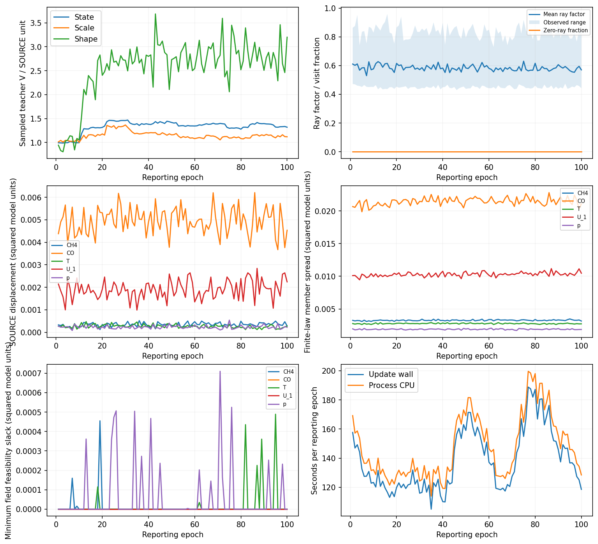
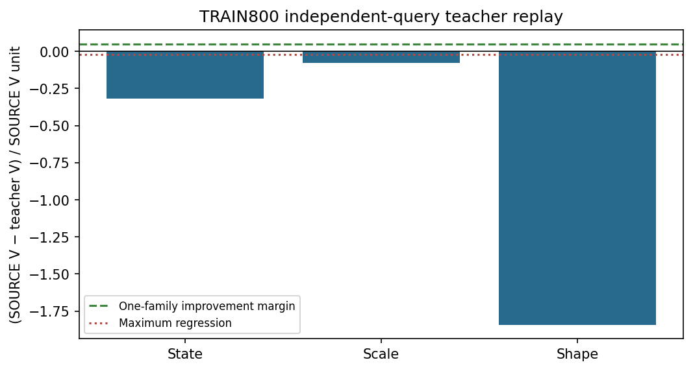
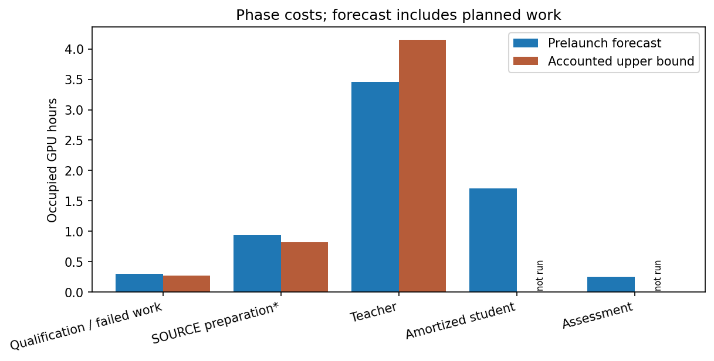

# Round 4: constrained teacher and native amortization

Publication snapshot from the accepted campaign report. Figure previews and PDF masters are copied unchanged; the [evidence index](evidence/INDEX.md) identifies the original report and local research evidence. [Publication PDF](report.pdf). This publication PDF is newly rendered from the accepted Markdown; no standalone main PDF existed in the original report directory.

**Evidence status:** Terminal evidence complete. Main review accepted all included panels, field tables, cost scopes and the rendered report; relative PNG/PDF assets were verified through the home-checkout report-directory alias.

Teacher results are TRAIN-only finite empirical-law construction. TEST remains locked.

## Decision

The 100-epoch teacher did not meet its declared construction gate. Close this local mechanism and retain SOURCE/C8; students were not qualified to start. No measured 500-epoch speed ratio is claimed because students were not run.

The teacher completed 76800 objective-bearing visits (9.6 TRAIN passes). The final construction audit reported 0 native field/sensor violations and zero correction for 0.00% of audited conditions.

Forecast inclusive candidate GPU cost: 6.65 hours at the planned 500-epoch student endpoint; forecast teacher CPU worker cost: 3.93 hours. Forecasts are not measured costs.

## TRAIN800 teacher field diagnostics

These are in-sample finite-law errors on the fixed TRAIN800 replay. The mean is the exact average of the four jointly optimized atoms; it has no independent-draw variance subtraction. Each pair is SOURCE / teacher. Physical-mass weighting applies to field RMS values; sensor RMS averages observed member entries.

### Model field units

| Field | Mean RMSE SOURCE / teacher | Member RMSE SOURCE / teacher | Member spread RMS SOURCE / teacher | Teacher displacement RMS | Sensor RMSE SOURCE / teacher |
| --- | ---: | ---: | ---: | ---: | ---: |
| CH4 | 0.0877 / 0.088141 | 0.1036 / 0.10524 | 0.05516 / 0.057501 | 0.019348 | unobserved |
| CO | 0.22658 / 0.2292 | 0.2638 / 0.27161 | 0.13509 / 0.14573 | 0.068862 | unobserved |
| T | 0.092796 / 0.092923 | 0.10589 / 0.10674 | 0.051011 / 0.052521 | 0.014882 | 0 / 0 |
| U_1 | 0.18573 / 0.1862 | 0.20948 / 0.2128 | 0.096881 / 0.10301 | 0.046023 | unobserved |
| p | 0.11052 / 0.10982 | 0.11821 / 0.11804 | 0.041932 / 0.043273 | 0.014603 | unobserved |

### Decoded dataset field units

| Field | Mean RMSE SOURCE / teacher | Member RMSE SOURCE / teacher | Member spread RMS SOURCE / teacher | Teacher displacement RMS | Sensor RMSE SOURCE / teacher |
| --- | ---: | ---: | ---: | ---: | ---: |
| CH4 (unknown) | 0.0023415 / 0.0023533 | 0.0027662 / 0.0028098 | 0.0014727 / 0.0015352 | 0.00051658 | unobserved |
| CO (unknown) | 0.0021477 / 0.0021725 | 0.0025005 / 0.0025745 | 0.0012805 / 0.0013814 | 0.00065273 | unobserved |
| T (unknown) | 71.956 / 72.055 | 82.112 / 82.768 | 39.555 / 40.726 | 11.54 | 0 / 0 |
| U_1 (unknown) | 6.9132 / 6.9308 | 7.7972 / 7.9208 | 3.6061 / 3.8344 | 1.713 | unobserved |
| p (unknown) | 789.58 / 784.57 | 844.5 / 843.27 | 299.57 / 309.14 | 104.33 | unobserved |

## Teacher construction

| Family | SOURCE empirical V | Teacher empirical V | SOURCE − teacher / frozen unit |
| --- | ---: | ---: | ---: |
| State | 0.073911 | 0.097451 | -0.31849 |
| Scale | 0.36917 | 0.39676 | -0.077704 |
| Shape | 1.8551 | 4.7677 | -1.8419 |

Accounted GPU component upper bounds (seconds): source_generation: 2963, teacher: 1.496e+04.

Qualification and failed-attempt overhead: 985 seconds, charged once to the candidate. SOURCE preparation includes the declared inseparable SOURCE qualification and RF smoke.

The accounted GPU cost is an upper bound. Bounded unknown components are:

- Candidate overhead upper bound 322 GPU seconds: Conservative launch-to-diagnosis bound. No training or formal model run was admitted; early model imports may have created a brief CUDA context before the ownership check. [Receipt](evidence/INDEX.md#bounded-cost-receipt-01).
- Candidate overhead upper bound 274 GPU seconds: Upper bound from launch to corrected relaunch; no model/target generation or training began, and no lease receipt was created. This is not a measured occupied GPU duration. [Receipt](evidence/INDEX.md#bounded-cost-receipt-02).
- Candidate overhead upper bound 246 GPU seconds: Upper bound from launch to corrected relaunch; no model/target generation or learner update began. No successful lease admission receipt exists. [Receipt](evidence/INDEX.md#bounded-cost-receipt-03).

Teacher CPU worker time: 1.597e+04 seconds; elapsed campaign wall: 2.352e+04 seconds. Native student/control training and held-out assessment costs were not incurred. TRAIN800 endpoint replays and the full-bank feasibility audit are included in the teacher leases; their separate subphase timers were not recorded.

SOURCE qualification and full preparation CPU: 3277 seconds; current-route timing qualification CPU: 183.2 seconds; teacher numerical-qualification total CPU: unavailable. These are scoped separately from teacher CPU worker time.

Elapsed wall basis: enclosing wall including gaps; failed ends are upper bounds; known-clock span excludes auxiliary work with unknown absolute timestamps.

Auxiliary CPU work: TRAIN manifest preparation: 104.8 CPU seconds; CPU-only teacher recovery I/O qualification: 13.04 CPU seconds; CPU-only qualified SOURCE row copy: 5.434 CPU seconds; CPU-only fixed-case report validation: 4.563 CPU seconds; CPU-only fixed-case report validation: prior attempt 1: CPU time unavailable; CPU-only fixed-case report validation: prior attempt 2: 0.6504 CPU seconds; CPU-only fixed-case report validation: prior attempt 3: 5.469 CPU seconds; CPU-only teacher history recovery: 8.942 CPU seconds; CPU-only epoch-20 teacher pause curve refresh: 5.93 CPU seconds; CPU-only teacher resource-code freeze and verification: 0.1678 CPU seconds; CPU-only real FFM fresh-process resume qualification: 111.7 CPU seconds; CPU-only epoch-1 history recovery visual check: 9.369 CPU seconds; CPU-only epoch-1 history recovery visual check: prior attempt 1: CPU time unavailable; CPU-only epoch-1 history recovery visual check: prior attempt 2: CPU time unavailable; CPU-only epoch-1 history recovery visual check: prior attempt 3: CPU time unavailable; CPU-only warm teacher cost review: 7.876 CPU seconds; CPU-only warm teacher cost review: 7.928 CPU seconds. These scoped amounts are not a complete CPU sum.

Additional unavailable auxiliary clocks: CPU-only fixed-case report validation: prior attempt 1 (process CPU); CPU-only fixed-case report validation: prior attempt 1 (wall); CPU-only fixed-case report validation (absolute start/end); CPU-only teacher resource-code freeze and verification (absolute start/end); CPU-only epoch-1 history recovery visual check: prior attempt 1 (process CPU); CPU-only epoch-1 history recovery visual check: prior attempt 1 (absolute start/end); CPU-only epoch-1 history recovery visual check: prior attempt 2 (process CPU); CPU-only epoch-1 history recovery visual check: prior attempt 2 (absolute start/end); CPU-only epoch-1 history recovery visual check: prior attempt 3 (process CPU); CPU-only epoch-1 history recovery visual check: prior attempt 3 (absolute start/end).

## Figure index

- [Figure: Teacher Histories](#figure-teacher-histories)
- [Figure: Teacher Replay](#figure-teacher-replay)
- [Figure: Inclusive Costs](#figure-inclusive-costs)

## Figure: Teacher Histories

[PDF master](figures/teacher_histories.pdf)

Complete sampled teacher V, native field constraints, finite-law spread and accepted-ray histories.

## Figure: Teacher Replay

[PDF master](figures/teacher_replay.pdf)

Independent fixed-query TRAIN800 empirical-law teacher replay; positive values improve on SOURCE.

## Figure: Inclusive Costs

[PDF master](figures/inclusive_costs.pdf)

Prelaunch forecast assumes 500 student epochs and remaining SOURCE preparation; accounted costs use the actual terminal age and declared SOURCE total. An upper bound includes bounded unknown work; unknown quantities are not treated as zero.
